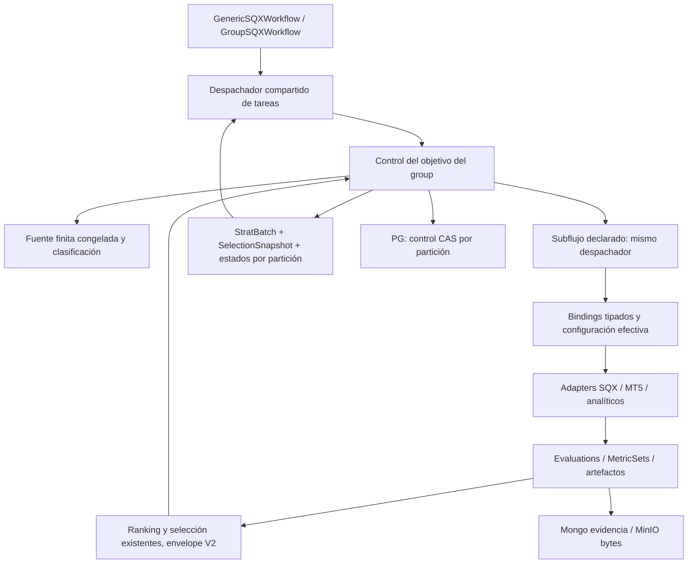

# 03 — Target Architecture and Decisions

## Propósito

Arquitectura objetivo y decisiones técnicas congeladas para Shot 2. Todo cambio descrito es **PROPUESTO**, no estado de producción.

## Contenido

### Ownership

| Componente | Responsabilidad exclusiva | No absorbe |
|---|---|---|
| Intérprete existente | Ordenar tareas declaradas, dependencias y composición | WFM, fórmula de ranking, fechas físicas |
| Group target controller | Particiones, iteraciones, acumulación, X, Y, terminación y salida | Generación implícita de nuevas estrategias |
| Fuente congelada | Enumeración exacta, dedupe, cursor y prueba de agotamiento | Decidir elegibilidad económica |
| Ranking/selection | Validar métricas, ejecutar algoritmo elegido, ordenar y cortar | Ejecutar tareas del subflujo |
| Runtime bindings | Resolver productor/selector/tipo y sellar configuración efectiva | Editar ZIP/INI o interpretar WFM en el core |
| Adapter WFM/Apply | Período aplicable y correspondencia con parámetros aplicados | Dictar que todo workflow contiene WFM |
| Adapter SQX | Copia CFX, parche permitido, readback, ejecución serial | Determinar X o cambiar el source original |
| Adapter MT5 | INI efectiva, EX5 exacto, fechas y reporte real | Derivar fechas por nombre de una task SQX |
| Foundation existente | Identidad, CAS, insert-once, referencias y evidencias | Segundo plano de persistencia |
| ForgeCampaign | Waves, Builder supply, target global y límites existentes | Top X interno por logical_type |

### Registro de decisiones / ADRs

| ID | Estado | Decisión y evidencia | Alternativa descartada / coste | Consume |
|---|---|---|---|---|
| D01 | CONFIRMED | Top X pertenece al group; Y es independiente; repetir subflujo completo (mandato F4–F7) | Ranking final obligatorio fuera del group contradice mandato | S2.1–S2.4 |
| D02 | TECHNICAL_RESOLUTION | Una fuente finita congelada por invocación; actual input, SelectionSnapshot o ranking completo exacto | Pool vivo vuelve exhaustion no reproducible; freeze materializa refs | S2.2 |
| D03 | TECHNICAL_RESOLUTION | Group no genera Builder supply; Campaign conserva waves. Wave nueva = invocación nueva y acumulador vacío | Absorber Campaign duplica lifecycle; carry cross-wave queda fuera del requisito | S2.2 |
| D04 | TECHNICAL_RESOLUTION | Una iteración por partición en vuelo, partitions paralelas con K global de leaves | Especulación en misma partición altera qué entra antes de alcanzar X | S2.4 |
| D05 | TECHNICAL_RESOLUTION | Extraer dispatcher compartido con shell legacy versionado | Copiar otro switch profundiza la divergencia actual | S2.1 |
| D06 | TECHNICAL_RESOLUTION | Reutilizar kernel minmax de `echo/v3/shared-analytics/ranking` y sort score; envelopes V2 genéricos | Reescribir fórmula duplica motor; V1 Builder refs no se falsifican | S2.3 |
| D07 | TECHNICAL_RESOLUTION | Una tabla PG `sqx.group_partition_runs`, evidencia inmutable en stores actuales | Sólo memoria Temporal crece y carece de ledger externo; múltiples tablas por tarea son innecesarias | S2.2 |
| D08 | TECHNICAL_RESOLUTION | Scope de ejecución V2 explícito para colisiones de tareas repetidas; preservación de bytes V1 | Usar índices dinámicos como TaskPath rompe gramática e identidad | S2.1 |
| D09 | TECHNICAL_RESOLUTION | Ledger de resultados por task path+scope+StrategyRef, no lookup latest | Único EvaluationRef mutable del carrier pierde productores anteriores | S2.1/S2.5 |
| D10 | TECHNICAL_RESOLUTION | WFM selected-period.v1 = celda exacta + período validado + parámetros; Apply y fechas comparten autoridad | `periods[size-1]` no prueba temporalidad ni exclusión future | S2.6 |
| D11 | TECHNICAL_RESOLUTION | CFX/INI inmutables por ejecución; primera versión física N=1 para bindings por estrategia | Agrupar Y con fechas distintas introduce carreras; N=1 cuesta throughput pero conserva contrato | S2.7 |
| D12 | TECHNICAL_RESOLUTION | Ventana normalizada [from,to), conversión date-only exacta con perfil de calendario versionado | Guess timezone o truncar a día falsea comparabilidad | S2.6/S2.7 |
| D13 | TECHNICAL_RESOLUTION | UNKNOWN/MISSING metric contractual falla; OBSERVED negativo puede excluir; disponibilidad es error operacional | UNDERFILLED como fallback oculta fallos | S2.3/S2.4 |
| D14 | TECHNICAL_RESOLUTION | Profiles in-flight fijan contracts/algorithms/build compatibility; replay versionado y no reinterpretar hechos | Leer la release nueva como autoridad retroactiva rompe recovery | S2.8 |
| D15 | TECHNICAL_RESOLUTION | `evaluate_strategy` obtiene adaptación durable con inputs exactos para escenario sin SQX/MT5 | Nuevo tipo de tarea dummy sólo para tests no prueba composición real | S2.5 |

### Compatibilidad y retiro

| Superficie | Sin opt-in | Con opt-in |
|---|---|---|
| Workflow/groups históricos | Replay y resultados V1 idénticos; tests de historial | `execution_contract=dynamic-groups.v1`; renderer y consumidor compatibles obligatorios |
| Task sin input_bindings | Config estática existente | La misma task puede coexistir con otra instancia dinámica |
| Ranking/Selection V1 | Se leen y validan sin mutación ni rehash | Readers V2, writes V2 solamente para ejecución nueva |
| Source ranking_snapshot actual | Sigue consumiendo TopProjection por contrato histórico | Source explícito `ranking_snapshot_full` consume OrderedEntries, no top |
| Campaign target | Target global/waves intactos | Group target independiente, sin egress/promoción automática |
| Groups anidados | Mantener ruta histórica en historias viejas | Mismo handler, scope por invocación y leaves bajo presupuesto raíz |
| Error/cancelación | Contratos históricos | Drenaje de children/recursos antes de liberar presupuesto |

Obsoleto para diseño nuevo: cupo implícito 5, fórmulas/fuentes/nombres mágicos, asumir que split A/B es requisito, requisitos de un SQX DEV paralelo, `EchoForgeAutomator` monolítico y contrato de integración V1 superseded. No se elimina código histórico necesario para replay en Shot 2. Ni el pipeline del ejemplo de octubre ni la restricción física de Optimizer=1 se convierten en dependencia universal.

## Fuentes

`xKoRx/symphony@dd4af7d`: `sqx/workflows/generic_workflow.go`, `sqx/core/domain/ranking_snapshot_per_type.go`, `sqx/core/domain/persistence_identity.go`, `sqx/workflows/forge_campaign_workflow.go`. [[02 — Capability Inventory]].
