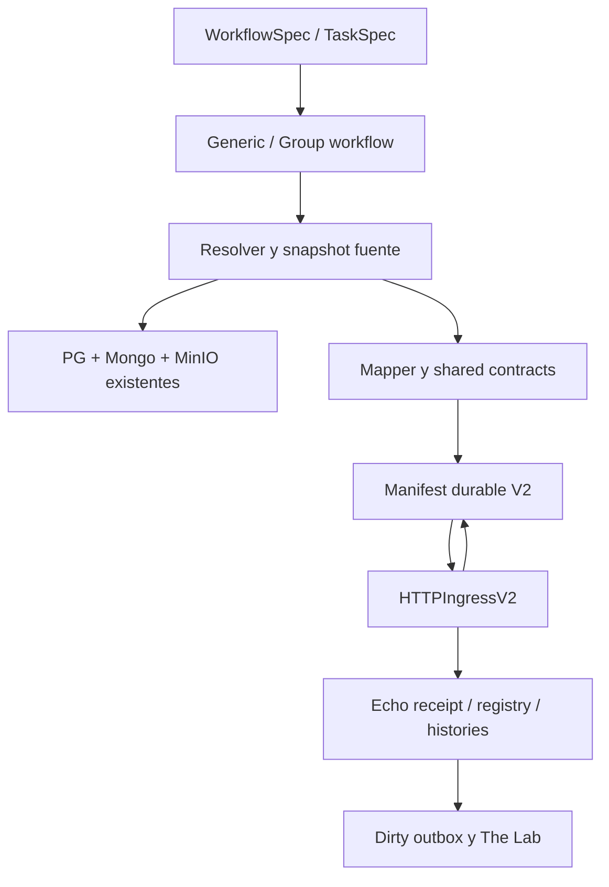

# B — Frozen Design

## Propósito

**Autorización documental — 2026-10-27:** el Owner autorizó explícitamente publicar íntegramente este paquete técnico en xKoRx/agents-os, con conocimiento de que el repositorio es público. La restricción de divulgación del intento anterior queda resuelta para este paquete. Agents-OS se actualiza directamente en master; esta autorización no habilita PROD, flota ni trading.

SPEC ejecutable de la task nativa echo_ingestion_v2, recibida del arquitecto independiente y adjudicada por el Primary Manager. Define la implementación TARGET; no representa una capacidad ya implementada.

## Contenido

### Identidad de esta entrega

Programa nuevo `forge-echo-ingestion-task-v2`. El Ingestion V2 anterior es su dependencia consolidada; sus SHAs finales 22f337ca/f93cd4f8 son las bases elegidas aquí. La existencia del endpoint/adapter/CLI no acredita la task nativa. Rectificación del despacho: [[SHOT2 — Local Implementation Mandate]].

### Adjudicación del Primary Manager — 2026-10-27

**Gate: FORGE_ECHO_TASK_DESIGN_FROZEN.** Recibido y revisado el candidato del GOD Architect independiente, contrastado con A y Contract Source Review. El Manager verificó directamente los puntos de identidad/evidencia, contrato compartido, persistencia/receipt y entrada a Lab, y adjudicó los ajustes de este documento y del addendum Echo. Es autorización técnica para Shot 2, no certificación del producto ni autorización de despliegue.

Decisiones aceptadas: modelo declarativo existente con extensiones mínimas; ninguna heurística de carpeta; evidencia exacta PG/Mongo/MinIO; definición analítica conservadora; registro sin historia explícito; mismo adapter y store V2; snapshot/manifest antes de red; recovery y concurrencia verificables; composición data-only; cambios Echo limitados a gaps demostrados. No se incorpora un framework de datos ni otro motor analítico.

Ajustes de revisión integrados: XML observado conservado como artefacto; linkage completo hasta children/result_key; rename sobre el tramo productor alcanzado; versión única compatible por estrategia; recuperación PG antes de Mongo y reporte pendiente separado; SDK efectivo además de contracts en build frío; receipt NativePOST separado de PUT/legacy; moneda/zona y tamaños/counts con semántica cerrada; límite del manifest JSON completo. Las incertidumbres físicas quedan en gates de ejecución, sin bloquear decisiones deducibles de source.

**Producto:** NOT_IMPLEMENTED. **A/B/C/D:** NOT_RUN en este programa. **E:** NOT_AUTHORIZED/NOT_RUN. El candidato histórico V2 conserva su certificación con findings; no acredita la nueva task. **Siguiente gate:** FORGE_ECHO_TASK_IMPLEMENTED_LOCAL después del mandato de Shot 2 y revisión de evidencia.


**Estado de entrega:** FORGE_ECHO_TASK_DESIGN_FROZEN, adjudicado por el Primary Manager.  
**Fecha:** 2026-10-27.  
**Ejecutor:** GOD Architect independiente ONE-SHOT.  
**Adjudicador:** GOD Primary Technical Manager.  
**Estado de producto:** task nativa NOT_IMPLEMENTED; HTTP V2 existente es EXISTING_ACCEPTED_DEPENDENCY, con hallazgos actuales de source.  
**Freeze técnico de diseño; ejecución pendiente.** No se ejecutaron builds, suites, SQCLI ni infraestructura. El primer intento documental fue rechazado por revisión automática. El Owner autorizó posteriormente su divulgación íntegra en el repositorio público; esta revisión publica la autoridad canónica sin cambios de producto.

## 0. Decisión principal y límites

El nombre definitivo es **echo_ingestion_v2**. Será un TaskSpec normal, ejecutable en GenericSQXWorkflow y GroupSQXWorkflow, con configuración tipada, source declarativo, activities Temporal y resultados durables. Construye los DTOs de la misma librería Echo Contracts que usa el consumidor y entrega por el HTTPIngressV2 existente.

La task consume un cohort exacto o selecciones exactas de evidencia; no ejecuta un Retester ni un Exporter físico para completar datos. La lectura de evidencia existente funciona sin SQCLI instalado. El pipeline puede colocar una task productora física antes de ella cuando sea necesario, como trabajo separado y explícito del workflow.

La versión sin MT5 se representa mediante definition-v1 ANALYTIC a partir de definición acreditada; no se inventa un EX5. Registro sin TradeSet se representa con histories=[] bajo política explícita y el addendum Echo. Ningún dato corrupto, ambiguo o contradictorio se convierte en “registro parcial exitoso”.

### Autoridades segregadas

- **Fuente de datos:** [[10-projects/Echo Forge — Operación Real V2/artifacts/forge-echo-ingestion-task-v2/A — Source Authority Report|A — Source Authority Report]] (A, investigación completa de productores/stores).
- **Consumidor/shared contract:** [[10-projects/Echo/Ingestion V2 — Operational Integration/Forge Task — Contract Addendum|Forge Task — Contract Addendum]] (autoridad del contrato consumidor en el proyecto Echo).
- **Esta SPEC:** configuración, resolución, orchestration, mapping productor, persistencia/recovery, resultados y oráculos.
- **Evidencia del consumidor:** [[10-projects/Echo Forge — Operación Real V2/artifacts/forge-echo-ingestion-task-v2/evidence/Contract Source Review|Contract Source Review]], fuente de los defectos concretos; no certificado de runtime.
- **Programa/ownership:** C del Manager mantiene exactamente cuatro shots.

No se duplica la SPEC en A/C. No se crea tercer proyecto de integración, ETL framework, cliente HTTP alterno, tabla analítica Forge ni motor nuevo Lab.

## 1. Baseline y capacidades realmente disponibles

| Superficie | Source verificado | Consecuencia |
|---|---|---|
| Symphony consolidado | lab-v4/shot4-symphony @ 22f337ca434549c492b2d402fd158e23ac4758a8 | Base de implementación elegida; tiene adapter V2, ControlPlane V2, migración 017 y CLI. |
| Symphony master | dd4af7d05c03db9b39b5467b46e2c2c7d0c1fa19 | Compare API: ancestro de 22f337ca, tres commits por detrás, sin divergencia. No copiar V2 desde otra rama. |
| Echo candidato | lab-v4/shot4-integration @ f93cd4f80085e328f9176c1215e42e6c8e0b2404 | Consumidor inicial; sólo cambios delimitados en addendum. |
| Contrato declarado Forge | v0.0.1-lab-v4-shot2.1, tag→52f8d509… | No coincide con contracts del Echo candidato; pin nuevo y builds fríos son gate de SHOT 2. |
| Dynamic Groups | Workstream separado, takeover GO_WITH_INTEGRATED_FIXES; candidato publicado 266976be8944c74ac1632d297c1bad0ca351b264; NOT_CERTIFIED | No asumir TaskResult.v2 ni bindings privados en 22f337ca. No mezclar sus migraciones ni abrir reconciliación general. |

El refresh final conserva las bases elegidas. Otro programa publicó Echo Runtime `feature/echo-runtime-lab-v4-integration@2daa58daddfbebaf57e2d1c934a25ec644bf0a94` y Symphony `feature/echo-runtime-lab-v4-integration@3dfaa5facb96fcc297c062c46ca77085f882cc1c`. La comparación estrecha de Contract Source Review deja los gaps de contracts/adapter/persistencia/Lab vigentes; sólo aporta el write-ahead de artifacts canónicos como port mínimo reutilizable. Sus migraciones Echo 087–091 requieren comprobar colisiones, sin merge general ni cambio automático de baseline.

El baseline seleccionado contiene TaskSpec/TaskSource, carriers StrategyArtifact, salida StratBatch, resolución histórica de cohort y StageExecutionResult. **No se encontró un agregado Go público denominado OutputCohort en este baseline**: su comportamiento real es el conjunto exacto de carriers/links. La nueva task reutiliza esas superficies; no importa un modelo privado de Dynamic Groups ni crea una segunda autoridad de cohort.

Fuentes de configuración/runner:

- [runtime/config.go](https://github.com/xKoRx/symphony/blob/22f337ca434549c492b2d402fd158e23ac4758a8/sqx/core/runtime/config.go): WorkflowSpec:24; TaskSpec:244; TaskSource:429; StrategyArtifact:977; ETCD:1337–1343.
- [runtime/mt5_task_config.go](https://github.com/xKoRx/symphony/blob/22f337ca434549c492b2d402fd158e23ac4758a8/sqx/core/runtime/mt5_task_config.go): ValidateWorkflowSpec:20; restricciones cohort_wave:226; validateTask:332.
- [workflows/generic_workflow.go](https://github.com/xKoRx/symphony/blob/22f337ca434549c492b2d402fd158e23ac4758a8/sqx/workflows/generic_workflow.go): runner raíz:165; switch:239; group:2384/2433; histórico:1494–1598.
- [historical_cohort_activity.go](https://github.com/xKoRx/symphony/blob/22f337ca434549c492b2d402fd158e23ac4758a8/sqx/activities/worker/historical_cohort_activity.go): helper read-only:104; owner explícito:215; artifacts exactos:386.
- [capabilities/persistence.go](https://github.com/xKoRx/symphony/blob/22f337ca434549c492b2d402fd158e23ac4758a8/sqx/core/capabilities/persistence.go): owner:132; namespace evaluations:219; StageExecutionReader:376; StrategyIdentityReader:390; evidence exacta:535.

## 2. Autoridad de datos adjudicada

El hallazgo de A queda adoptado con sus límites:

| Dato | Autoridad que esta task usa | Lectura/clave | Límite obligatorio |
|---|---|---|---|
| Membresía del cohort | Output carriers durables y/o StageExecutionResult sellado | StageExecutionRef→result EvaluationRefs | Ni filename, ni posición, ni latest. |
| Source folder histórico | Owner PG + evaluaciones Mongo del namespace | FlowRunRef exacto, bucket/prefix opaco | Folder sólo localiza. Owner histórico COMPLETED. |
| StrategyRef/CanonicalStrategyID | PG strategies | LoadStrategyIdentity/LoadStrategyManifestIdentity | No repetir heurísticas de filename usadas por productores brownfield. |
| Instrumento/dirección/timeframe | Identidad PG contrastada con Evaluation.Scope | StrategyRef + EvaluationRef | Contradicción bloquea; no completar desde label. |
| Métricas | MetricSetEvidence hijo exacto | MetricSetRef, EvaluationRef, scope/calculator/catalog | Evidencia SQX; no métricas Lab. |
| Metadata enriquecida | Payload/overview/artifact exactos de esa evaluación o XML exacto | ArtifactRef y digest, EvaluationRef | databank_metadata por wave+strategy_id no acredita evaluación final. |
| Historial | TradeSetEvidence + payload MinIO | TradeSetRef→EvaluationRef→StageExecutionRef | Si falta no crear trades desde agregados. |
| StrategyVersion ejecutable | Sello F04 PG + exact Apply/Compile/artifacts | version_ref explícita | Config.Version y el hash .sqx no son StrategyVersion. |
| Definición analítica | StrategyFile XML acreditado o definition artifact explícito | DurableArtifactRef + byte hash | No implica equivalencia ejecutable ni readiness. |
| Provenance | PG + Evaluation/MetricSet/TradeSet + artifacts | Referencias/digests exactos | TaskPath/TaskName sólo cuando acreditados. |
| construction/cutoff/available | Evidencia temporal específica | TimeEvidenceV2 | created_at, sealed_at y receipt no sustituyen esos hechos. |

El Retester evalúa; Overview/TradeList extraen del ResultsGroup; el worker persiste. No existe un único “Mongo decorado” que pruebe todo. El TradeList durable actual sólo acredita la ruta final-reretester especializada. La task de ingesta no impone ese productor: admite cualquier productor que entregue la evidencia requerida por un formato soportado y validado. No promete extraer historias físicamente de un productor que aún no las conserva.

**Hallazgos preexistentes que no se propagan:** stage=Folder en Overview brownfield; fallback result_key no acreditado; swap=0 como convención de CommSwap; zero-values sin presence. Si un fixture real utiliza esas rutas, el tramo mínimo necesario se corrige o se rechaza como evidencia insuficiente. No declarar D por el solo hecho de existir un exporter Java.

## 3. Contrato de configuración

### 3.1 Delta mínimo al modelo vigente

Añadir a TaskSpec:

```go
EchoIngestion *EchoIngestionTaskConfig `json:"echo_ingestion,omitempty"`
```

Añadir a TaskSource, sin cambiar campos actuales ni sus modos:

```go
Task               string                       `json:"task,omitempty"`
FlowRunRef         string                       `json:"flow_run_ref,omitempty"`
StageExecutionRefs []string                     `json:"stage_execution_refs,omitempty"`
StrategyRefs       []string                     `json:"strategy_refs,omitempty"`
Bindings           []DurableEvaluationSelection `json:"bindings,omitempty"`
```

`DurableEvaluationSelection` contiene evaluation_ref obligatorio y metric_set_refs/trade_set_refs opcionales como conjuntos exactos; strategy_ref opcional como aserción; version_ref y definition_evaluation_ref opcionales cuando ese elemento requiere binding de versión específico. No contiene credenciales ni documentos de negocio incrustados.

Los tipos nuevos son structs serializables en `core/runtime/echo_ingestion_task.go`. Los campos de producto remotos usan contratos compartidos; no copiar sus structs. Las refs fuente siguen usando tipos domain al salir del parser runtime.

### 3.2 Modos de TaskSource

| source.type | Campos válidos | Resolución y precondiciones |
|---|---|---|
| task_output | task obligatorio; strategy_refs opcional | Snapshot exacto del output de una task nombrada anterior, visible en el mismo workflow/scope. Grupo nombrado produce su output unido; una task interna se selecciona dentro de ese Group invocation. No cruzar children por nombre global ambiguo. |
| input_cohort | strategy_refs opcional | Cohort inicial durable ya resuelto por bootstrap actual (selection_cohort/import/input). No rehace selección ni enrichment. Rechaza input de keys sin carriers durables. |
| output_cohort | flow_run_ref obligatorio; source_folder en TaskSpec; cohort_wave para la wave productora; stage_execution_refs y strategy_refs opcionales | Reutiliza el resolver histórico. FlowRun histórico COMPLETED; ownership coincidente si existe. Sin ownership, sólo la vía explícita existente para owner completado. |
| exact_evaluations | bindings no vacío; strategy_refs opcional como aserción | Carga exactamente esos EvaluationRefs. Permite múltiples evaluaciones del mismo StrategyRef, cada una con selección explícita de hijos. |

En modos nuevos, collection/ranking_key/wave_key/logical_type/top_n_per_logical_type/ranking_name antiguos deben estar vacíos. No mezclar dos autoridades. `StageExecutionRefs` en output_cohort filtra el productor exacto y permite acreditar un cohort vacío; no usa selección temporal.

`source_folder` es obligatorio sólo cuando se necesita lookup de namespace. En task_output es una aserción opcional del routing declarado por el productor: la lectura real usa ArtifactRefs del snapshot; nunca reconstruye esos refs desde la carpeta. En exact_evaluations/input_cohort no se necesita y se rechaza un source_folder adicional para evitar una segunda fuente ignorada.

`cohort_wave/cohort_flow_run` actuales permanecen válidos para groups históricos. Para echo_ingestion_v2 se usa source.flow_run_ref y se habilita cohort_wave bajo su forma output_cohort. Si se escribe además cohort_flow_run, el validator rechaza la duplicación. No mantener dos campos capaces de contradecirse.

### 3.3 EchoIngestionTaskConfig

| Campo | Tipo/valores | Semántica |
|---|---|---|
| destination | string requerido | Nombre de perfil lógico ETCD, sin endpoint ni bearer. |
| mode | REGISTER_ONLY requerido en este release | PROVISION_REFERENCE devuelve UNSUPPORTED_CAPABILITY en validación local; no POST parcial. |
| history_policy | REQUIRED / IF_AVAILABLE / NONE | REQUIRED exige historia seleccionada; IF_AVAILABLE permite cero sólo si no hay TradeSet; NONE declara omisión intencional. |
| history_write_mode | CREATE_ONLY | Mismo contenido converge; contenido corregido de misma historia→REVISION_REQUIRED. |
| version_mode | SEALED_REF / SQX_DEFINITION / DEFINITION_REF | Binding exacto de versión sellada, lectura XML acreditada o definition artifact acreditado. |
| source_profile | SQX_TRADELIST_V1 / MT5_TRADESET_V1 / CANONICAL_HISTORY_V2 | Decoder concreto de payload, no tipo de task ni folder. Sólo se habilitan perfiles realmente implementados y acreditados por sus formatos. |
| history_scopes | []TradeSetSelector | Selectores semánticos explícitos: stage, variant, sample_type, result_key y cell_key cuando aplican. Cada selector debe resolver exactamente un hijo por evaluación. |
| currency_declaration | {currency,evidence_ref} opcional | Sólo si la fuente no trae moneda; status DECLARED y ref real obligatoria. No moneda por defecto. |
| failure_policy | FAIL_AFTER_BATCH / CONTINUE | Procesa los demás miembros; la primera opción falla workflow después de persistir reporte completo. |
| limits | estructura numérica de límites | max_strategies, read_timeout_ms, request_timeout_ms, delivery_budget_ms, max_request_bytes, max_artifact_bytes, max_decompressed_trade_bytes. Todos positivos y ≤ tech ceilings ETCD. |

TaskSpec.BatchSize se reutiliza como tamaño de lote de estrategias para esta task; no controla procesos SQCLI. TaskSpec.MaxParallel continúa reservado a group. La task nueva inicia con procesamiento secuencial de lotes; la concurrencia entre ejecuciones independientes se soporta por contrato. No agregar un scheduler de streaming.

No se ofrece control requested_curve_profiles: el consumidor no lo aplica hoy. No se aceptan Config/ExporterProject/CustomAnalysisPlugin/MetadataExport/SQXVersion/MT5/ApplySelectedRun/Stage/Variant en una task echo_ingestion_v2; esos son contratos de productores físicos, no del consumidor de evidencia.

Los límites de ejemplos son valores de fixture propuestos, no hechos de la infraestructura. El perfil ETCD efectivo y sus tech ceilings se validan al arranque y quedan fijados en la resolución de task. La task puede reducir budgets dentro de esos tech ceilings.

### 3.4 Ejemplo concreto: carpeta histórica

TaskSpec para insertar en un WorkflowSpec vigente con instrumento/dirección/timeframe/strategy/version/config_folder/wave_config ya validados. **Describe el delta diseñado, todavía no ejecutable en el baseline sin SHOT 2.** Refs y nombres de destino de este ejemplo son fixtures declarativos, no recursos reales:

```json
{
  "type": "echo_ingestion_v2",
  "name": "registrar_resultados_echo",
  "folder": "entregas_echo",
  "source_folder": "full_precision_tick",
  "cohort_wave": "wave_fixture_source",
  "batch_size": 10,
  "source": {
    "type": "output_cohort",
    "flow_run_ref": "11111111-1111-4111-8111-111111111111"
  },
  "echo_ingestion": {
    "destination": "echo_lab_candidate",
    "mode": "REGISTER_ONLY",
    "history_policy": "REQUIRED",
    "history_write_mode": "CREATE_ONLY",
    "version_mode": "SQX_DEFINITION",
    "source_profile": "SQX_TRADELIST_V1",
    "history_scopes": [
      {
        "stage": "tick_retest",
        "variant": "optimized",
        "sample_type": "FULL",
        "result_key": "main",
        "cell_key": ""
      }
    ],
    "failure_policy": "FAIL_AFTER_BATCH",
    "limits": {
      "max_strategies": 100,
      "read_timeout_ms": 30000,
      "request_timeout_ms": 130000,
      "delivery_budget_ms": 600000,
      "max_request_bytes": 8388608,
      "max_artifact_bytes": 16777216,
      "max_decompressed_trade_bytes": 67108864
    }
  }
}
```

`result_key="main"` es sólo la clave del fixture; un run auténtico debe configurar su clave real. No existe default “main”. Si la historia carece de moneda, este ejemplo falla CURRENCY_EVIDENCE_MISSING; el operador debe aportar evidencia de moneda observada o una declaración trazable, no reemplazarla por un valor supuesto.

Rename oracle: sustituir source_folder por resultados_finales_2027 y actualizar únicamente los bindings de routing válidos. La selección y mapping semánticos no cambian. El nombre de ninguna de las dos carpetas acredita tick precision.

### 3.5 Ejemplo upstream de otro productor válido

```json
{
  "type": "echo_ingestion_v2",
  "name": "registrar_analisis",
  "folder": "publicaciones",
  "batch_size": 5,
  "source": {
    "type": "task_output",
    "task": "analisis_custom_acreditado"
  },
  "echo_ingestion": {
    "destination": "echo_lab_candidate",
    "mode": "REGISTER_ONLY",
    "history_policy": "IF_AVAILABLE",
    "history_write_mode": "CREATE_ONLY",
    "version_mode": "DEFINITION_REF",
    "source_profile": "CANONICAL_HISTORY_V2",
    "failure_policy": "CONTINUE",
    "limits": {
      "max_strategies": 50,
      "read_timeout_ms": 30000,
      "request_timeout_ms": 130000,
      "delivery_budget_ms": 600000,
      "max_request_bytes": 8388608,
      "max_artifact_bytes": 16777216,
      "max_decompressed_trade_bytes": 67108864
    }
  }
}
```

Ese productor debe entregar definición/evidence válidas; llamarlo CustomAnalysis no basta. El fixture alterno implementa un productor tipado mínimo que usa Foundation, sin arrancar SQX. IF_AVAILABLE sólo transforma ausencia comprobada de TradeSet en histories=[]; una historia presente con identidad/currency/hash defectuosos rechaza al miembro.

Para varias evaluaciones usar source.type exact_evaluations y bindings explícitos; si un único miembro lleva dos MetricSets sin selector inequívoco se devuelve AMBIGUOUS_METRICSET. No ordenar por created_at para escoger uno.

## 4. Resolver fuente exacta y congelar selección

### 4.1 Algoritmo

1. Validar spec/source/profile y resolver destino/caps desde la configuración inmutable. No red Echo todavía.
2. Crear/resolver StageExecution técnico `echo_ingestion_source@sqx-echo-ingestion-source.v1`, FlowRun consumidor + TaskPath estructural + Generation=1. Temporal attempt/run IDs son correlación.
3. Derivar EvaluationRef de snapshot por receta Foundation con scope canónico de selector/políticas. Antes de cualquier búsqueda, intentar LoadEvaluation(ref). Si existe, verificarlo y reutilizarlo.
4. Obtener carriers por el modo configurado. En output_cohort usar el helper read-only histórico; no llamar su Execute para realizar una segunda selección/membresía oculta.
5. Cada evaluación exige: Ref válido, StrategyRef exacta; StageExecution identity del mismo FlowRun/subject/contract; StageExecution COMPLETED; EvaluationRef en LoadStageExecutionResults; metadata Mongo consistente con PG.
6. Para namespace, owner histórico COMPLETED; bucket/prefix sólo routing. Filtrar exactamente los stage refs/strategy refs declarados. Un stage no terminal produce SOURCE_NOT_TERMINAL, no lista vacía.
7. Validar StrategyManifestIdentity y su concordancia con scope. Carriers heredados deben ValidateDurable; Key es sólo espejo de Artifact.ObjectKey.
8. Resolver hijos exactos: refs en binding/carrier cuando existan; si no, reader por EvaluationRef + selector explícito. Un hijo debe pertenecer a esa evaluación, estrategia y scope. Cero=ausente; >1=ambiguo salvo conjunto explícito. Nunca latest.
9. Agrupar por StrategyRef. Dentro de una ejecución de esta task, cada StrategyRef admite una sola StrategyVersion compatible. Múltiples evaluaciones se admiten sólo como conjunto explícito con esa misma definición/versión; incompatibilidad produce VERSION_SOURCE_MISMATCH para el miembro, sin partirlo silenciosamente en dos identidades ni alterar los counts.
10. Ordenar por StrategyRef/EvaluationRef/refs semánticos. Persistir `EchoIngestionSourceSnapshotV1` como payload tipado de EvaluationEvidence en Mongo; Header y digest Foundation. Enlazarlo en StageExecutionResult con CompleteStageExecution CAS.
11. Sólo tras ACK de snapshot y enlace PG se permiten preparar/deliver manifests.
12. Recuperación: snapshot Mongo ya persistido con stage PG no completado se valida y se sella idempotentemente. No volver a listar una fuente para reemplazar la selección.

SourceSnapshot contiene selector normalizado, config/profile digest, fuentes exactas, bindings de versión/definición/hijos, cantidad y errores de preflight por miembro. No contiene secretos ni trades completos. Su identidad local puede variar entre FlowRuns consumidores; los requests/key de entrega dependen de la autoridad fuente estable y no de ese snapshot local.

### 4.2 Lecturas y volumen

El reader actual de namespace devuelve un slice completo. Ampliación requerida, acotada: un método adicional `ListNamespaceOutputEvaluationsBounded(ctx, flowRef, bucket, namespaceKey, limit)` que consulta como máximo max_strategies+1 y falla SOURCE_LIMIT_EXCEEDED si excede el límite. No usar cursor.All sin límite ni cargar toda la colección. Reutilizar filtros actuales y sus índices.

Los readers de hijos consultan sólo por EvaluationRef y selector; límite fijo a expected_count+1 según el selector, o lista explícita dentro del máximo de historias. Un namespace ambiguo no se reduce por posición.

Max histories por request=8, provenance inputs=64 y definition manifest JSON completo emitido≤262144 bytes, incluidos escapes/wrapper, vienen del contrato real; operations≤250000 y movimientos totales≤1000000 por historia. El techo de bytes de request lo determina el destino Gateway efectivo, congelado en ETCD, y puede ser menor que los tech ceilings del contrato. No cortar una historia para pasar el techo. PAYLOAD_TOO_LARGE exige selección/partición explícita o capability futura, no más history_ids generados automáticamente.

Un cohort vacío es éxito tipado sólo si StageExecutionResult o snapshot acredita cero. Ausencia de documentos bajo una carpeta no prueba un cohort vacío.

## 5. Definición y StrategyVersion

### 5.1 SEALED_REF

Exigir version_ref exacto por miembro o binding fuente. Reutilizar LoadStrategyVersion y el manifest/Apply/Compile/artifacts exactos del sellador. Verificar pertenencia a StrategyRef y recomputar receta shared. ListStrategyVersions es inspección, no selector automático. La versión pertenece al paquete sellado; las evaluaciones económicas deben acreditar que usaron esa definición, o registrar error VERSION_SOURCE_MISMATCH.

### 5.2 SQX_DEFINITION

Reutilizar el lector ZIP limitado de `sqx/adapters/magic-readback/readback.go`: extraer un helper que devuelva los bytes exactos de strategy_Portfolio.xml, conservando rechazo de ausente/duplicado/ZIP corrupto, límite y CRC. No usar FromSQX como si fuera un parser de definición porque exige MagicNumber y su parser XML es tolerante.

El adapter nuevo `sqx/adapters/sqx-definition`:

- Lee un OUTPUT/STRATEGY_SQX exacto de la Evaluation seleccionada con FetchDurable/VerifyDurableArtifact.
- Extrae XML exacto, UTF-8, sintaxis XML estricta y forma StrategyFile soportada con una Strategy. No resuelve entidades externas ni ejecuta código.
- Conserva todos los bytes XML observados como artifact exacto con SHA256 y ref verificable, separados de la receta/manifest. No normaliza XML ni elimina atributos/metadatos.
- Construye el manifest tipado sqx-strategyfile.v1 del addendum; calcula DefinitionContentDigest/ComputeVersionRef compartidos y target ANALYTIC.
- Extrae metadata descriptiva sólo de elementos reconocidos, con ref al XML; unknown fields quedan sin metadata, no desaparecen de la definición byte-exacta.
- Versiona por cualquier cambio del XML, incluso cambios sólo descriptivos: decisión conservadora explícita.
- No incorpora settings.xml, lastSettings.xml, resultados, nombres de carpeta ni timestamps al hash de definición. Sus efectos de evaluación se conservan en la fuente, no se declaran iguales al ejecutable.
- Forma desconocida, definición ambigua o tamaño excesivo: VERSION_DEFINITION_UNAVAILABLE/DEFINITION_TOO_LARGE; cero POST.

Evidencia de SHOT 1: dos archivos SQX versionados de la misma etiqueta, `cmd/symphony/02_retester_hp/XAUUSD_axi_v1_Strategy 1.40.86.h2.sqx` (blob b2bbd79442d354b367419929c5d22055affa1e70) y `cmd/symphony/03_retester_full/XAUUSD_axi_v1_Strategy 1.40.86.h2.sqx` (blob 21237d4669c8c9b9d335b79b68dd5755a6822a08), tienen contenedores SHA256 distintos y el mismo XML SHA256 **6a89cc10aef01118e216cc544679f51b4ee9335535a3a4e00e4517aad4797f41**. Se inspeccionaron ZIP y tags, sin ejecutar estrategias. Esto justifica la frontera en esa forma; no acredita equivalencia general ni fuente auténtica del Owner.

### 5.3 DEFINITION_REF

Exigir definition_evaluation_ref exacta (puede ser la misma Evaluation principal) con exactamente un artifact tipado de definición y su schema soportado. No elegir un XML cualquiera por nombre. El producer contract determina artifact kind. El decoder concreto produce el mismo contrato definition-v1. Para una fuente futura desconocida no se habilita un “JSON passthrough”: error UNSUPPORTED_SOURCE_CONTRACT hasta agregar el adapter pequeño correspondiente.

Si no existe definición ni versión acreditada, incluso REGISTER_ONLY falla VERSION_DEFINITION_UNAVAILABLE. El código no inventa un manifest vacío para conseguir registry PASS.

## 6. Mapping productor → DTO shared

El addendum conserva la autoridad de los DTOs y las recetas. Este cuadro define la transformación Forge, no nuevas copias de sus structs.

| Campo DTO | Fuente/algoritmo | Validación |
|---|---|---|
| schema_version | contracts.SchemaStrategyIngestionV2 | Literal shared. |
| producer_ref | Writer autorizado del perfil destino | Debe igualar token writer; no es source digest ni TaskName. |
| external_strategy_ref | StrategyRef Forge exacta | Se preserva separada de UUID Echo. |
| strategy.canonical_strategy_id | PG StrategyManifestIdentity | Sin normalizar label/filename. |
| strategy.strategy_ref | Mapping Echo exacto ya conocido; vacío si Echo debe asignar | UUID retornada se sella una vez; no colocar StrategyRef Forge aquí por semejanza. |
| display_name | Metadata acreditada o identificador canónico como etiqueta explícita | Nunca identidad. |
| instrument_ids | Identidad PG y crosswalk canónico configurado/acreditado del destino | No inferir alias ni crear símbolo Echo. Inconsistencia→INSTRUMENT_UNRESOLVED. |
| direction/timeframe | PG contrastado con scope | Map explícito de enum; BOTH sólo si fuente lo acredita. |
| magic_allocation | Asignación real existente, opcional | No reservar magic por registrar; ausencia válida ANALYTIC. |
| version_definition | SEALED_REF/SQX_DEFINITION/DEFINITION_REF | Hashes calculados shared, antes de SaveManifest. |
| version temporal metadata | Hechos acreditados o UNKNOWN con reason | No import time como construcción. |
| histories | Un conjunto por economic run/scope exacto | Máximo 8; no union IS/OOS/Full/MT5. |
| source_evidence | Bloque typed del addendum | Métricas nativas y metadata por evaluación; sin autoridad Lab. |
| provenance.inputs | NamedRefs exactos, con schema/digest cuando existen | Orden deterministic; no timestamps como refs ni truncación. |
| operational_request | REGISTER_ONLY, sin profile, revision 0 | No provisioning incidental. |
| requested_curve_profiles | Omitido | Override config no soportado hasta contrato efectivo. |

### 6.1 HistoryInputV2

- SourceKind se decide por el decoder/producer contract acreditado (FORGE_SQX/FORGE_MT5/OTHER_DECLARED), no por folder.
- source_instance_ref proviene de la identidad de productor configurada y sellada en el source snapshot.
- account_ref sólo si existe; backtest sin cuenta usa account_absence_reason explícito.
- run_mode BACKTEST/REPLAY del contrato real; run_ref usa el run real del payload. En TradeList actual run_id=EvaluationRef está acreditado por su activity; no generalizarlo a otros productores.
- role representa la función histórica declarada (REFERENCE para el perfil fuente que así se acredita); no implica operacional READY.
- MM digest/evidence sólo si están probados. No copiar defaults de money management de otra evaluación.
- expected_revision=0 y expected_digest ausente para CREATE_ONLY.
- TemporalMetadata versional concuerda entre historias y versión. UNKNOWN está permitido con motivo.
- Coverage proviene de datos de cobertura acreditados; periodo CFX configurado, intervalo de actividad y cobertura económica se distinguen. COMPLETE requiere prueba; no se calcula como min(open)..max(close).
- Provenance contiene un objeto concreto tipado de mapping fuente con refs de evaluación/trades/artifacts; su serialización usa el contrato común. No JSON libre para sustituir los campos tipados del addendum.

### 6.2 Identidad de historia y revisiones

El mapper calcula un `SourceHistoryIdentityV1` con source_system, source_instance_ref, run_ref acreditado, evaluación/ejecución económica fuente y scope semántico (stage, variant, sample, result, cell). history_id es `contracts.DigestTagged("forge-source-history.v1", sourceHistoryIdentity)` sobre ese objeto tipado completo, con canonicalización compartida. Es D(tag,x)=H(tag,string(canonical(x))); no concatenación propia ni copia de receta. No incluye folder, payload digest, parser version, attempt, hora de entrega ni aleatoriedad.

Para el perfil SQX existente la evaluación acredita el run exportado. Un nuevo retest físico con nueva ejecución acreditada puede crear otra identidad. Una corrección de normalización/TradeSet de ese mismo run conserva history_id. Si el productor marca replacement/correction, o la relación run/revisión es ambigua, CREATE_ONLY devuelve REVISION_REQUIRED/HISTORY_IDENTITY_UNPROVEN; nunca crea identidad alternativa para evitar conflicto.

El server calcula HistoryRefV2(namespace,version,writer,history_id). OperationRef y movement refs usan funciones shared. No importar fórmulas duplicadas.

### 6.3 Operaciones y economía

El decoder TradeList reutiliza `core/trades.Reader` gzip/NDJSON. Cada callback valida Trade.Validate, campos con presence, trade_key único, run/result/sample/cell/strategy exactos, counts y presupuesto. FetchDurable verifica el gzip almacenado; el parser también consume a EOF y verifica integridad/descompresión. No aceptar líneas omitidas silenciosamente.

TradeList v1 se mapea a CLOSED_SUMMARY:

- source_operation_id = trade_key fuente, estable y preservado.
- opened_at/closed_at = TimeEvidence acreditada del registro, sin epoch ficticio. cycle_started_at queda UNKNOWN si no existe prueba de ciclo.
- side/instrument = hecho exacto/crosswalk acreditado.
- status CLOSED o CLOSED_INCOMPLETE_ECONOMICS según disclosure real, nunca OPEN inventado.
- closed_summary.net = net fuente como Decimal canónico y moneda acreditada.
- Si números vienen como JSON numbers, conservar lexema/precisión fuente con json.Number antes de canonical Decimal; no float→redondeo monetario arbitrario. Si el parser vigente sólo expone float64, documentar su precisión y fijar conversión estable sin afirmar más precisión que fuente.
- Gross derivado del CommSwap combinado no es gross observado: sólo se conserva si el contrato acredita la derivación; si no, omitir en DTO económico y retener en evidencia fuente.
- Commission/swap individuales UNKNOWN para el productor actual; no transformar swap=0 normalizado en KNOWN_ZERO. Neto no se vuelve a sumar con desglose.
- qi ausente, orders/fills/partials/cycle refs ausentes, missing_fields explícitos. No fabricar cantidad ni correlación por precio/hora.
- Exposure UNKNOWN cuando no hay certificado de ciclo, aunque el resumen esté cerrado.
- No currency/FX/Q por default. Historia presente sin moneda necesaria rechaza el miembro, también con IF_AVAILABLE.

CANONICAL_HISTORY_V2 reutiliza el decoder shared sobre un artifact ya acreditado y contrasta su source identity con el binding. No sustituye ids ni “corrige” hechos para que pasen Validate.

MT5_TRADESET_V1 se habilita sólo si su parser existente demuestra mapping económico y version lineage; SHOT 2 no puede declarar soporte basándose sólo en el nombre del perfil. Si no se completa ese decoder, config MT5_TRADESET_V1 se rechaza UNSUPPORTED_SOURCE_CONTRACT y la segunda fuente válida de aceptación usa CANONICAL_HISTORY_V2. Esta limitación es explícita, no bloqueo de todas las fuentes no-Retester.

## 7. Arquitectura mínima y ports



### 7.1 Paquetes y responsabilidades

- `core/runtime/echo_ingestion_task.go`: config, canonicalización de selectors, validación recursiva. No I/O.
- `core/domain/echo_ingestion.go`: SourceSnapshotV1, ItemResultV1, TaskResultV1, reason codes. Payloads tipados de EvaluationEvidence, sin JSON genérico de negocio.
- `core/forge/echo_ingestion.go` y mapper: caso de uso, validación de lineage, ensamblado contratos compartidos; sólo ports.
- `adapters/sqx-definition`: formato SQX/ZIP/XML; reutiliza helper reader existente.
- `activities/worker/echo_ingestion_activity.go`: límites/heartbeat/correlación Temporal y llamadas del caso de uso.
- `workflows/echo_ingestion_workflow.go`: secuencia deterministic de snapshot→lotes→finalize; no stores/HTTP/ETCD.
- Existing adapters PG/Mongo/MinIO/echo-handoff siguen siendo autoridades I/O.

### 7.2 Capacidades reutilizadas y ampliaciones

| Port | Acción |
|---|---|
| ControlPlaneStore, StageExecutionReader, FlowRunStatusReader, OutputNamespaceOwnershipReader | Reuso directo. Completar source/report con StageExecutionResult CAS. |
| StrategyIdentityReader, StrategyManifestIdentityReader, LoadStrategyVersion | Reuso; exact refs. |
| ImmutableEvidenceStore | Reuso para reads y nuevos payloads tipados source/report dentro de EvaluationEvidence. |
| NamespaceOutputEvaluationReader | Añadir método bounded y extraer helper de resolución de cohort sin duplicar queries. |
| BuilderMetricSetBindingReader | Reusar su lógica por evaluation_ref; nombre nuevo genérico sólo como alias/refinement cohesivo. |
| EvidenceChildrenReader (nuevo estrecho) | `ListMetricSetRefs(ctx,evaluationRef,selector,limit)` y `ListTradeSetRefs(ctx,evaluationRef,selector,limit)`; implementado por EvidenceStore actual. No scan por wave/name. |
| StageCompletionStateReader (refinement técnico mínimo si hace falta) | Lee row_version/status exactos del StageExecution ya existente para CompleteStageExecution. No alterar la proyección de identidad para exponer timestamps como semántica. |
| Durable payload reader | Reusar FetchDurable/VerifyDurableArtifact, size/SHA y budgets. |
| IngestionPersistenceV2 | Extender prepare/recovery/attempt state; no segundo store. |
| HTTPIngressV2 | Reusar y endurecer; métodos Prepare/DeliverPrepared/Recover en el mismo adapter. |

La extensión de productor debe verificar EvaluationRef dentro del StageExecutionResult COMPLETED y el artifact OUTPUT/STRATEGY_SQX exacto, además de StrategyRef/FlowRun/scope de cada child. Quitar sólo el guard sqx-final-reretester.v1 es insuficiente. El result_key hoy no conservado por el TradeSet durable debe preservarse mediante extensión versionada mínima o readback exacto del manifest/payload; jamás reconstruirse por filename/default. Evidencia de otra evaluación con igual StrategyRef se rechaza.

No interface universal de Source/Connector ni discovery por plugin name. Los tres decoders concretos anteriores son capacidades pequeñas, versionadas y con oráculos propios.

## 8. Workflow, activities y wiring

### 8.1 Secuencia

1. Añadir case echo_ingestion_v2 a ambos switches Generic/Group.
2. Capturar outputs de tasks nombradas en un mapa local deterministic de `runtime.StratBatch`; copia inmutable de carriers. Validar referencia a un productor anterior del mismo scope. El output de un group nombrado es su batch terminal unido.
3. `resolve_echo_ingestion_v2_source` devuelve SourceSnapshotRef, count y work-item refs acotados tras persistir y sellar. Cada ref contiene ordinal, StrategyRef, expected_version_ref, source_binding_digest e idempotency_key ya determinados desde la selección/definición exactas. Esos identificadores pequeños quedan en historia Temporal; no los trades ni el body. Su tamaño se limita antes de devolverlos, sin truncar el cohort.
4. Workflow recorre lotes de esos work-item refs por ordinal canónico con TaskSpec.BatchSize. `echo_ingestion_v2` carga primero el manifest PG por key y valida binding/scope; sólo si no existe lee snapshot/evidencia para preparar. Procesa cada lote, aísla resultados por StrategyRef y devuelve refs de resultado+counts. Trades/body nunca van por historia Temporal.
5. Retryable/PENDING/UNKNOWN se reintentan dentro del delivery_budget mediante Temporal timer/backoff, usando manifest/ref ya preparado. Un callback de retry nunca vuelve a seleccionar fuente.
6. `finalize_echo_ingestion_v2` persiste TaskResultV1 y links exactos de resultados, devuelve `ActivityResponse[EchoIngestionTaskResult]`.
7. FAIL_AFTER_BATCH falla el workflow sólo después de registrar el reporte con todos los miembros; CONTINUE conserva resultado partial para el consumidor. Ambas mantienen carriers de estrategias de entrada intactos.

ActivityResponse usa status success/partial/failure existente. La salida raíz Generic mantiene su firma; el resultado tipado llega al workflow por activity y es inspeccionable por StageExecutionResult. No requerir un cambio de API de todos los workflows para observar resultados.

Los budgets se fijan en la entrada de workflow/task y no se leen de ETCD dentro de workflow. ActivityOptions específicas deben dar tiempo a read+HTTP+durable updates, heartbeat acotado y cancelación cooperativa. Reusar Temporal, no sleep loops ni jitter aleatorio en workflow.

### 8.2 Worker sin SQCLI

El main actual activa/valida SQX antes de registrar cualquier activity ([main.go:111–133](https://github.com/xKoRx/symphony/blob/22f337ca434549c492b2d402fd158e23ac4758a8/sqx/cmd/sqx-worker/main.go)). Cambiar sólo composición:

- Añadir perfil startup ETCD `worker/profile` = physical (compatibilidad actual) o data_only.
- data_only bifurca antes de ActivateSQXVersion, ValidateCommand, Maintenance y CampaignEngine. No crea SQXExecutor ni pollers físicos.
- Reutiliza DI, Temporal, Foundation PG/Mongo/MinIO y wiring de lifecycle/spans. Registra Generic/Group + source/ingestion/finalize + bootstrap read-only de selection/input cuando proceda.
- Validación de data_only rechaza tasks físicas o watcher import que requiera enrichment físico. Registrar wrapper puro con el nombre de workflow existente y validación de capabilities; no ejecutar una activity física accidentalmente.
- Exigir namespace/cola propios configurados explícitamente en data_only; no usar fallback de cola de flota. No inventar valores reales: el Environment Contract y preflight local fijan los autorizados.
- La rama physical registra también la nueva task, que tampoco abre SQCLI al ejecutarse.
- Sin nuevo binario obligatorio ni script manual. No alterar límites de un SQCLI por host.

wireDurablePersistence actual aplica migraciones/indexes. En harness sólo stores aislados autorizados. No arrancar este worker contra recursos compartidos para “probar configuración”. La configuración nueva no autoriza deploy.

### 8.3 Configuración ETCD

Usar el cliente SDK oficial/cache al startup, inmutable:

- `worker/profile`.
- `echo/ingest/v2/destinations/<logical_id>/base_url`, bearer credential/reference, namespace, writer, source_instance_ref, capability/profile version, instrument crosswalk y límites.
- Para no romper V1, no reutilizar implícitamente `echo/ingest/base_url`/bearer existentes como destino V2 si falta el perfil. Puede existir migración/config explícita administrada, nunca fallback silencioso.
- Secretos no viajan a Flow JSON, source snapshots, manifest body, repo ni logs.
- Al recuperar, mismo destination_id + namespace + writer + authority fingerprint. Rotación de bearer para misma autoridad es válida; cambio de scope no lo es.
- Data-only profile requiere Foundation; no revive persistence legacy ni evita Mongo por flags de metadata.

## 9. Persistencia, keys y concurrencia

### 9.1 Source snapshot y resultados

Se reutilizan Evaluations/StageExecutionResults para:

- source snapshot inmutable antes de entregas;
- resultado por estrategia (refs/digests/outcome, no cuerpo completo repetido);
- reporte final task con refs de items y counts.

No nuevas tablas fuente ni réplica de colecciones Mongo. Los requests canónicos se guardan en handoff_manifests_v2 ya existente; receipts/estado mutable en handoff_deliveries_v2. SourceSnapshotRef es relación local de ejecución; no cambia la identidad económica remota.

### 9.2 Identidad de entrega

Definir `SourceBindingDigestV1 = contracts.DigestTagged("forge-source-binding.v1", binding)` con un objeto tipado de NamedRefs fuente exactas, versión esperada, scope de historias, policy semántica y mapping version; refs/conjuntos ordenados canónicamente y duplicados contradictorios rechazados. No incluye carpeta, ruta local, consumer FlowRun, Temporal attempt/run, created_at ni hora de reloj.

Idempotency-Key:

```text
HashTaggedV2(
  "forge-echo-delivery.v1",
  destination_id, namespace, writer,
  forge_strategy_ref, expected_version_ref,
  source_binding_digest, mapping_version
)
```

Es sha256:hex válido bajo el límite 128 del endpoint. No incluye request_digest: mismo binding/key con cuerpo distinto debe detectar conflicto. Antes de red se congelan versión y request digest. ProducerRef = writer; source provenance va en SourceEvidence, no en ese campo.

Reejecuciones consumidoras del mismo conjunto y config semántica reproducen key/body. La identidad local de task/FlowRun se conserva en sus resultados/telemetría, no contamina el body y rompe dedupe. Nueva fuente real puede crear intención distinta; la identidad de historia y CREATE_ONLY siguen impidiendo sobrescribir el mismo run por otra key.

### 9.3 Correcciones a persistencia V2

Migración aditiva sobre tablas V2 existentes (siguiente ordinal libre en la rama, previsiblemente 018; verificar antes de crear, sin tomar migraciones del workstream Dynamic Groups):

- destination_id, registry_namespace, producer_writer y source_binding_digest no vacíos para perfil nativo.
- producer_ref/schema_version y expected_version_ref persistidos antes de POST. Separar Forge StrategyRef de Echo StrategyRef.
- decision_ref pasa a opcional para intenciones sin Decision. Eliminar la obligación/unique universal (decision_ref,version_ref) para este perfil; mantener la guardia legacy sólo en filas que realmente poseen esa Decision. No `decision:<key>` sintético.
- source binding único por destino/scope/source_binding_digest; idempotency_key global sigue siendo seguro porque su receta incluye el scope. Si una segunda key pretende el mismo binding: SOURCE_BINDING_CONFLICT.
- canonical_body: conservar bytes canónicos exactos (text/bytea adicional) y su digest; jsonb puede mantenerse como proyección de inspección. Un load valida digest/redecode antes de enviar.
- delivery guarda estado, receipt, error code, post_attempts/reconcile_attempts y última correlación/instante de intento. No nueva cola o tabla de leases.

SaveManifest es insert-once atómico: mismo key/digest/scope/version/binding converge; diferente contenido falla local sin HTTP. Las credenciales no forman parte del manifest.

### 9.4 Máquina de recuperación

| Estado durable/observación | Siguiente acción |
|---|---|
| Sin manifest | Resolver/mapear, shared Validate+strict roundtrip, canonicalizar, guardar manifest y delivery row. Cero red hasta ACK. |
| Preparado, ningún POST iniciado | BeginAttempt atómico antes del POST: incrementa contador y deja estado potencialmente UNKNOWN. |
| Crash después de manifest | Cargar manifest, verificar bytes/digest/config scope y entregar. No exige reconstruir body desde Mongo. |
| POST iniciado / timeout / cierre de conexión / worker crash | Estado ya durable UNKNOWN_RECEIPT. GET-by-key mismo scope antes de otro POST. |
| GET 200 válido | Misma validación que POST; persistir receipt+Echo refs+snapshots atómicamente; UNKNOWN→INGESTED permitido. |
| GET 404 / error red | Sigue UNKNOWN. Tras backoff y presupuesto, repetir sólo POST mismo key/body o dejar outcome desconocido; nunca rechazar por 404 ni cambiar identidad. |
| 200/202 malformado/truncado | UNKNOWN durable con error; GET recovery. |
| Receipt ajeno/digest distinto | Conflicto de contrato, outcome remoto no acreditado; cuarentena del item, cero key nueva. |
| Receipt válido, DB update falla | No éxito. Mantener manifest; próximo intento reconcilia y guarda el mismo receipt. |
| INGESTED | Retornar receipt durable validado; no POST innecesario. |
| 400/422 negocio, 409 conflicto probado | REJECTED con código preciso; HISTORY_EXISTS→REVISION_REQUIRED. No retry infinito. |
| 401/403 | Error de configuración/autorización; cero promoción operacional. Si había POST ambiguo previo, conservar UNKNOWN mientras no se acredite outcome. |
| Presupuesto agotado | PENDING o UNKNOWN tipado; reporte parcial, misma key disponible para recovery posterior. |

Los argumentos de retry conservan key/binding; no requieren volver a cargar Mongo para descubrir la key. Si Mongo falla después de Prepare, reconciliar y sellar receipt/refs en PG sigue siendo obligatorio. La escritura del resultado Foundation se marca REPORT_PENDING y se reintenta al volver Mongo; ese retraso no cambia DELIVERED a rechazo ni autoriza un nuevo manifest. El reporte final no se declara persistido hasta recibir su ACK.

BeginAttempt persiste antes de enviar; por eso cancelación/crash no necesita una escritura posterior exitosa para conservar incertidumbre. Nunca ignorar un error SQL ni convertir load error en ausencia.

Concurrencia: dos tasks pueden mandar el mismo body/key; el contrato exige una ingestión lógica y receipt único, no exactamente un paquete HTTP. Insert-once local y advisory lock scope+key remoto hacen converger. UpdateReceipt transaccional/lock y relectura del ganador permiten aceptación idéntica y prohíben downgrade; un error tardío no pisa INGESTED. Contadores cuentan llamadas reales iniciadas, no sólo updates de receipt. No agregar lease/distributed-lock innecesario.

Se unifica tratamiento POST/GET y shared receipt validator. Corregir los once defects FORGE-R1..R11 del informe dentro del mismo adapter/store; no uno nuevo.

## 10. Resultados tipados, errores e inspección

`EchoIngestionItemResultV1`:

- forge_strategy_ref, canonical_strategy_id, expected/echo_version_ref;
- source_snapshot_ref, evaluation_refs, metric_set_refs, trade_set_refs;
- source_binding_digest, destination_id/scope, idempotency_key, request_digest;
- outcome DELIVERED / REJECTED / PENDING / UNKNOWN_RECEIPT;
- phase SOURCE / DEFINITION / MAPPING / PREPARED / DELIVERY / RECONCILIATION;
- reason_code, missing_evidence, retryable;
- receipt_id/receipt_digest/echo_strategy_ref/history refs/counts cuando válidos;
- operational/analytics snapshots con observed_at, separados de outcome;
- post/reconcile attempts, artifact/source refs y mapping version.

TaskResult contiene selected/delivered/rejected/pending/unknown counts, orden canónico y refs de item results. Conservar ecuación selected = suma de categorías, sin descartar silenciosamente candidatos. Un error de task source global antes de elegir miembros devuelve error de source y cero POSTs.

El reporte final es snapshot de lo observado al acabar el presupuesto, no promesa de que UNKNOWN sea terminal remoto. StageExecution COMPLETED significa que la fase local produjo su reporte; el outcome tipado determina éxito de entrega. Default FAIL_AFTER_BATCH hace fallar el workflow si hay rechazados/pendientes/unknown. Una ejecución de recovery posterior produce otro reporte, usando los mismos manifests, sin reescribir evidencia inmutable.

| Familia | Códigos mínimos | Comportamiento |
|---|---|---|
| Config | INVALID_SOURCE_CONFIG, UNSUPPORTED_CAPABILITY, DESTINATION_UNCONFIGURED | Fail closed global; 0 POST. |
| Autoridad | SOURCE_NOT_TERMINAL, SOURCE_IDENTITY_MISMATCH, AMBIGUOUS_EVALUATION/METRICSET/TRADESET, SOURCE_LIMIT_EXCEEDED | No elegir por latest. Aislamiento item si membresía ya fijada; si no, abortar selección. |
| Artefactos | ARTIFACT_MISSING, ARTIFACT_DIGEST_MISMATCH, PAYLOAD_SCOPE_MISMATCH, INVALID_TRADE_RECORD | Rechazo; IF_AVAILABLE no oculta corrupción. |
| Definición | VERSION_DEFINITION_UNAVAILABLE, VERSION_SOURCE_MISMATCH, DEFINITION_TOO_LARGE | Rechazo incluso REGISTER_ONLY. |
| Historia | HISTORY_REQUIRED, CURRENCY_EVIDENCE_MISSING, HISTORY_IDENTITY_UNPROVEN, REVISION_REQUIRED | Ausencia legítima sólo admite no-history con política apropiada. |
| Entrega | CONTRACT_CONFLICT, SOURCE_BINDING_CONFLICT, AUTH_SCOPE_MISMATCH, UNKNOWN_RECEIPT, ECHO_UNAVAILABLE | Clasificación precisa según tabla de recovery. |

Observabilidad: spans source/definition/map/prepare/post/reconcile/finalize; métricas de cantidad/latencia/outcome, tamaños y retries; logs JSON con refs y TaskPath. No bodies ni secretos. Inspección usa StageExecution→Evaluation de reporte y manifest/receipt por key; ampliar la superficie inspect existente sólo para leer esos resultados, sin otra UI administrativa obligatoria.

## 11. The Lab y criterios funcionales

Después del commit Echo se usa dirty outbox/relay/AnalysisWorkerV4 existentes. Forge no invoca cálculos ni escribe Lab. El addendum exige preservar coverage/currency/time y permitir registry/screener sin historia.

- Con historia completa acreditada y Q_i causal, comprobar los cuatro perfiles y dos rankings pertinentes.
- Con TradeList v1 sin Q_i, money puede ser justificable; R/10k quedan INSUFFICIENT_DATA. Eso es C honesto para ese dataset, no evidencia de cuatro curvas completas.
- Con moneda/FX no comparable, conservar series/motivos; sin comparabilidad no inventar score.
- Con coverage PARTIAL/GAP, métricas que requieren cobertura completa reflejan insuficiencia; no rellenar días faltantes para mejorar Sharpe.
- Con histories=[], estrategia visible, fuente/metadata consultables, sin History ni curva ficticia.
- Receipt GET es snapshot de aceptación. Gate C usa readback real de HistoryRevision y generación analítica, no la palabra ANALYTICS_PENDING/READY del receipt inicial.
- Readiness operacional pertenece a Echo; REGISTER_ONLY/ANALYTIC nunca habilita trading.

## 12. Mapa de archivos y ownership

| Repo/área | Cambio previsto | Owner SHOT 2 |
|---|---|---|
| Symphony core/runtime/config.go + nuevo echo_ingestion_task.go + mt5_task_config.go | TaskSpec/TaskSource additive, validation recursiva/source visibility/limits | TOP config/workflow |
| Symphony core/domain/echo_ingestion.go | Snapshot/results/reason codes tipados | TOP source/use-case |
| Symphony core/capabilities/echo_ingestion.go | Refinements exact readers/attempt ports | TOP source/persistence |
| Symphony core/forge/echo_ingestion*.go | Resolver/mapper/use-case, shared DTOs | TOP source/use-case |
| Symphony activities/worker/historical_cohort_activity.go | Extraer/reusar helper read-only y lectura bounded sin cambiar semántica de callers | TOP source |
| Symphony adapters/metadata-mongo/evidence_store.go + indexes si query lo requiere | Reads por eval/ref+selector acotados | TOP persistence |
| Symphony adapters/trade-list/binding/*.go + activities/worker/trade_list_exporter_activity.go + steps/steps.go (tramo alcanzado) | Binding genérico exacto, result_key y stage/variant acreditados, sin source_folder semántico | TOP source/producer |
| Symphony adapters/sqx-definition/*.go + magic-readback helper | Definición XML exacta sin SQCLI | TOP source |
| Symphony activities/worker/echo_ingestion_activity.go | Resolve/ingest/finalize activities | TOP workflow |
| Symphony workflows/echo_ingestion_workflow.go + generic_workflow.go | Cases raíz/group, mapa outputs/typed result, retry deterministic | TOP workflow |
| Symphony cmd/sqx-worker/main.go + echo_ingestion_wiring.go + persistence.go | data_only composition, V2 profile, registration, no SQCLI dependency | TOP wiring |
| Symphony adapters/echo-handoff/http_ingress_v2.go | Prepare/DeliverPrepared/Recover, shared receipts, bounded IO, truthful states | TOP delivery |
| Symphony adapters/registry-postgres/ingestion_v2_persistence.go + siguiente migración | Scope/binding/canonical bytes/atomic receipts/attempts | TOP delivery |
| Symphony sqx/go.mod/go.sum + build manifest | Pin contratos + SDK exacto sin reemplazo local como única prueba | TOP build |
| Echo contracts/postgres/Gateway/Lab read model | Sólo deltas del addendum | TOP consumer |
| Ambos repos tests/fixtures y specs/FEAT-SQX-ECHO-INGESTION-TASK | SPEC/PLAN/TASKS/VERIFICATION y evidence manifest | TOPs + QA independientes |

La numeración de migraciones se verifica sobre la rama efectiva. No aplicar ninguna sobre DB compartida. No copiar V2 ni mezclar 017/018 de Dynamic Groups. Los assets voluminosos permanecen en repos/workspaces; Agents-OS contiene decisiones, estado y refs compactos.

## 13. Plan ejecutable dentro de los cuatro shots

1. **SHOT 1:** completado: diseño independiente y forensics recibidos; Manager revisó/adjudicó los ajustes y congeló este diseño con el addendum. Sin implementación.
2. **SHOT 2, GLM local:** worktree nuevo sobre 22f337ca; implementar en paralelo por ownership (contrato/consumer, source/mapper, workflow/wiring, delivery/persistence). Integrar una sola task utilizable. Publicar módulo y manifest reproducible. Corregir source/consumer defects que hacen mentir el trayecto. Entregar builds/tests/evidencia sobre SHA exacto.
3. **SHOT 3, GLM local independiente:** contexto fresco, cero autoría, falsificación con fixtures independientes/real stores aislados/Temporal real; no sólo repetir tests verdes del implementador.
4. **SHOT 4:** correcciones y regresiones focalizadas; otro verificador independiente reconstruye SHA final y repite oráculos críticos. El verificador forma parte del Shot 4, sin Shot 5.

El programa no necesita más diseño premium en cadena. Un fallo de wiring tiene corrección local; una capacidad no autorizada es gate separado. Source gaps implementables no se etiquetan BLOCKED_EXTERNAL.

## 14. Oráculos y evidencia exigidos

| ID | Prueba independiente | Expected / criterio observable |
|---|---|---|
| O01 | Source Full Precision Tick con bindings exactos | Selección StrategyRefs/evals/hijos exactos; precisión demostrada por config producer, no carpeta. |
| O02 | Rename full_precision_tick→resultados_finales_2027 | Con mismos bindings válidos, mismo mapping semántico/version/historia; sólo routing/provenance de traslado puede cambiar si cambian artifacts físicos. No branches por nombres. Cuando el programa use el tramo metadata productor, el rename abarca ese tramo completo y transmite stage/variant explícitos, corrigiendo allí stage=Folder sin refactor general. |
| O03 | Otro productor válido tipado | Misma task/ports; CANONICAL_HISTORY_V2/definition artifact auténticos del fixture, cero requisito Retester. |
| O04 | Mismas labels, distintas refs | Dos identidades aisladas; no merge ni colisión por nombre. |
| O05 | Varias evals/MetricSets y scopes | Sin selección explícita→ambiguous; con refs exactas→historias separadas, no latest. |
| O06 | Sólo aggregates, sin TradeSet | REQUIRED→HISTORY_REQUIRED, cero POST; IF_AVAILABLE→registro sin historia visible; ningún trade inventado. |
| O07 | TradeSet presente corrupto o moneda faltante | Rechazo incluso IF_AVAILABLE; no degradación silenciosa. |
| O08 | PG completo/Mongo faltante, Mongo extranjero, MinIO hash/size incorrecto | Fail closed localizado, ningún éxito ficticio. |
| O09 | CommSwap combinado; Q_i/FX desconocidos | No comisión observada/swap cero/Q fabricado; insuficiencia/no comparabilidad correctas. |
| O10 | Replay misma task/otra ejecución | Mismos key/body, un receipt lógico; local accepted no re-POST. |
| O11 | Crash tras snapshot, tras manifest, tras POST, antes/después de update receipt | Recupera selección y body exactos; GET-key tras posible commit; sin releer Mongo una vez preparado. |
| O12 | Timeout POST con commit Echo exitoso | UNKNOWN durable→GET válido→INGESTED; keys/refs exactas. |
| O13 | GET404/error/auth scope cambiado | Unknown/pending apropiado; no rechazo por 404 ni nueva identidad. |
| O14 | Dos workers/concurrent tasks | Una ingestión lógica, manifests convergentes, counters reales, sin downgrade y error tardío no pisa accepted. |
| O15 | Misma key/body distinto | Conflicto local/HTTP contract, cero segunda publicación autorizada. |
| O16 | Receipt ajeno, vacío, faltante/extra history, counts/digests malos | No INGESTED; replay/readback robustos. |
| O17 | Shared goldens/publicación fría | Tag/SHA/checksum reales, consumidores iguales, errores/digests independientes. Acreditar también xKoRx/sdk efectivamente resuelto: GOWORK=off no anula replace ../../sdk. |
| O18 | Temporal real worker restart | Workflow raíz+group realmente llaman activities registradas; data_only inicia sin SQCLI; sin handler huérfano. |
| O19 | Regresión workflows anteriores | Misma semántica de source/group/carriers/selection; no dependencia Dynamic Groups privada. |
| O20 | Definition fixture ZIP | Igual XML/diferente .sqx→misma versión ANALYTIC; XML cambiado→nueva; corrupto/duplicado/exceso→rechazo. |
| O21 | Evidencia corregida mismo run | history_id estable; CREATE_ONLY→REVISION_REQUIRED, sin retry infinito ni key/id alternativo. |
| O22 | History→Lab real | Revision exacta→outbox→target→generation→curvas/metric/ranking/screener; ausencia/coverage/unknown honestos. |
| O23 | No-history registry/screener | Visible con metadata/source evidence; score/rank/curvas ausentes, cero History placeholder. |
| O24 | Aislamiento | Stores desechables/colas/prefijos propios y negativos de no interferencia; ninguna operación sobre flota ajena. |

Cada oráculo incluye fixture checksum, expected escrito independientemente, command/exit/output sanitizados, SHA fuente/binario, config digest, refs y query readback. No usar únicamente fixture httptest que refleja el request y comparte errores del mapper. Los errores antes de publicación deben comprobar cero requests y ausencia de cambios remotos.

### Gates separados

- **A Functional Contract:** source/config/mapping/persistence/recovery/task real PASS.
- **B Echo Ingestion E2E:** Gateway/DB/artifact store del harness, contrato y readback PASS.
- **C The Lab E2E:** historia, generación, métricas/rankings/screener y motivos honestos PASS según evidencia.
- **D Authentic Forge Source:** snapshot autorizado de ejecución/export real con PG/Mongo/MinIO/lineage/hashes/config; UNKNOWN o BLOCKED_EXTERNAL demostrado si no existe acceso/fuente.
- **E Release/Deploy:** autorización posterior, independiente. No se adquiere por A–D.

No FULL_CERTIFIED con fixtures. Un C que demuestra insuficiencia correcta no prueba cuatro curvas completas. Cuando haya evidencia suficiente, su fixture también debe demostrar las cuatro curvas pertinentes y rankings esperados.

## 15. Ambiente y seguridad de ejecución

Se aplica Environment Contract §0, corrección Owner 2026-09-24: Forge tiene un ambiente operacional único; Echo tiene DEV/PROD. No crear “Forge DEV” ni usar ausencia de licencia de Daedalus como blocker conceptual.

SHOT 2–4 usan recursos candidate-local y harness aislados. Datos reales empiezan por lectura autorizada con provenance. Tener acceso a una capability no autoriza migrar DB compartida, reiniciar flota, sustituir plugins, ejecutar campañas, mutar Echo PROD o activar trading. El preflight debe demostrar targets/colas/prefijos/jobs propios antes de iniciar workers reales.

No ejecutar suites indiscriminadas contra ETCD real; existe antecedente de seed destructivo. Los comandos de prueba deben apuntar a recursos descartables identificados y tener guardas reales.

## 16. Decisiones adjudicadas y límites de ejecución

| ID | Decisión técnica congelada | Fuente | Estado / riesgo restante |
|---|---|---|---|
| D01 | Base 22f337ca, no master incompleto | Compare API y source | Aceptada por Manager; ningún merge producto realizado. |
| D02 | Task echo_ingestion_v2 integrada en ambos runners | TaskSpec/runner existentes, mandato | Diseño completo; falta código. |
| D03 | Extender TaskSource mínimo y reutilizar cohort/carriers | config.go + histórico + StageResults | No dependencia DG privada. |
| D04 | Fuente exacta sellada antes de publicar | Foundation write-once/CAS | Nuevos payloads tipados, no tabla fuente. |
| D05 | SQX definition ANALYTIC por XML exacto | Fixtures y magic-readback + Echo definition-v1 | Aceptada por Manager; forma unknown rechaza. |
| D06 | 0 histories sólo registro explícito | Owner + consumer validator gap | Addendum requiere cambio compartido/persistencia/UI. |
| D07 | SourceEvidence neutral tipado, métricas no-Lab | Metadata/MetricSet real + contrato gap | Cuerpo/receipt persistidos en stores existentes. |
| D08 | CREATE_ONLY y REVISION_REQUIRED | HTTP POST/PUT CAS existentes | No cliente de revisiones nuevo; límite visible. |
| D09 | REGISTER_ONLY único modo habilitado ahora | Consumer guard 503 de provisioning | No nueva capacidad operacional. |
| D10 | Same adapter/store, scope/key/atomic recovery fixes | FORGE-R1..R11 | Parte de SHOT 2; no external blocker. |
| D11 | data_only en mismo worker | main valida SQCLI universalmente | Separar composición sin cambiar worker físico. |
| D12 | Lab fidelity fixes acotados | LAB-C1..C5 | Coverage/currency/time y no-history read model; motor intacto. |
| D13 | Pin compartido nuevo + cold builds | Tag/candidato distintos | Disponibilidad real de tag aún PENDING_EXECUTION. |
| D14 | Source profiles limitados a formatos acreditados | Contratos productores reales | SQX_TRADELIST_V1 y CANONICAL_HISTORY_V2 son perfiles exigidos. MT5_TRADESET_V1 permanece no habilitado salvo evidencia completa; no ampliar el alcance para anunciar soporte inexistente. |
| D15 | Rechazo corrupción bajo IF_AVAILABLE | Correctness y requisito Owner | Default fail-after-batch; otros miembros siguen aislados. |

### UNKNOWN reales

- Dataset físico auténtico disponible y sus permisos actuales: no se inspeccionó infraestructura; gate D pendiente.
- Límites efectivos del Gateway/targets/profiles runtime: deben medirse/configurarse en preflight, no inventarlos del ejemplo.
- Resultado de cold build del nuevo tag y toolchain/SDK local exactos: SHOT 1 no ejecuta builds.
- Resultado actual de suites/regresiones: no ejecutado.
- PRO_CHAT_POOL_DELTA: UNKNOWN, sin contador medido.

Estas incertidumbres no impiden concretar la implementación local ni congelar decisiones de código con el freeze técnico adjudicado. Sí impiden declarar runtime E2E, fuente auténtica o release certificados.

## 17. Reuse e Improve

**Preservar:** TaskSpec/TaskSource, Generic/Group, StrategyArtifact/StratBatch, Foundation identity/CAS, historical source resolver, exact PG/Mongo readers, MinIO durable integrity, trades.Reader, ZIP helper magic-readback, S0 StrategyVersion recipes, shared V2 decoder/canonicalización/digests, HTTPIngressV2, tablas V2/CLI como herramienta de repro, history CAS, dirty outbox/relay/worker Lab, registry/readiness y assets golden útiles.

**Improve candidates concretos dentro del scope:**

1. Alias nominal de BuilderMetricSetBindingReader a lectura exacta genérica.
2. Reads bounded por EvaluationRef/scope y namespace propietario.
3. Fuente metadata/moneda/result_key con evidencia explícita cuando falte en productor utilizado.
4. Eliminar stage=Folder sólo del tramo productor efectivamente usado por el programa.
5. Receipt validation/recovery y canonical bytes compartidos.
6. Preservar estados económicos al entrar a Lab.

No cambios de skills. No rediseño runtime paralelo, no framework ETL, no expansión operacional.

## 18. Handoff de implementación

El gate de diseño está adjudicado. La orden siguiente es [[SHOT2 — Local Implementation Mandate]], ejecutada por GLM-5.3-Flash Max LOCAL/ZCode. No se dispone de canal directo local en esta superficie CLOUD; el Owner recibe un despacho ejecutable con commit documental fijado. El Primary Manager retoma la adjudicación cuando llegue el paquete integrado del Shot 2.

No se cierra Agents-OS, no se crea feedback/L0/L1 y no se declara implementación. A es la autoridad de fuente CURRENT; este B y el addendum Echo son TARGET; C conserva gestión y gates, sin duplicar la SPEC.

## Fuentes

- Mandato Owner 2026-10-27.
- [[A — Source Authority Report]], [[Contract Source Review]] y [[10-projects/Echo/Ingestion V2 — Operational Integration/Forge Task — Contract Addendum|Forge Task — Contract Addendum]].
- Enlaces source fijados por SHA en cada sección; [[Echo + Echo Forge — Environment Contract]].
