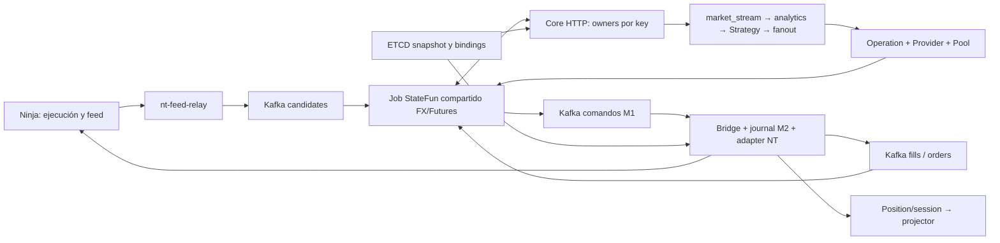

# EF-PROD-GOD-01-SOURCE-FORENSICS

## Propósito

Revisión integral EF-PROD-GOD-01, corte 2026-10-23 America/Santiago. Candidato para adjudicación del Primary Manager. No certifica producción ni modifica las aceptaciones históricas R6/FEFB/F1. Sólo se inspeccionaron archivos, Git y documentación oficial; no se ejecutaron tests, benchmarks, builds, sondas SSH/MCP de infraestructura, despliegues ni órdenes. Los archivos de pruebas se consideran fuente, nunca resultados de esta sesión.

## Contenido

### 1. Baseline y alcance probatorio

| Autoridad | Corte inspeccionado | Método y límite |
|---|---|---|
| Producto `xKoRx/echo`, `feature/ef-runtime-pools` | `ac0621a1917a9ecbed50b3daed4add1518ffc71d` | Checkout `echo-runtime-pools` limpio; HEAD local exacto; GitHub compare desde ac0621a1 a rama devuelve `identical`, 0 commits, 0 archivos. Reconfirmar antes de implementar. |
| F1 | ac0621a1, cinco archivos, +218/−1 | `git show` confirma clock LIVE y pruebas; no cambia Strategy/MM ni manifiestos. |
| FEFB aceptado G3 | `2ee61791deb3139be23e1c9be3708b1d41da8d6b` | Ledger y matriz S3; no se reejecutó la verificación histórica. |
| Vault `xKoRx/agents-os`, `master` | `ab264ac57e863224e6fe34ef4c9a096b260c21ec` | HEAD inicial y `ls-remote` concordantes; publicación documental posterior separada. |
| Imagen declarada | `apache/flink-statefun:3.2.0-java11` | Compose versionado, no digest instalado. POM upstream 3.2.0 declara Flink 1.14.3; falta identidad del JAR efectivo. SDK Go v3.3.0 en contratos FEFB. |
| Runtime DEV reportado F1 | Core ac0621a1; gateway/relay 2ee61791; job anterior `6551ccab`, posterior `9d99a9da` | Handoff F1 y planner; no observación actual de procesos en esta sesión. |

The Lab V4 comparte historia de la rama; sus cambios no se atribuyen a Futures. No se propone modificar backtester/Lab ni usar sus resultados para acreditar LIVE. La identidad de fuente, binario, módulo y estado son cuatro evidencias diferentes.

Readback final de source durante la revisión: `git ls-remote origin refs/heads/feature/ef-runtime-pools` devolvió nuevamente ac0621a1 completo y el checkout permaneció limpio. Sin deltas materiales nuevos que adjudicar.

Documentación obligatoria consultada: proyecto padre (objetivo, freezes, tarea puente y presupuestos), ledger Runtime Pools (R6, RESUME-01–05, FINAL-01, F1 y decisión Owner integral), R6 §§12–18, planner FEFB, diseño FEFB y anexo T1.1, matriz de verificación con cierre S3, dictamen S2, checklist CERT-NT-01 vigente. Contratos adicionales: D2-04, D2-05B/C por referencias de implementación, D2-06C, D2-07/A/C, Performance Resource Budgets V1 y README del backtester en sus seams de paridad. Retrieval enfocado por rutas, encabezados y símbolos; no se afirma lectura exhaustiva de cada documento histórico.

### 2. AS-IS reconstruido

Core sirve funciones remotas; su proceso no es dueño durable del estado StateFun. `futuresruntime.Registrations` compone siete propietarios: market_stream, market_analytics, strategy_engine, signal_fanout, pool_manager, provider_rules, operation. Las claves son stream, Strategy, pool, cuenta y cuenta:AccountStrategy según R6. Un restart de Core no debe crear otro job ni resetear estos propietarios.

El módulo v3 configura `echo/*` hacia un único endpoint HTTP, batch StateFun máximo 1000, transporte async con call 2 min y payload máximo 32 MiB. Éste es un lote de invocaciones StateFun, distinto del sobre FEFB de hasta 4096 items que el shell valida y aplica secuencialmente. `PublishCandidateBatch` preserva un Kafka record por lote/stream; no explota los items. El shell carga por owner, conserva efectos por evento y serializa estado final; el SDK prepara mutaciones y sends en la respuesta HTTP. Eso no implica checkpoint durable ni commit físico del venue.

Futures ingresa mercado y hechos de ejecución con `startupPosition: latest`; configuración Strategy/Pool y algunos flujos FX usan otras políticas, incluidos `earliest`. Los offsets de Kafka recuperados por Flink son autoridad cuando se restaura estado; el consumer group por sí solo no restaura cuentas, secuencias o timers. Posiciones y sesiones físicas van al projector fuera de StateFun; no se convierten en fills sintéticos.

Bridge consume M1 con `read_committed`, offset inicial oldest y commit tras handler. M2 conserva PREPARED/SUBMITTING antes del envío, ambigüedad, correlación y fence de claim. R6 conserva claims, afinidad, turnos, reservas y drenaje lógico/físico. La composición del productor contable LIVE completo no está demostrada por tener esos consumidores.

### 3. Código, despliegue e historia no son equivalentes

| Superficie | Hecho de fuente | Evidencia reportada / diferencia |
|---|---|---|
| Checkpoints DEV | RocksDB incremental, `file:///opt/flink/checkpoints`, intervalo 120 s, min-pause 120 s, retención 1, AT_LEAST_ONCE, HA none | Handoff reporta checkpoints COMPLETED; no prueba volumen independiente, restore ni lineage. |
| Checkpoints PROD declarados | AT_LEAST_ONCE, intervalo/min-pause 60 s, retención 2, ZK HA | Compose tiene un ZK y un JM y paths locales. No acredita quorum ni HA entre hosts. Nunca asumir que está aplicado. |
| Egress M1 | Comentario exige EXACTLY_ONCE, `spec` sólo id/address | Configuración efectiva no recuperada; source carece de declaración necesaria. `read_committed` no convierte registros no transaccionales en transaccionales. |
| REC-03 | Dos strings de ETCD, igualdad o ausencia de prior permite composición | No interroga estado restaurado, offsets, JobID ni generación. Evaluado al arrancar Core; no protege contra pérdida posterior del job. |
| F1 | LIVE RealtimeClock; replay/backtest VirtualClock | Verificación F1 reporta >4000 eventos sin falso future-dated y timer de silencio. No prueba monotonía de todos los owners. |
| FEFB | ACK control/data separados; FIFO detenido ante publish fallido; autoridad NATIVE estampada | G3 es aceptación de código. C4 aislado usó cliente sintético; AddOn físico integrado aún no certificado. |
| Rendimiento | Camino singleton y camino batch conviven | 4,65 M drenados en ~25 min es reporte histórico, no tasa steady-state calculable sin arrivals. FINAL-01 aún tenía feed legacy; atribuir todo el resultado a lotes del terminal sería incorrecto. |
| Incidente | No se encontró un submitter de Flink en `echo-core/main.go` | Nuevo job/restored:0 y reset de stream_seq reportados. Actor y primer fallo siguen sin logs; standalone re-submit es hipótesis. |
| Estado seguro | Sin activación realizada aquí | Último reporte: ejecución desarmada. No equivale a verificación actual de cinco capas. |

### 4. Hallazgos agrupados por causa

Severidad es riesgo si se habilitara producción con el defecto, no afirmación de pérdida monetaria ocurrida. **P0 demostrados: F01, F02, F03. P1: F04–F09. P2: F10.** F08/F09 contienen gaps explícitos. No se inventa daño en cuentas: el incidente ocurrió desarmado.

#### F01 — P0: continuidad económica sin autoridad verificable de recuperación

1. **Implementado:** `v3/core/internal/futuresruntime/recovery.go:64–87` permite ausencia de prior o igualdad de strings; `cmd/echo-core/main.go:577–590` consume esas claves una vez. Flink usa backend/checkpoint local con reinicios limitados.
2. **Problema:** estado vacío puede componer con pins vacíos o antiguos; el gate de Core no detecta reemplazo posterior del job. No hay prueba de relación checkpoint→JobGraph→owner→offsets.
3. **Evidencia:** defecto de autoridad demostrado estáticamente; reset de secuencia/restored:0 reportado en F1; RCA del auto-submitter pendiente.
4. **Consecuencia:** reuso de secuencias/epochs, pérdida de reservas/afinidad/dedup, autorizaciones incoherentes con órdenes físicas anteriores.
5. **Mínimo:** RecoveryManifest inmutable, bootstrap registrado, único controlador de submission, restore obligatorio de lineage compatible, comprobación dentro de owners y barrera de ejecución que también detecta cambio de job en caliente. Estado ausente nunca significa cuenta nueva.
6. **Alternativa descartada:** aumentar retries o habilitar ZK sin guard; HA no retiene necesariamente metadata tras terminal failure y no decide si bootstrap es legítimo.
7. **Cambia:** lifecycle de despliegue, REC-03, registro ETCD, marcador checkpointed, readiness Core/Bridge, no reglas económicas.
8. **Migración:** sólo con desarme, snapshot completo y compare de owners/offsets. Estado de F1 perdido no se recupera fabricando pins. Nueva lineage sólo tras retiro explícito y prueba de inexistencia de exposición/deuda; historia perdida permanece declarada.
9. **Certificación:** reinicios Core/TM/JM, fallo terminal, manifest ausente/corrupto, checkpoint incompatible y reemplazo de job con Core vivo; jamás OPEN antes de restore y reconciliación.
10. **Residual:** pérdida simultánea de todas las copias o historia venue insuficiente impide recuperación automática; permanece BLOCKED.

#### F02 — P0: frontera M1 y recording declarados sin commit transaccional configurado

1. **Implementado:** `v3/core/deploy/flink-statefun/{develop,production}/module.yaml` egress `futures-operations-egress` (develop:500–509) sin deliverySemantic; core/signals egress también sin él. `flink-conf.yaml` usa AT_LEAST_ONCE (DEV:78–84; PROD:80–86). Consumer M1 sí usa ReadCommitted (`adapters/kafka/command_consumer.go:58–76`).
2. **Problema:** el comentario no configura transacciones; el default documentado del builder es at-least-once. M1 puede ser visible antes de un checkpoint consistente. Recording exige semántica más fuerte que la configurada.
3. **Evidencia:** contradicción source/contrato demostrada; comportamiento exacto desplegado pendiente de configuración/JAR efectivo.
4. **Consecuencia:** orden visible cuyo estado emisor se pierde; replay con decisiones/tiempo distintos; M2 deduplica una identidad, no toda decisión económica divergente.
5. **Mínimo:** checkpoint EXACTLY_ONCE y egress Futures transaccionales explícitos, read_committed en lectores autoritativos, IDs transaccionales sin colisión, timeout compatible. Incluir costo de commit en latencia antes de GO.
6. **Alternativa:** at-least-once más M2 reduce latencia pero no conserva la atomicidad exigida estado→decisión; se descarta. Nueva base transaccional por tick viola presupuesto de hot path y no es necesaria sin medir.
7. **Cambia:** manifests y validación release; consumidores de facts/journal; contratos de visibilidad y completeness.
8. **Migración:** corte coordinado sin mezcla de instancias, preservando offsets y semántica de todos los lectores. No cambiar groups para “resolver” lag.
9. **Certificación:** matar antes/después de respuesta HTTP y commit checkpoint; consumidor aislado observa sólo commits; exactitud de IDs/payloads y una intención física bajo redelivery. Medir latencia real con transacciones.
10. **Residual:** Kafka y venue no comparten transacción; M2/reconciliación siguen obligatorios. Varios sinks transaccionales no garantizan visibilidad simultánea entre topics.

Complemento transversal F02/FX: `v3/core/internal/functions/mm_engine.go:671–672` emite a `echo/core-commands-egress`, también sin deliverySemantic explícito en module.yaml:120; close/automation egress requieren el mismo inventario. `v3/bridge/internal/session/command_consumer.go:110–147` usa group por hostname y OffsetNewest, y su configuración no fija IsolationLevel=ReadCommitted. `pipe_handler.go:1776` sí verifica TTL antes de transmitir; eso no acredita un fence de generation en el terminal. Esta diferencia impide extrapolar las garantías del consumer Futures a FX. No se ejecutó EA ni se afirma duplicación física FX. Corrección y gate de convivencia especificados en Documento 2 §6–7.

#### F03 — P0: observación económica marcada entregada antes de entrega durable

1. **Implementado:** `v3/futures-bridge/internal/session/gate.go:117–130` marca `seenFills` antes de `PublishEvent` (final de Observe); `adapters/ninjatrader/adapter.go:448–500` marca `executionSeen` antes de journal/publicación. `handleOrders:445` ignora error de emit. AddOn `PublishExecExecutions:1708` también marca antes de enviar; reconexión limpia su cola.
2. **Problema:** Kafka falla tras marcar visto; mismo execution_id retorna sin publicar en adapter o gate. Terminalizar journal antes de publicar no equivale a entrega del fill. Quarantine de gate es contador volátil, no registro recuperable.
3. **Evidencia:** camino de pérdida demostrado por orden de instrucciones, sin ejecutar repro. Pérdida física histórica no demostrada.
4. **Consecuencia:** Operation puede desconocer fill/partial fill; exposición, finality, reservas y política diaria divergen de cuenta física.
5. **Mínimo:** extender journalfs/M2 con inbox/outbox durable de observaciones por identidad nativa y digest; pending/published distintos; reintentar bytes originales; watermark de historia por binding. Eliminar dedup anticipado en todos los eslabones y propagar errores. Terminal command no permite GC de observaciones pendientes.
6. **Alternativa:** mover un map después de Publish arregla un borde pero pierde callbacks en crash y deja el map anterior del adapter; insuficiente. No introducir un broker nuevo.
7. **Cambia:** adapter/ntx, EventGate, journalfs, capability de event delivery y AddOn execution queue/ACK. Strategy/MM intactos.
8. **Migración:** schema aditivo en M2; sin truncar journals existentes; reconciliación inicial reconstruye sólo hechos autoritativos, preservando native execution ID; jamás posiciones como fills.
9. **Certificación:** Kafka down, crash antes/después de publish y de ack, callbacks duplicados/reordenados, partial fills, terminal sin publicación, reconnect y reinicio terminal. Core debe recibir cada hecho una sola vez lógicamente y reservas nunca liberarse prematuramente.
10. **Residual:** un fill anterior al durable capture local requiere historia autoritativa del venue; ausencia de historia bloquea la cuenta.

#### F04 — P1: ventana bounded confundida con garantía de deduplicación permanente

1. **Implementado:** `sdk/futures/market/canonicalize.go:153–246` consulta identidad en ventana 4096, asigna nueva secuencia si no la encuentra y expulsa FIFO. `VerifyRedelivery` absorbe seq antigua, pero no es el camino `Accept` de candidatos.
2. **Problema:** tras 4097 identidades, reentregar el primer candidato ejecuta la rama “nuevo”. El comentario sobre horizonte no implementa un cursor de origen ni rechazo de identidad expirada.
3. **Evidencia:** demostración estática directa; consecuencias downstream concretas dependen del evento y guards posteriores. No se afirma una orden duplicada observada.
4. **Consecuencia:** mismo hecho puede adquirir otra secuencia/identidad canónica por epoch; nuevas decisiones, gaps y paridad falsa tras replay de outbox o restore.
5. **Mínimo:** cursor durable por lane/epoch/stream con secuencia contigua de datos y expansion index; duplicados antiguos se rechazan como fuera de horizonte sin asignar nueva stream_seq; conflicto digest se verifica dentro de ventana o desde archivo durante recovery offline. Barras usan bucket/revision y cobertura, no supuesto de monotonía por timestamp.
6. **Alternativa:** aumentar map/TTL sólo desplaza el borde; dedup ilimitado por tick es incompatible con presupuesto de estado.
7. **Cambia:** FEFB metadatos aditivos de lane, market sequencer, registro de epochs retirados y catálogo de restore horizon; mantiene IDs ya emitidos.
8. **Migración:** frontera explícita por fuente con desarme; no deducir high-watermark completo desde último evento si se desconocen gaps. Inputs legacy sin evidencia de horizonte sólo observation/recovery bloqueado, nunca bootstrap automático.
9. **Certificación:** reenvío más allá de 4096, lotes reagrupados, multi-stream interleaved, epoch viejo, revisión tardía válida, offset rewind y checkpoint anterior al ack.
10. **Residual:** fuera de horizonte se sabe que no debe operar; no se afirma igualdad de contenido sin consultar historia.

#### F05 — P1: durabilidad de proceso insuficiente para corte eléctrico

1. **Implementado:** `EchoFeedV1.cs:1012–1018` usa Flush() sin flush-to-disk; cursor:1074–1082 e identidad:1360–1381 usan escribir tmp, borrar destino, mover; compaction hace patrón similar. `journalfs/fence.go:82–87` ignora errores de apertura/fsync del directorio.
2. **Problema:** ventana de pérdida del nombre y éxito reportado antes de garantía durable requerida; errores de fsync pueden ocultarse.
3. **Evidencia:** defecto del protocolo de escritura visible; pérdida eléctrica física y propiedades del disco/VM pendientes. Flush() no es prueba de barrera física.
4. **Consecuencia:** outbox, cursor, epoch o fence retroceden tras apagón; reenvío inseguro o hueco sin trazabilidad.
5. **Mínimo:** append con checksum/longitud y Flush(true) soportado; reemplazo atómico con backup válido, orden de persistencia documentado, errores fatales para readiness. Fence propaga fsync/close fallidos. Registrar los ticks todavía volátiles como gap tras recovery, sin prometer que se capturó lo que el proveedor no entregó.
6. **Alternativa:** SQLite durable sería razonable, pero no se añade antes de agotar el journal existente; UPS no reemplaza protocolo correcto.
7. **Cambia:** storage del AddOn y journalfs; no payloads de negocio.
8. **Migración:** lector de formato antiguo, writer nuevo versionado, snapshot/backup antes de conversión. No reset de sesión para ocultar corrupción.
9. **Certificación:** cortes en append/rename/ack/compaction, ENOSPC y filesystem errors; restore exacto o GAP/BLOCKED, nunca vacío silencioso.
10. **Residual:** garantías dependen del filesystem/controlador/hypervisor; power-loss se certifica en entorno aislado equivalente.

#### F06 — P1: fencing de claim local no equivale a propietario global de runtime

1. **Implementado:** group M1 incluye hostname (`command_consumer.go:82–84`); sesión NT mantiene conexión activa local al servidor; fence M2 protege claim epoch de R6. D2-07C prohíbe takeover automático entre hosts.
2. **Problema:** dos hosts tienen grupos diferentes y journals distintos; ambos pueden leer todos los comandos. Un lock de proceso no invalida otro host ni un comando ya encolado.
3. **Evidencia:** construcción de identidad demostrada; no se observó doble propietario físico. Instalación legacy a cuenta comercial está documentada, ya neutralizada históricamente.
4. **Consecuencia:** duplicación de submit o cuenta/binding equivocados bajo error de despliegue.
5. **Mínimo:** identidad estable ambiente+cuenta+binding, lock de journal, registro exclusivo ETCD y generation de ejecución monotónica verificada por AddOn. Handoff sólo con fence físico del antiguo y journal transferido; lease expirado solo no habilita sucesor.
6. **Alternativa:** mismo consumer group mejora exclusión de lectura pero no cerca un consumer particionado después de read; insuficiente por sí solo.
7. **Cambia:** bootstrap bridge, command metadata, lane NT y grants de arming; no selección de cuentas del Pool.
8. **Migración:** group change sólo tras barrera y offsets/M2 conciliados, sin reset oportunista; default desarmado si falta generation.
9. **Certificación:** dos hosts, lease loss, proceso suspendido que vuelve, replay tras transferencia, alias doble, account ID drift y token/binding cruzados.
10. **Residual:** conectividad venue perdida impide demostrar fence remoto; no takeover automático, intervención Owner.

#### F07 — P1: tiempo y recording no uniformes en todos los decisores

1. **Implementado:** F1 corrige LIVE; market `OwnerInputOrder.Admit` persiste max(previous, wall). Provider llama `engine.Apply(...Clock.Now())` (`futures_provider_rules.go:195`); Operation consulta Clock.Now varias veces (`operation/engine.go:977,1152,1810,2037`).
2. **Problema:** la monotonía demostrada de market no puede extrapolarse a cuentas; repetir la misma transición puede observar varios instantes y NTP step-back. Recording de mercado no demuestra log completo de inputs/contextos económicos.
3. **Evidencia:** llamadas visibles; divergencia física/paridad completa pendiente. No se reclasifica F1 como fallido.
4. **Consecuencia:** frontera de sesión, expiry o config diferente entre LIVE y replay; recuperación aparentemente sana con otra causalidad.
5. **Mínimo:** un AdmissionContext inmutable por transición/owner, tiempo monotónico persistido, input order y referencias de config/contexto grabados; reloj fijo durante Apply, replay consume ese contexto. Freshness evalúa también edad actual al autorizar ejecución, no sólo flag viejo.
6. **Alternativa:** reemplazar todo por event_ts introduce lookahead/backdating; volver a VirtualClock LIVE reproduce F1.
7. **Cambia:** shells, recording/replay adapter y schemas aditivos; kernels Strategy/MM y calendarios conservados.
8. **Migración:** runs anteriores se declaran partial cuando faltan inputs, sin inventar exact replay; writer v2/readers compatibles antes de activar.
9. **Certificación:** mismos inputs y contextos → hashes iguales entre LIVE-recorded/replay/backtest-seam; saltos de reloj, timers/retry/batching, DST, feriados y sesión overnight.
10. **Residual:** backtest histórico no observado no tiene timings reales; es simulación, no EXACT_REPLAY.

#### F08 — P1 + EVIDENCE_GAP: evidencia de economía, protección e historia venue incompleta

1. **Implementado:** Provider consume hechos contables/policy, Operation mantiene exposición y reservas, M2 reconcilia. `adapter.Submit:558–645` transmite órdenes individuales; AddOn `ExecuteSubmit:1363–1372` crea/envía una Order. No se ha demostrado protección autónoma del venue durante caída de Core/NT.
2. **Problema:** consumidor contable/fixtures no prueban productor LIVE; balance NT no prueba ledger de fees/fills/correcciones. Tampoco dos submits separados prueban protección atómica.
3. **Evidencia:** limitación del source individual y gates históricos; no se inventa ausencia de protección en todo caso ni un breach observado.
4. **Consecuencia:** paused/DD/eligibility sin autoridad, protección perdida tras partial fill o desconexión, reconciliación sin historia suficiente.
5. **Mínimo:** pipeline contable causal reutilizando kernels, revisiones covers-through; gate de capability por binding que sólo autoriza exposición bajo una política de protección demostrada. Sin protección segura durante falla, binding queda NO_GO_PROD; no se traslada MM al Bridge.
6. **Alternativa:** asumir que Sim101 representa custodia y persistencia del broker real es inválido; flatten ciego tras desconexión puede duplicar/revertir posición.
7. **Cambia:** productor/adaptador de hechos contables, capability/readiness y evidencia de protección, no targets/DD/sizing congelados.
8. **Migración:** primer saldo/checkpoint contable con procedencia y frontera; toda cuenta desconocida UNKNOWN; nunca sembrar con fixtures.
9. **Certificación:** fees, partial fills, cancel/fill, posiciones ajenas, DD y boundary, caída durante entrada/protección; snapshot sellado de historia/cuenta y supervivencia real de protección.
10. **Residual:** el transport puede no ofrecer capacidad requerida. Resolución cerrada: esa combinación no se promueve; no se inventa automatismo económico.

#### F09 — P1: disponibilidad y capacidad sin contrato global de progreso seguro

1. **Implementado:** job compartido; checkpoints locales; /health HTTP de proceso; freshness market 30 s/event, 60 s/silencio, 5 s/skew por defecto; errores de payload pueden abortar request completa. Presupuestos exigen 200 cuentas sin duplicar mercado, no acreditan 200 físicas.
2. **Problema:** RUNNING/HTTP200 no prueba freshness, recoverability ni autorización; poison repetido puede agotar restart strategy de FX/Futures. Capacidad singleton no es techo FEFB; cifras pre-F1 de edad están contaminadas por clock.
3. **Evidencia:** blast radius observado en RESUME; F1 edad real y capacidad física batched pendientes; no medición nueva.
4. **Consecuencia:** reapertura insegura o indisponibilidad compartida; expansión de memoria/disco invisible; desarme lógico que no preserva gestión de posiciones.
5. **Mínimo:** cuatro estados de salud independientes, guard externo que expire new-risk, cuarentena durable acotada de errores deterministas con gate del stream/cuenta, envelope medido, compaction con horizonte. Recuperación y safety traffic tienen prioridad sobre nuevas entradas.
6. **Alternativa:** shardear un mismo owner o subir timeout/freshness no repara causalidad. Separación inmediata exige migración de estado no demostrada; A conserva job con fallo compartido explícito, B aísla conforme al diseño.
7. **Cambia:** métricas, readiness, release preflight, manifests, quarantine y límites; sin servicio económico nuevo.
8. **Migración:** observation-only hasta probar los gates. FX conserva IDs/offsets; no saltar su replay cambiando earliest a latest.
9. **Certificación:** tráfico NT real 1×/2×/burst, ≥30 min y sesión completa, 200 deliveries estructurales; backlogs, poison, timer retrasado, FX y fallos de observabilidad.
10. **Residual:** A acepta interrupción conjunta de cálculo ante fallo del job; no acepta pérdida de estado ni nuevas órdenes sin gates. Si ese costo no cumple envelope aprobado, A es NO-GO y se aplica B.

#### F10 — P2: ciclo de soporte y escalado no cuantificado

1. **Implementado:** imagen antigua pinneada por tag, backend RocksDB y configuración estática por ambiente.
2. **Problema:** digest/versiones efectivas, compatibilidad de serializers y vulnerabilidades aplicables no están inventariadas; añadir nodos no elimina una hot key.
3. **Evidencia:** fuente demuestra tag/config, no estado de soporte actual ni CVE concreta.
4. **Consecuencia:** upgrade apresurado pierde estado o capacidad; falsa promesa de HA por más slots.
5. **Mínimo:** release manifest con hashes/SBOM, ownership del parser/config, pruebas de restore de versiones y presupuestos por owner. Una vulnerabilidad explotable que viole el threat model se reclasifica bloqueante antes de PROD.
6. **Alternativa:** migrar a otro engine ahora añade dependencia y riesgo sin evidencia de necesidad.
7. **Cambia:** metadatos de release y gates de compatibilidad; evolución B/C.
8. **Migración:** una dimensión por release; backup y restauración ensayados. Nunca actualizar engine y formato de estado a ciegas en el mismo paso.
9. **Certificación:** identidad efectiva y matriz reader/writer/restore; capacity slope por stream/owner.
10. **Residual:** versión sin mitigación/soporte suficiente bloquea promoción; no se afirma segura por estar en red privada.

### 5. RCA: hechos, hipótesis y artefactos faltantes

**Hechos reportados:** restart Core 11:55:34Z; aproximadamente 12:07:52Z cambia job 6551ccab→9d99a9da; nuevo REST restored:0; stream_seq desde 1, dedup vacío; replay FX y conflictos Journal; ejecución desarmada. **Hipótesis:** batch in-flight, timeout/retries agotados y entrypoint standalone resometiendo sin restore. Correlación temporal no prueba actor ni causalidad. No se atribuye a F1, Lab V4, Kafka ni Flink una RCA exacta sin evidencia.

| Gap | Artefacto exacto exigido al futuro bloque de implementación/operación | Fallback cerrado |
|---|---|---|
| E01 fallo/submission | `incident-f1/timeline-utc.md`, logs JM/TM y orquestador 11:50–12:20Z, exception history de ambos JobIDs, inspect/entrypoint/container events y quién llamó submit; hashes de archivos, tiempos monotónicos cuando existan | Guard de restore obligatorio independiente de RCA; sin logs, RCA=UNRESOLVED, nunca borrar esa condición. |
| E02 último estado válido | `recovery-inventory.json`: lista de checkpoints COMPLETED, URI/metadata/checksum, JobGraph/operator IDs, maxParallelism, offsets por ingress/partición, permisos y objetos/SST dependientes | No candidato verificable → COLD_RECOVERY_REQUIRED. |
| E03 config efectiva | `effective-runtime-manifest.json`: image digest/JAR, JVM/Go, module/flink-conf, mounts, storage/backup, Kafka RF/minISR/retention/transaction configs, ETCD revision sin secretos | Ninguna promoción basada en manifiestos del repo. |
| E04 conflictos FX | `fx-journal-reconciliation.md`: conteos por tipo, sample IDs anonimizados, hashes previos/nuevos y filas/quarantine; comandos físicos en ventana | No llamar benignos a todos los conflicts; FX new-risk bloqueado si no se demuestra consistencia. |
| E05 NT físico | `nt-install-manifest.json`, assembly/source hashes cargados, perfil aplicado, account catalog, frame→Kafka→owner ledger, restart/history/ACK | Feed-only; C5 no armado. |
| E06 economía/protección | `account-readiness-evidence.json`: ledger revision/covers-through, open orders/fills/position con scope/fecha, proof de protección en desconexión y horizon real | UNKNOWN / MANAGE_ONLY; no inventar fees, cuenta ni orden protectora. |
| E07 capacidad | `capacity-envelope.json` + series crudas y capturas RTH sin secretos, transacciones/checkpoints reales, escenarios y hardware | Límite comercial no declarado; no “200 cuentas certificadas”. |

### 6. Trazabilidad source → contrato → riesgo

Todas las rutas siguientes pertenecen a `xKoRx/echo@ac0621a1`; los números de línea son de ese corte, no del futuro implementado.

| Source/símbolo | Contrato propietario | Finding / reparación |
|---|---|---|
| `core/internal/futuresruntime/recovery.go` EvaluateColdRecovery; `core/cmd/echo-core/main.go:577` | ATP REC-03, R6 continuidad | F01 → arquitectura §3–5 |
| `core/deploy/flink-statefun/*/{module.yaml,flink-conf.yaml,docker-compose.yml}` | D2-04 M1; D2-07C; recording §24 | F01/F02/F09 → §§3–6,13 |
| `futures-bridge/internal/session/gate.go:117`; `adapters/ninjatrader/adapter.go:448` | Fill nativo, M2, R6 drenaje | F03 → §7 |
| `sdk/futures/market/canonicalize.go:153,235` | D4-A1 identidad/horizonte | F04 → §6 |
| `futures-bridge/addon-ninjatrader/EchoFeedV1.cs:1012,1074,1360`; `adapters/journalfs/fence.go:82` | FEFB durable outbox; R6 fence | F05 → §§7–8 |
| `futures-bridge/adapters/kafka/command_consumer.go:58–84`; `core/ntx/server.go` | D2-07C single owner/no takeover | F06 → §7 |
| `sdk/futures/domain/clock.go`; `market/recording.go:63`; `core/internal/functions/futures_provider_rules.go:195`; `sdk/futures/operation/engine.go` | DomainClock, D2-06C exact replay | F07 → §9 |
| `sdk/futures/provider/{state,engine,admission}.go`; `core/internal/functions/futures_provider_rules.go` | R6 §12C, Provider authority | F08 → §10 |
| `futures-bridge/adapters/ninjatrader/adapter.go:558`; `EchoExecutionAddOn.cs:1363` | D2-07 protection/finality | F08 → §10 |
| `core/internal/functions/futures_market_stream.go:113,423`; `futures-bridge/adapters/ntfeed/{kafka,relay_batch}.go` | FEFB C1–C6 y AC13 | F09 → §§8,12 |

Prefijo común omitido en esta tabla: `v3/`. Los contratos aprobados prevalecen sobre comentarios descriptivos; este paquete propone enmiendas técnicas concretas que requieren adjudicación, no autoaceptación.

## Fuentes

- [[Echo Futures — Runtime Pools]], [[Echo Futures — Execution Client y Feed Batching]], [[ECHO-FUTURES-RUNTIME-POOL-DESIGN]], [[EXECUTION-FEED-BATCHING-DESIGN]], [[EXECUTION-FEED-BATCHING-VERIFICATION]], [[EXECUTION-FEED-BATCHING-S02-DICTAMEN]], [[OWNER-CHECKLIST-CERT-NT-01]], [[Echo Futures — Performance Resource Budgets V1]].
- Handoff histórico local `aranea/work/cert-nt-01-f1/HANDOFF-SUBMANAGER-F1.md`, inspeccionado; no se copia como log físico independiente. El ledger conserva esa referencia externa.
- [Producto exacto](https://github.com/xKoRx/echo/tree/ac0621a1917a9ecbed50b3daed4add1518ffc71d), [StateFun Kafka](https://nightlies.apache.org/flink/flink-statefun-docs-release-3.2/docs/modules/io/apache-kafka/), [KafkaEgressBuilder default y commit](https://nightlies.apache.org/flink/flink-statefun-docs-release-3.2/api/java/org/apache/flink/statefun/sdk/kafka/KafkaEgressBuilder.html): sustentan F02.
- [StateFun async HTTP](https://nightlies.apache.org/flink/flink-statefun-docs-release-3.2/docs/modules/http-endpoint/): el nesting directo de call/connect del transporte async es válido; no se inventa un defecto de YAML por compararlo con OkHttp.
- [POM StateFun 3.2.0](https://raw.githubusercontent.com/apache/flink-statefun/release-3.2.0/pom.xml), [HA Flink 1.14](https://nightlies.apache.org/flink/flink-docs-release-1.14/docs/deployment/ha/overview/), [savepoints y operator IDs](https://nightlies.apache.org/flink/flink-docs-release-1.14/docs/ops/state/savepoints/): versiones y límites de recuperación; el JAR desplegado sigue pendiente.
- [FileStream.Flush](https://learn.microsoft.com/en-us/dotnet/api/system.io.filestream.flush?view=netframework-4.8): diferenciar flush de buffers y flush-to-disk; sustenta F05 sin certificar filesystem real.
