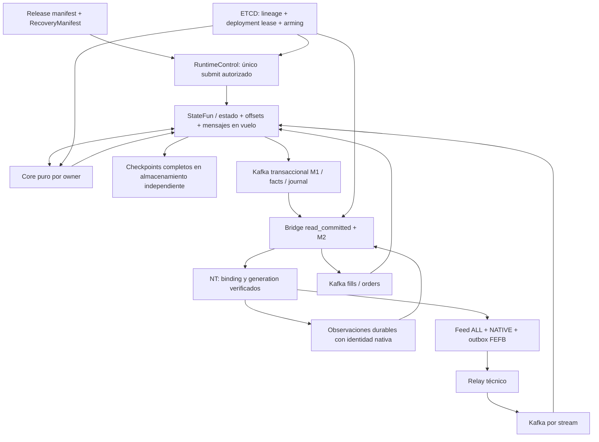
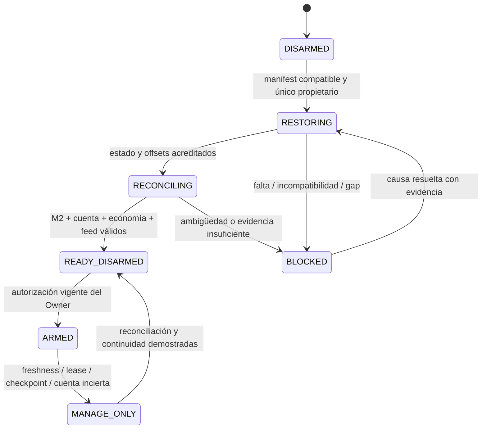

# EF-PROD-GOD-02-PRODUCTION-ARCHITECTURE

## Propósito

Diseño candidato prescriptivo EF-PROD-GOD-01, 2026-10-23. Baseline `xKoRx/echo@ac0621a1917a9ecbed50b3daed4add1518ffc71d`. Este documento fija una solución recomendada para GLM LOCAL, pendiente de adjudicación del Primary Manager. No es certificación, autorización de implementación ni permiso de operar cuentas. Los números propuestos son presupuestos de aceptación, nunca mediciones inventadas.

## Contenido

### 1. Decisión única: Opción A, conservar motores y cerrar fronteras

Conservar Go/Core, StateFun/RocksDB, Kafka, ETCD, PostgreSQL existente, M2 local, Execution Client FEFB y los kernels actuales. Implementar recuperación con manifest y fencing, M1 transaccional real, entrega durable de observaciones económicas, tiempo por admisión, horizonte explícito de dedup y gates independientes. Reutilizar object storage existente para checkpoints/artefactos recuperables y PostgreSQL para contabilidad/proyecciones existentes; no crear un bus, motor de workflows, base por tick o microservicio económico adicional.

La opción base mantiene inicialmente el job FX/Futures y su JobGraph para minimizar riesgo de migración. **Acepta indisponibilidad conjunta, nunca continuidad falsa.** El antecedente de fallas compartidas hace obligatoria una prueba de blast radius y un gate común de ejecución: si Futures falla, FX no puede seguir emitiendo con estado incierto. Se reserva CPU/memoria para Core, Flink y reconciliación; ningún benchmark/Lab comparte esos recursos durante operación. Si A no cumple los gates de capacidad o la interrupción compartida admisible del release, no se promueve: B queda definida en §13. No se impone separación sólo por taxonomía de mercado.

No se cambian generación de Signal, matemática Strategy/MM, targets, DD, budgets completos R6, afinidad, FIFO o criterios de rotación. Los cambios económicos se limitan a acreditar la autoridad de sus entradas, conservar su estado y evitar efectos duplicados o inciertos.

### 2. Propietarios y fronteras

| Componente | Autoridad | Prohibición |
|---|---|---|
| NT integrado | Captura de datos/callbacks, barras nativas, aplicación mecánica del plan sellado, identidad de cuenta y lane, outbox local | No Strategy/MM/riesgo ni elección de cuenta alternativa |
| Relay feed | Validación, límites, orden, publicación Kafka y ACK consecutivo | No sampling, construcción de barras ni decisiones económicas |
| market_stream | Único orden canónico/epoch/dedup por stream, freshness y recording | No ordenar por llegada del consumidor ni fabricar continuidad |
| market_analytics | Barras/indicadores compartidos, coverage y revisión causal | No duplicarse por cuenta |
| strategy_engine / fanout | Una evaluación por Strategy; entregas/no-target definitivos por asociación | No retarget de señal histórica tras recovery |
| pool_manager | Turno por asociación y protocolos R6 | No balances, fórmulas MM o liberación por timeout |
| provider_rules | Cuenta: claim, afinidad, reservas, autoridad/riesgo/policy/day | No inferir fill desde posición ni limpiar breach por reloj |
| operation | Ciclo/órdenes/fills/MM sellado y claims locales | No nueva exposición con permiso viejo; gestión mantiene correlación original |
| futures-bridge/M2 | Intento físico, observaciones durables, fence y reconciliación técnica | No decidir sizing, cierre por DD ni nueva política de protección |
| futures-projector + adaptador contable | Hechos físicos/proyecciones y revisiones de ledger mediante kernel SDK | Proyección no restaura estado de trading; saldo NT aislado no es ledger |
| RuntimeControl | Lifecycle deployment/recovery, registro de manifest, exclusión de submission | No negocio ni reset automático de lineage |
| Owner / Manager | Autorización económica / adjudicación técnica y gates | Disponibilidad de herramientas no concede autoridad |

`RuntimeControl` es una utilidad operacional en el módulo Core, invocada por el mecanismo de despliegue existente; no un daemon ni un servicio con decisiones de trading. El watchdog de permiso vive en Core y el fence técnico en Bridge/AddOn. Toda configuración nueva usa el cliente ETCD existente; argumentos del utility identifican operación/artefacto, no overrides secretos de configuración.

### 3. Contratos persistidos y autoridad de recuperación

Usar `schema_version` explícito, hashes sobre representación canónica, IDs estables y rechazo de versiones desconocidas. Ningún timestamp, hostname, nombre de pool o PID es identidad económica. Las rutas ETCD de esta sección son **nuevas rutas propuestas**, relativas al namespace de ambiente ya existente; no se afirma que existan hoy.

**C-REC-1 RecoveryManifest v1:** documento inmutable almacenado junto a los artefactos de recuperación; ETCD `futures/recovery/active_manifest` guarda URI+digest y compare revision. Contiene environment, deployment_id, domain_scope (FX/Futures si comparten job), lineage_id, run_ids, generation, source_sha por binario, image/JAR digest, module/config hashes, config snapshot URI+hash+revision, calendar/ruleset/MM versions, Flink job_id, JobGraph/operator UIDs, maxParallelism/serializers/TypeNames/ValueSpec names, checkpoint/savepoint ID, metadata URI+digest y conjunto de objetos dependientes, completion time, ingress IDs y topic identities/partition counts/offsets, roster de owners activos/retirados, checkpointed marker, policy de compatibilidad y referencia a último release reversible. Las listas grandes viven en objetos anexos con hash; ETCD no almacena dumps de estado.

**C-REC-2 LineageRegistry:** ETCD `futures/recovery/lineages/<lineage_id>` con estado `REGISTERED|INITIALIZED|ACTIVE|RETIRED`, deployment, generation máxima, historia de releases y existencia durable de economía. No expiración para existencia/retirement. Sólo el controlador puede actualizarlo por compare-and-swap. Borrar un pin no autoriza bootstrap. Ausencia/desacuerdo entre ETCD, manifests, M2 o venue = UNKNOWN, no NEW.

**C-REC-3 OwnerContinuity:** ValueSpec aditivo en cada owner con lineage_id, schema version, owner key, birth_config_version, run_id, retirement watermark y generation de control. Inicialización de una key sólo mediante bootstrap autorizado o alta explícita de config; en modo RECOVER, state missing de una key preexistente falla cerrado. Contadores económicos originales, owner_input_seq, runtime_ts y dedup se conservan; este marcador no los sustituye.

**C-REC-4 RestoreAttestation:** lectura posterior al restore con nonce de operación de control, JobID/generation reales, restored checkpoint metadata, conjunto de owners y sus marcadores/counters resumidos, offsets restaurados y estado de reconciliación. No se acepta un “restored>0” de un checkpoint ajeno ni un config pin como prueba. Roster de cuentas y owners activos completo; verificación de estado migrado mediante export/lectura del snapshot en aislamiento. Inventario de todas las keys en artefacto checkpoint; el hot path no escanea historia.

**C-EXEC-1 ExecutionPermit v1:** environment, lineage, generation de runtime, account canonical ID, physical binding, provider account ref, terminal identity, config digest, owner authorization ref, issue/expiry, allowed risk mode y scope SIM/LIVE. Permit explícitamente ligado a una generation restaurada/reconciliada. Clock/identidad desconocida lo invalida. Claim epoch R6 y runtime generation son campos separados: uno cerca un turno, el otro cerca una instancia económica.

**C-DATA-1 Envelope de causalidad:** schema, provenance, stable input ID, origin lane/epoch/data_seq/stream_seq cuando corresponda, received/available timestamp, effective config version, payload digest y causal parent. Extensiones son aditivas. Seq de transporte control/heartbeat nunca sustituye data_seq. Kafka offset real se conserva como evidencia de transporte donde el connector lo exponga; `IngressRecordRef.offset` de NT hoy es frame.Seq, no offset del broker.

### 4. Regla inequívoca: jamás fallback a job vacío

**El mecanismo que lo garantiza es la conjunción de tres barreras:** (1) el único submitter autorizado exige restore URI compatible o un token de bootstrap de namespace nuevo; (2) los owners rechazan state missing en recuperación y atestiguan lineage real; (3) Bridge/NT sólo aceptan nueva exposición con ExecutionPermit de la generation recuperada. Un job vacío incluso creado por error queda incapaz de emitir efectos económicos. ACL de REST/submission y configuración del entrypoint eliminan caminos alternativos; no confiar sólo en disciplina humana.

Estados:

El RuntimeControl toma lock ETCD por deployment con lease; si falla la consulta no hace submission. Comprueba ausencia de instancia competidora por registry, REST y control de proceso; un lease vencido no prueba que el antiguo murió. Ante resultado incierto de submit consulta el JobID esperado antes de repetir. El lock gobierna deploy, no sustituye fencing físico.

**Bootstrap realmente nuevo:** namespace sin historial económico, inventario negativo de M2/órdenes/posiciones/registry, config y roster sellados, offsets iniciales explícitos por partición y autorización de inicialización. Registrar LineageRegistry antes de iniciar ingresses. Primera snapshot completa con markers antes de emitir permit. No permitir “prior_run vacío” como atajo. Altas de streams/cuentas posteriores usan config versionada y birth marker; una key nueva no vuelve nueva a toda la cuenta.

**Falla de Core:** Flink mantiene estado; Core vuelve con el mismo release compatible/config y no toca job ni offsets. Requests fallidos se reintentan. Core sin pins/registry/owners compatibles sólo readiness=false; debe seguir accesible para diagnóstico. Si se necesita detener totalmente por seguridad, Bridge conserva las órdenes protectoras en venue y su reconciliación técnica.

**Falla TM o JM no terminal:** recuperación nativa del mismo deployment desde último checkpoint completo; después se verifica lineage/generation y se invalida arming hasta reconciliación. No emitir bootstrap de config con valores más nuevos que los sellados durante replay. Los cambios pendientes se aplican prospectivamente tras el watermark de recovery.

**Job FAILED terminal / caída del contenedor / corte eléctrico:** automático sólo si existe último checkpoint COMPLETED exacto, objetos íntegros/accesibles, mismo JobGraph/estado compatible, offsets todavía retenidos, ninguna instancia competidora y M2 disponible. Controlador puede someter restore, pero nunca armar; permiso queda invalidado. Si falta cualquiera, `COLD_RECOVERY_REQUIRED` y operador. No escoger otro checkpoint antiguo silenciosamente.

**Checkpoint inexistente/incompatible:** no operar. Recuperar copia íntegra o ejecutar procedimiento de recuperación offline autorizado con evidencia original de inputs, M2 y venue. Si no se puede reconstruir causalidad, esa lineage se retira con deuda explícita; nunca sembrar posiciones/claims desde una proyección. Un nuevo run de observación no constituye continuidad del antiguo.

**Caso F1 actual:** preservar ambas JobIDs y toda evidencia. Una nueva checkpoint de 9d99a9da acredita sólo su historia nueva; no repara el prefijo perdido de 6551ccab. Si hay snapshot antiguo utilizable, restaurar en aislamiento y conciliar. Si no, registrar discontinuidad; nueva lineage de certificación sólo tras demostrar ausencia de economía/deuda en Futures y tratar FX por separado. No resetear FX para limpiar la certificación Futures.

### 5. Flink, almacenamiento y rollout

**Checkpoint policy objetivo A:** EXACTLY_ONCE, incremental RocksDB, un checkpoint concurrente, externalized checkpoints retenidos en cancel, mínimo tres completos recientes más el savepoint pre-release y copia independiente verificada. Uso de backend local para trabajo RocksDB; checkpoint/savepoint/HA metadata en object storage S3-compatible existente, prefijo por ambiente/deployment/lineage y credenciales de mínimo privilegio. No apuntar varios jobs al mismo prefijo. Storage independiente del host Flink; “otra carpeta del mismo disco” no cumple. No borrar SST compartidos por edad sin grafo de referencias.

Como punto inicial **propuesto**, intervalo 1 s, min-pause 200 ms, timeout 60 s, concurrencia 1; capacidad certificada debe sostener checkpoint p99 ≤1 s y edad del último completado ≤5 s en steady-state. Son criterios de commissioning, no promesa del hardware. Si no puede sostenerse, no activar M1 con latencia oculta: reducir carga/batch/costos de serialización dentro de A, o aplicar B. No mantener 60/120 s de intervalo presentando comandos como baja latencia. RPO económico de comandos visibles M1 exige checkpoint recuperable correspondiente; “último hace cinco segundos” por sí solo no basta para probarlo.

Guardar cada checkpoint COMPLETED utilizable y registrar su metadata; sólo promover manifest activo después de confirmar objetos completos. El registro externo puede ir detrás de un checkpoint: nunca recuperar automáticamente uno más viejo que el último que pudo confirmar transacciones. La autoridad de último completed es metadata HA/CheckpointCoordinator persistida. Si esa metadata se perdió y no se demuestra el frontier de commits, BLOCKED; no adivinar mediante timestamp del directorio. Copias de backup incompletas no se publican.

**HA:** A conserva capacidad de restart en el host designado y restore controlado desde almacenamiento independiente; no promete failover instantáneo entre hosts. ZK del Compose de un nodo no es un quorum resiliente. No habilitar “HA” sólo cambiando un flag. Si se conserva ZK configurado en el ambiente, documentar su fallo como dependencia y prohibir fresh-submit cuando no responda. B exige quorum de tres miembros en dominios de fallo distintos y JM redundante si el objetivo de disponibilidad lo requiere; ETCD de Echo no se ofrece como backend HA nativo de Flink.

**Restart policy propuesta:** intentos bounded de mismo job/checkpoint (tres con 10 s de pausa); después terminal BLOCKED y alerta. No bucle ilimitado contra poison ni auto-delete de estado. Timeouts HTTP mantienen inicialmente async call 120 s; se exige service p99 ≤25% de call y ninguna request alcanzando 50% bajo envelope de commissioning. Un timeout es señal de error/capacidad; no modificar límites de freshness para ocultarlo. `maxNumBatchRequests` se decide con el envelope de invocaciones × tamaño FEFB, no confundiéndolo con ticks por batch; punto inicial 100 para acotar retry/visibilidad, sujeto al mismo throughput 2×, sin alegar que aumenta capacidad (RESUME-05 rechazó esa inferencia).

**Identidad/compatibilidad:** fijar image digest, versión efectiva Flink/StateFun/SDK, job graph, ingress/egress IDs, function TypeNames, ValueSpec name/type, key encoding, maxParallelism, state schema y calendar/config hashes. Los UIDs generados por StateFun se extraen del JobGraph real; no se inventan setters en Go. Cambio incompatible exige migración offline explícita y diff semántico, no `allowNonRestoredState`. Mover TypeName o namespace cambia identidad; mantenerlos estables en A.

**Deploy coordinado A:** cerrar new-risk mediante generación/control fuera del job; esperar ACK físico de fence y drenar entradas pendientes sin cancelar protección; reconciliar M2; detener productores de control de cambios, seguir capturando mercado en Kafka; finalizar checkpoint/savepoint compatible sin adelantar artificialmente timers de sesión; detener job de forma controlada; comprobar ningún viejo propietario activo; instalar binarios por SHA exacto; restore explícito; probar markers, offsets, reservas, claims y orders; catch-up con egress expansivo cerrado; reconciliar de nuevo y declarar READY_DISARMED. No rolling ciego de versiones distintas contra las mismas keys. Para parada con savepoint se elige modalidad sin watermark final cuando “drain” pudiera disparar fin de sesión; comprobar semántica de Flink 1.14 efectivo antes del procedimiento físico.

**Rollback:** antes de efectos del nuevo release, volver al snapshot de corte y binario compatible. Después de cualquier efecto físico, no retroceder estado al savepoint pre-release sin conciliar todas las acciones posteriores; preferir binario anterior capaz de leer estado nuevo (compatibilidad probada) o reparación hacia adelante. Si no, MANAGE_ONLY/BLOCKED, conservar órdenes protectoras y recuperar offline. Nunca hacer rollback borrando claves, cambiando latest o reutilizando generation vieja.

### 6. Kafka, offsets, secuencias y replay

**C-KAFKA-1:** una lineage vincula snapshot de todos los owners, mensajes internos/timers que Flink checkpointa y offsets de todas las fuentes. Se recuperan juntos. Offsets de consumer group son observabilidad/posición de consumo, no reemplazo de checkpoint. Inventariar por ingress ID, topic identity y partición: offset de snapshot, low watermark, high watermark y committed; validar `low ≤ offset_restore ≤ high`. Topic recreado con mismo nombre no prueba identidad; partition count y configuración forman parte del manifest.

No cambiar earliest/latest en ingresses existentes para corregir recovery. En restore no debe gobernar startupPosition; sólo bootstrap aprobado usa posiciones iniciales explícitas. Para nueva lineage, economics/control usa frontera causal completa y mercado tiene prefijo de warmup y barrera prospectiva de LIVE; no se ejecutan señales generadas en catch-up. EXACT_REPLAY/BACKTEST sólo publican en namespace de simulación, sin permiso/credenciales de venue real. LIVE recovery de un checkpoint no es un BACKTEST: conserva identidad, completa efectos ya comprometidos y consulta M2; nuevas entradas atrasadas vencen, no se fuerzan.

**M1:** declarar `deliverySemantic` exactly-once en operations, core y signals egress que contienen autoridad/journal. Todos sus consumidores autoritativos leen committed. Kafka broker debe admitir transaction timeout mayor que checkpoint timeout + máximo recovery automático + margen; propuesta inicial 15 min, sólo si el presupuesto de recovery permite resolver la transacción antes. Si excede, no reanudar ciegamente. Producer identities y generation separan deployments; no dos writers del mismo transactional ID.

Los sinks distintos pueden hacerse visibles en momentos diferentes. Consumidores que unen journal/ref/config esperan un frontier sellado y verifican hashes; un evento todavía ausente no implica pérdida. No existe transacción global StateFun↔PostgreSQL↔NT. Facts FX fuera de Flink transactional egress usan idempotency key/digest y comparación de contenido; duplicate exacto=no-op, mismo ID con contenido distinto=conflicto durable y gate de cuenta. Tormenta de logs nunca se “resuelve” descartando todo ON CONFLICT.

**Productores feed/observaciones:** PublishSync actual ya usa WaitForAll; conservarlo y añadir idempotencia Sarama compatible con versión fijada, límite de in-flight que preserve orden, retries bounded/backpressure y error visible. El async WaitForLocal no se usa para facts de economía. RF objetivo ≥3/minISR≥2 en dominios de fallo identificados, unclean leader election deshabilitado; seis procesos Kafka en un mismo host no equivalen a seis dominios. Si no se puede disponer de esa redundancia, la reducción de disponibilidad/durabilidad debe quedar explícita y no cumple promoción con RPO cero ante pérdida de ese host.

**Retención:** mínimo contractual `H_log ≥ H_outage + H_restore + H_catchup + H_rollback + margen`; medir bytes/s y provisionar disco. Propuesta de commissioning siete días para candidates/inputs/facts no compactados y catorce días para recovery artifacts, siempre que supere la fórmula. Retener las versiones config/calendario referidas por cualquier snapshot válido. Los logs necesarios para EXACT_REPLAY se archivan con checksums antes de expirar; topic compactado de latest bars/manifests no sustituye historia de revisiones. Sin archivo completo, replay de ese intervalo es PARTIAL.

**C-SEQ-1 (reparación F04):** cada fuente FEFB autorizada emite `lane_id`, `source_epoch`, `stream_data_seq` consecutivo por stream y `previous_stream_data_seq`; los frames de control no consumen esa secuencia. Items tienen identidad estable independiente del agrupamiento. El checkpoint conserva frontier contiguo por lane/epoch y ventana de digest. Seq siguiente se aplica; repetida dentro de ventana compara hash; seq ≤ frontier fuera de ventana se clasifica `OLD_REDELIVERY_UNVERIFIED`, no avanza ni genera decisión; gap marca stream INCOMPLETE y exige replay/backfill del intervalo; no completar con reloj. Un frame multi-stream publica subgrupos en orden, ACK sólo cubre todos; cursor por stream evita falsos gaps por intercalación. Epoch retirado queda cercado por mínimo epoch aceptable y registro durable de transiciones, no por map infinito.

Para identidades A/B que no llevan contador monotónico, el adaptador debe aportar orden de entrega estable y horizon verificable; en barras la clave `(source,contract,calendar,timeframe,bucket,revision)` permite duplicado exacto, revisión posterior y rechazo de regresión. Backfill entra por lane de reparación con cobertura declarada; no autoriza señales pasadas. En source legacy sin cursor fiable no fingir dedup infinito: conserva compatibilidad de lectura y rechaza habilitar nueva exposición hasta barrera de migración/horizon demostrados.

### 7. M2, observaciones, fencing y cuenta correcta

**C-OBS-1:** registro durable de observación en journalfs, con account/binding/venue identity, native execution_id para fills, payload original normalizado+digest, correlation original, receive time, pending/published, Kafka publication evidence y source history frontier. Una observación se marca publicada sólo después de ACK Kafka. Crash después de publish antes de marca causa redelivery segura; Core deduplica por identidad nativa y compara contenido. Cambios/correcciones explícitos son nuevos hechos con relación al anterior, no overwrite del fill.

Se utiliza el mismo dominio durable M2, con archivos/segmentos separados de intents para no convertir terminal de orden en ACK de observación. Un callback se persiste antes de avanzar dedup en adapter/gate. Recuperación drena pending antes de readiness. Fills sin correlación se guardan en cuarentena durable con evidencia, cuenta UNKNOWN; no se adoptan en la sucesora. Retención de published sólo se contrae cuando checkpoint Core/historia/recovery horizon cubren el hecho; conservar un frontier/tombstone suficiente para no duplicar economía. Memoria `seenFills` y `executions` es caché acotada, nunca autoridad ni all-history.

**C-OBS-2 NT execution lane:** durable local outbox de callbacks/observaciones, secuencia de datos por binding, ACK de recepción durable en Bridge distinto de command_result y ACK de venue. ACK Bridge implica que C-OBS-1 existe, no que Kafka/Core/venue completaron. Reusar disciplina de storage FEFB, no mezclar su cursor con ejecución. Historia venue completa y sellada cubre el intervalo previo a que el callback alcance disco; si no está disponible, recuperar es BLOCKED. Un reconnect no borra pending. Queries/reconciliation no requieren armar nuevas entradas.

**M2 comandos:** PREPARED→SUBMITTING durable→wire→VENUE_BOUND/AMBIGUOUS→terminal con finality. Offset Kafka sólo después de outcome durable. `command_id/client_order_id` nunca cambia por retry. AMBIGUOUS no reintenta a ciegas; ausencia autoritativa dentro de horizon habilita exclusivamente el mismo intent según contrato existente. Cancel ACK no acredita fill history completa. Modify/cancel llevan IDs propios, dedup de contenido y correlación; nuevo riesgo del replace se vuelve a validar, reducción no elude límite de exposición disponible.

**Fencing A:** un host designado por binding, lock de archivo de journal y registro ETCD exclusivo de cuenta física. Group M1 estable `environment+execution_account_id+physical_binding`, sin hostname; migración de offsets y journal obligatoria. Permit runtime generation se comprueba al consumir y justo antes de side effect, además del claim epoch R6. AddOn persiste máximo runtime generation y rechaza comando de generation menor, binding/account/contract distinto o permiso expirado. Claim fence R6 sigue persistido en M2 y no se resetea en día/release.

Lease da liveness, no exclusión física suficiente: no se transfiere a un sucesor por expiración sola. Handoff exige cerrar/fencear socket/proceso antiguo, confirmar fence más alto aplicado en terminal, transferir journal completo y reconciliar. Si no hay evidencia del viejo host/terminal, no takeover. En un mismo terminal, el pin account→binding/generation evita dos lanes diferentes hacia la misma cuenta; se rechazan aliases lógicos duplicados al componer catálogo global. Procesos suspendidos que reviven no pueden enviar con el token anterior.

El permiso es lease técnico de nueva exposición con TTL propuesto 5 s, renovación ≤1 s y reloj confiable; pérdida de control cierra expansión local aunque el job esté congelado. NT valida generation y expiración en el último punto antes de Account.Submit. Scope manage-only permite cancelaciones/reducciones correlacionadas sin convertirlas en entrada o reversión. La lógica de cantidad/riesgo sigue en Core; el adaptador verifica el command sellado y no inventa uno nuevo. Ante falta de conectividad, las protecciones nativas ya confirmadas permanecen; el sistema no puede prometer cancel/flatten remoto durante una partición.

**Cuenta:** validar tuple completo environment, canonical account, provider ref, binding, terminal/profile identity, account Name e ID real, permisos de conexión y modo. Sim101 se confirma en la instalación actual; ID “2” es evidencia histórica, no constante. Cuenta desconocida/drift/duplicada = bloqueada. Credenciales/bindings SIM y LIVE separados. Ni `health=200`, `ACTIVE` de feed ni tener un binding configurado arman ejecución.

### 8. Feed, batching, barras y durabilidad NT

Preservar FEFB C1–C6: ALL por defecto, flush 50 ms inicial, máximo 256 eventos y 1 MiB por frame propuestos existentes, cap de envelope 4096; outbox bytes finito configurado. Sampling LAST_PER_WINDOW sigue opcional/negociado por suscripción y separado de flush; consumidores deben declarar compatibilidad. BARRAS no se muestrean. No inferir una capacidad del terminal desde un fixture C# o broker sintético.

Negociación: hello capabilities → perfil requerido → validación completa → ACK control con config_version aplicada y up_to_seq=-1 → datos con perfil estampado → publicación FIFO → ACK datos sólo del prefijo durably publicado. NACK detiene avance hasta recuperación; posteriores ACK nunca cubren un frame fallido. Retry por conexión y stream mantiene orden y mismos bytes/identidades. Legado y FEFB no producen simultáneamente el mismo stream: enforcement de source/lane/epoch en market_stream, además de instalación y ACL del relay.

Una autoridad por `(instrument,physical contract,calendar,source epoch)`; origen NATIVE o TRADE_AGGREGATED sellado. Un cambio de origen exige corte/versionado y warmup; jamás compiten ambos builders. Backfill nativo incluye intervalo, cobertura, gaps, revisions y available_at. Consumir todo el rango de barras actualizado por la API nativa. Barras revisadas corrigen historia/analytics causal según contrato, no generan retroactivamente trades. Falta de barra en pausa/feriado se evalúa con calendario versionado; no rellenar con OHLC ficticio.

**Storage power-loss:** registro append-only con longitud/checksum, flush-to-disk antes de considerar durable; cursor y durable identity persistidos con atomic replace y backup validado. Orden obligatorio: reservar identidad/seq durably → persistir frame completo → enviar → ACK publication → persistir cursor → compactar sólo prefijo cubierto conservando backup hasta confirmar reemplazo. Recovery lee generación válida más reciente; tail parcial se conserva como evidencia y causa GAP si no puede acreditar qué fue capturado, nunca truncado silencioso. Propagar errores de disco/fence, no seguir en memoria como si hubiera durabilidad.

ALL significa todos los callbacks que el terminal entrega y el subsistema admite, no pérdida cero del proveedor en una desconexión. Callback→flush tiene ventana volátil: tras corte se declara intervalo incierto hasta coverage/historia verificable. Outbox full deja de aceptar con causa visible, degrada readiness y registra gap; no drop-oldest ni simular progreso. Si un contrato requiere ticks perdidos que no pueden recuperarse, ese stream queda no elegible para nuevas decisiones hasta nuevo warmup/barrera autorizada. Bars history no reconstruye todos los ticks.

### 9. Tiempo, determinismo y configuración

`event_ts` = timestamp del hecho en la fuente; `received_at` = recepción por el primer componente Echo; `available_at` = primer instante en que el dato/revisión estuvo disponible; `runtime_ts` = instante lógico de admisión por owner. Ninguno reemplaza al otro ni se retrodata por batching/backfill. LIVE usa pared confiable para admisión; EXACT_REPLAY usa el contexto registrado; BACKTEST usa scheduler determinista y su disponibilidad simulada declarada.

**C-TIME-1 AdmissionContext:** `(run_id,owner_key,owner_input_seq,runtime_ts,input_id,digest,config_ref,calendar_ref,context_reads,causal_parent,timer_generation)`; `runtime_ts=max(previous persisted runtime_ts, admission wall)` para todos los owners decisores, no sólo market. Una transición usa una instantánea de clock fija; múltiples llamadas a DomainClock dentro de Apply devuelven ese mismo instante. No compartir VirtualClock mutable entre owners LIVE. Context reads referencian versión/digest de observación económica, mercado/analytics, binding y RuleSet; cada versión debe estar archivada o registrada inline si pequeña.

Estado resultante + journal de admisión + efectos viajan juntos por StateFun; ningún side effect HTTP/PG de negocio dentro de estos reducers. Clocks de reintento de transacción no confirmada pueden diferir, pero no debe existir efecto económico visible previo que escape su checkpoint. Para EXACT_REPLAY se reproduce únicamente la secuencia comprometida completa de inputs/contextos/timers, incluyendo cuentas/Provider, no sólo ticks. Diario incompleto o cross-owner causal references sin resolver = `REPLAY_INCOMPLETE`. No afirmar que un timestamp global ordena todos los owners; se conserva orden local y causalidad de mensajes.

Timers persistidos llevan identidad/generación; duplicado obsoleto es no-op. Restore procesa deadlines vencidos con contexto registrado y política de recovery, sin resucitar entradas expiradas. Config bootstrap de Core es idempotente por ID+version+digest: misma versión diferente contenido es conflicto, no no-op. Hot updates prospectivos esperan frontera ordenada y conservan MM/calendario/contrato de operaciones existentes. Roll físico mantiene mappings históricos para órdenes vivas.

Freshness sigue defaults actuales 30 s event age, 60 s silencio, 5 s future skew salvo versión aprobada. Un flag FRESH viejo nunca autoriza por sí solo: Provider y último guard de envío recomputan expiración de la evidencia sellada contra reloj confiable. Feed heartbeat no renueva event_ts. NTP offset absoluto propuesto ≤1 s; salto fuera del límite invalida new-risk hasta sincronización y reevaluación. Max monotónico evita retroceso, no prueba hora correcta. Cierre/reapertura/DST/feriado son inputs de calendario versionado y account_day del Provider; no reset a medianoche del host ni al reiniciar Core.

### 10. Economía, reconciliación y protección

Conservar el orden R6: claim por cuenta → instalación Operation/config → ACK Provider → target OPEN_ENABLED; rotación a MANAGE_ONLY → fence → drenaje lógico+físico → release ACK → siguiente claim. Revalidar respuestas deduplicadas frente a fence vigente. Fills tardíos conservan identidad original y pueden refutar un drain; bloquean sucesora, no migran exposición. Outstanding incluye firm+executable reservations y fills aún no finalizados; cancel/reject parcial no libera capacidad sin evidencia causal.

**C-ECON-1 revision:** reutilizar `accounting.Revision` y `provider.EconomicObservation`; añadir sólo metadatos faltantes de source, account/context, revision_seq, account_day, effective/asof time, covers-through por partición/source, fees/corrections completeness, rule/config ref y digest. Implementar adaptador del productor contable en futures-projector: consume fills/order facts committed y eventos contables autorizados, aplica kernel SDK, persiste ledger+revision+outbox de publicación en una transacción PostgreSQL existente y publica a ingress `echo.futures.account-authority.v1` por account ID hacia provider_rules. Reintento del outbox mantiene revision/digest. No cálculo financiero en Bridge ni balances usados como verdad suficiente.

Primer ledger requiere saldo inicial y términos reales con fuente; falta de fees, carry, historia o frontier = ECONOMICS_UNAVAILABLE y claim inelegible. Reconciliar ledger derivado de fills contra snapshots físicos independientes; diferencia no se corrige con synthetic fill. El producer no libera new-risk cuando Provider aún no acreditó esa revisión. Cuenta plana también requiere evidencia de órdenes/ejecuciones pendientes; neto cero puede esconder posiciones/órdenes compensadas.

**Protección, límite explícito:** la evidencia inspeccionada no demuestra un bracket server-side atómico ni supervivencia de stops/OCO para cada proveedor. El diseño no promete seguridad económica imposible cuando terminal y red están caídos. Gate `PROTECTION_SURVIVES_DISCONNECT` obligatorio por binding/config. Core/MM conserva la decisión de precios/cantidades; adapter sólo transporta/ejecuta un plan sellado soportado por plataforma. No implementar otro risk engine ni retry de cierre en el Bridge.

Para habilitar una entrada, la secuencia autorizada por MM debe demostrar que no deja exposición sin la protección requerida frente a caída en cada frontera (antes de entry, partial fill, protección pendiente, rechazo, cancel/replace). Un mecanismo venue-native condicionado a fill, si realmente soportado por el binding, se representa como capability y plan técnico de órdenes con identidades originales; no convertir dos submits independientes en “atómicos”. **Si el transport actual no satisface ese gate sin alterar reglas económicas, NO_GO_PROD para ese binding.** Ésta es la decisión cerrada, no una invitación a GLM a inventar estrategia. SIM puede certificar transporte con autorización acotada, pero no elimina esta restricción LIVE.

Desarmar impide expansión y conserva observaciones, recuperación, cancel/reduce correlacionados y protección confirmada. Parada segura con posiciones vivas no equivale a matar Bridge/NT: primero Owner elige la política ya autorizada de cierre o permanencia protegida, Core emite acciones, se confirma finality y sólo entonces se detiene lo que no sea necesario. Sin conexión se documenta exposición residual y escalación; no afirmar FLAT por timeout.

### 11. Errores deterministas, bounded state y observabilidad

Un poison conocido (schema inválido, digest conflictivo, perfil incompatible) no provoca auto-bootstrap. Persistir rechazo/quarantine con raw ref+hash y cuenta/stream afectado, cerrar readiness de ese owner y consumir únicamente cuando la evidencia del rechazo y el estado bloqueado se confirmen en el mismo checkpoint. No “skip” de un fill ni reemplazo por éxito; quedan pendientes de adjudicación de datos. Errores transitorios de red/durabilidad abortan/reintentan. Parser incapaz de identificar scope bloquea el ingress afectado y el release exige intervención, no DLQ indiscriminada. Se reutiliza Kafka/PG existentes para cuarentena según propietario, con límites y alertas.

Bounded state: ventanas 4096 de mercado siguen siendo caché de hash, no garantía completa; cursores/fences sobreviven. Retirar epochs por frontera monotónica y archivo, no guardar set eterno por tick. Bar rings acotados por TF/lookback+warmup. Provider preserva reservas/claims vivos y tombstones de generations; compacta terminal sólo si ningún snapshot todavía permitido puede reemitirlo. Fanout conserva high-watermark por run y outcomes dentro de horizon; retired runs no se reabren. M2 no GC de AMBIGUOUS ni observación pending. Cap excedido = bloqueo visible de nueva exposición, jamás eliminar estado vivo para liberar memoria.

| Dimensión independiente | Evidencia mínima | No implica |
|---|---|---|
| runtime_available | HTTP vivo, workers/particiones asignados, dependencias de servicio | Mercado fresco |
| market_fresh | event/available age por stream, continuidad/cobertura, reloj válido | Estado recuperable |
| state_recoverable | último checkpoint completo+lineage+objetos+retention+M2 | Ejecución autorizada |
| execution_authorized | identidad/permit/fences/reconciliation/economics/protección/market válidos | Permiso perpetuo |

`/health` permanece liveness; añadir `/ready` estructurado con esas dimensiones y reasons por scope, sin exponer secretos. Readiness incluye generation y source/config hash. Permiso se vence fuera del mailbox StateFun, porque un timer detrás de backlog no puede garantizar cierre puntual de new-risk. Las protecciones existentes permanecen independientes de ese watchdog.

Métricas OTel con cardinalidad acotada por deployment/domain/stream/binding: checkpoint age/duration/failures/state bytes, restore attempts/lineage mismatch, Kafka records e items separados, low/high/committed/restored offsets, tx age/aborts, input/output rate y backlog slope, oldest event/available/queue age, batch counts/bytes, HTTP p99/max/timeouts, NACK/outbox bytes/oldest pending, gap/dedup-old/conflict, journal pending/ambiguous/fsync failures, physical/logical discrepancy, stale permits, day transitions y fences. Order IDs/run hashes van a logs/traces, no labels sin límite.

Alerta inmediata y bloqueo: lineage mismatch, state missing, duplicate physical owner, account drift, fsync failure, conflicto económico, protección incierta, checkpoint frontier irrecuperable. Alerta de capacidad: backlog slope positivo sostenido 60 s, checkpoint age >5 s, cualquier event age >30 s (defaults), fill pending más allá de presupuesto medido y outbox ≥80%; full bloquea captura con gap explícito. Telemetría caída no autoriza trading; gate local permanece, evidencia de certificación incompleta bloquea GO.

### 12. Envelope operativo y latencia que sí se medirá

La unidad importa: ticks/s, barras/s, items/s, frames/s, records Kafka/s, invocaciones StateFun/s y HTTP requests/s se registran separadas. Ninguna tasa se infiere de lag sin arrivals. Baseline de commissioning: NQ contrato vigente y TFs configurados, ALL/50ms/NATIVE, estado maduro, workload RTH capturado de una sesión representativa y ráfagas observadas. Medición física de una sesión completa, ≥30 min de peak sostenido y tres checkpoints reales como mínimo histórico; nueva policy 1 s debe producir muchos más sin fallos. Instanciación 1/100/200 cuentas en aislamiento prueba topología, no equivale a 200 cuentas físicas.

Definir `λ` como tasa real por stream y por clase, `μ` tasa efectiva de servicio con checkpoints y egress; exigir `μ ≥ 2λ` en replay de headroom aislado del mismo formato/config/estado, lag no creciente a 1× y drenaje con arrivals vivos. Para backlog B, `Tdrain ≤ B/(μ−λ)` más margen medido; si μ≤λ, NO-GO sin importar throughput promedio. Medir cola al final además de processed==ingress.

Presupuestos **propuestos** para A: feed received→canonical p99 ≤1 s y máximo normal ≤5 s; canonical→decisión p99 ≤1 s; decisión→M1 committed p99 ≤2 s; M1→venue ACK p99 ≤1 s sujeto a provider; extremo a extremo p99 ≤5 s. Estos límites no significan adecuados para todo MM: el gate económico requiere además ValidUntil/protección/ventanas vigentes y menor latencia si esas reglas lo exigen. Ningún stale command se ejecuta para cumplir throughput. Si el comportamiento económico congelado requiere menor latencia que la posible con checkpoint transactional, se declara NO-GO de esa configuración; no se degrada M1 para simular mejora.

Ecuación obligatoria de medición: `L_total = cola NT + flush + relay/Kafka + mailbox/HTTP + decisión + espera próximo checkpoint + duración checkpoint/commit + consumidor M1 + M2 fsync + wire/venue`. Histograma en cada frontera con reloj sincronizado y correlation ID; registrar error de sincronización. Un p99 in-process sin espera de commit no cumple.

Memoria: `M_owner = base + ventana×bytes_identidad + barras×TF×lookback + pending`; checkpoint total incluye estado interno/canales, no sólo JSON del bundle. Medir serde CPU/alloc por evento y por batch, bytes por ValueSpec, RocksDB memtables/cache/compaction, heap/offheap y pausas. Presupuesto propuesto steady CPU<60%, peak<80%, RAM<75% del límite, espacio libre>30% con retención cumplida. Son headroom de acceptance, no asignaciones actuales; no copiar slots=20/10GiB como sizing probado. Red y discos soportan peak más restore/checkpoint concurrente sin afectar M2.

Tabla a completar con evidencia, sin sustituir UNKNOWN por cero: hardware/domains; símbolos; TFs; cuentas; λ medio/p95/p99/peak por clase; bytes/item; batch items/bytes; μ; latencias por etapa; backlog/drain; checkpoint p99/size/delta/restore; CPU/RSS/offheap/disk IOPS/throughput; outbox/M2 growth/recovery time; FX latency/lag comparado. El release autoriza únicamente el envelope medido; crecimiento de símbolos/cuentas reabre el gate de capacidad, no la arquitectura general.

### 13. Opciones graduadas y compatibilidad de escala

| Opción | Cambio | Decisión |
|---|---|---|
| A mínima | Mismo JobGraph compartido; snapshot/offsets íntegros; guards económicos comunes; storage independiente; M1 real; reparaciones F01–F09; recursos reservados | Base recomendada. Menos migración, blast radius explícito y parada segura de ambos dominios. No se certifica si FX pierde sus garantías durante drills. |
| B escala razonable | Deployment StateFun Futures separado y Core endpoint dedicado; Kafka/ETCD/object storage existentes compartidos con quotas/ACL/prefijos; FX conserva su propio deployment; más workers por owners/keys | Aplicar si A falla envelope, exige reinicios frecuentes o costo de interrupción conjunta excede release SLA. Dos jobs en mismos TM no aíslan recursos; usar TM/process budgets dedicados. No particionar una cuenta ni un stream entre decisores. |
| C largo plazo | Compatibilidad de identity/schema/causal log, manifests de datasets y factories Strategy/MM reutilizables; transport plugins por contratos actuales | Diferir otro engine, portfolios dinámicos, active-active de cuentas, nuevo broker, Kubernetes y reescritura del backtester/Lab. |

**B sin decisiones abiertas:** migración en maintenance con new-risk cerrado globalmente; snapshot completo del job compartido; conservar copia recuperable original; export/import de estado StateFun por TypeName/key e ingress offsets usando APIs/herramienta compatible con JAR fijado, incluyendo timers/mensajes pendientes. Si éstos no pueden dividirse verificablemente, drenar mensajes internos a un corte estable sin operaciones pendientes o mantener job compartido: jamás `allowNonRestoredState` para perderlos. Emitir dos manifests hijos del mismo corte; groups/UIDs/transaction identities no colisionan; ningún owner activo aparece en ambos. Validar round-trip semántico, offsets y M2 antes de retirar el original. No cold-start de Futures porque “FX quedó sano”. Es migración explícita con gate, no permiso de ejecutarla ahora.

Escala por streams, Strategies y cuentas independientes; hot key mantiene serialización. Reducir costo serde/batch antes de shardear dedup. Repartir analytics sólo si preserva versión causal por stream/TF; no recálculo por cuenta. Aumentar particiones Kafka cambia mapping key→partition: requiere corte con nuevo topic/version o barrera por key, no cambio online sin orden. Rebalance StateFun mantiene key groups/maxParallelism compatible y restore probado.

### 14. Invariantes y failure modes

| Invariante | Fallo adversarial | Resultado obligatorio |
|---|---|---|
| I1 No economía sin lineage | Job vacío, pins falsos, cambio JobID con Core vivo | Permit inválido; UNKNOWN/BLOCKED |
| I2 Estado/offset/efecto causales | Crash antes/después checkpoint commit | Restore del mismo corte; M1 no duplica efecto lógico |
| I3 Una cuenta, un propietario | Host viejo despierta tras handoff | Fence generation en terminal rechaza |
| I4 Fill no desaparece por publish fallido | Kafka down y repeat callback | Durable pending; redelivery completa; no dedup prematuro |
| I5 Bounded no significa olvidar economía | Dedup eviction, disco lleno | Cursor/tombstone/reject, no nueva decisión por identidad vieja |
| I6 STALE no expande | Mailbox congelado, timer atrasado | Permit externo expira; protección/gestión preservadas |
| I7 Reconnect es reconciliación | TCP ACK perdido o NT reiniciado | AMBIGUOUS, historia autoritativa; nunca nuevo client_order_id |
| I8 Pool no es riesgo | DD/día/drain parcial | Provider decide; turno no rota hasta evidencia completa |
| I9 Replay no ejecuta mercado real | Namespace/credenciales equivocados | Rechazo por environment/mode/permit |
| I10 Actualización reversible | Schema/UID nuevo incompatible | Restore rechazado; no estado omitido |
| I11 FRESH no oculta gap | Datos recientes después de pérdida | Continuity/readiness incompletos hasta reparar |
| I12 Desarme no borra protección | Core down con posiciones | Órdenes protectoras custodiadas según capability; si no demostrado, entrada no elegible |

### 15. Decisiones preservadas y enmiendas candidatas

R6 D1–D9 conservadas: owners, afinidad, turnos, presupuesto completo, facts tipados, fanout histórico, analytics común y lanes por binding. FEFB D1–D10 conservadas; se endurece horizonte/power-loss y se añade ACK durable de ejecución separado, no cuarta fase FEFB. F1 conservado y extendido con reloj por admisión para cuentas. D2-07C no takeover automático permanece; se vuelve verificable con fencing. DT-EF-POSITION-RECONCILIATION-05 no habilita auto-repair: sólo se exige mismatch fail-closed ya presente en garantías de Provider.

Enmiendas sometidas a Manager: sustituir REC-03 de pins por C-REC-1..4; hacer efectivo M1; cerrar F03/F04/F05; gate de arming por runtime generation independiente del claim; completar autoridad contable/recording; rechazar promoción si protección/horizonte faltan. A no modifica reglas de trading. Ningún documento marca estas decisiones accepted antes de adjudicación.

## Fuentes

- [[EF-PROD-GOD-01-SOURCE-FORENSICS]] fija evidencia y severidades; [[EF-PROD-GOD-03-IMPLEMENTATION-PLAN]] fija ejecución futura; [[EF-PROD-GOD-04-CERTIFICATION-AND-RELEASE]] fija oráculos y autorización.
- [[ECHO-FUTURES-RUNTIME-POOL-DESIGN]], [[EXECUTION-FEED-BATCHING-DESIGN]], [[Echo Futures — Performance Resource Budgets V1]], D2-04/D2-05/D2-06C/D2-07 y sus contratos enlazados: autoridad económica conservada.
- [Checkpoints Flink 1.14](https://nightlies.apache.org/flink/flink-docs-release-1.14/docs/ops/state/checkpoints/) y [S3 filesystem](https://nightlies.apache.org/flink/flink-docs-release-1.14/docs/deployment/filesystems/s3/) sustentan elección de snapshots recuperables en almacenamiento independiente; disponibilidad y plugin del ambiente deben acreditarse.
- [Kafka producer configuration](https://kafka.apache.org/28/generated/producer_config.html) sustenta acks/all, idempotencia y orden bajo retry; no prueba configuración del cluster existente.
- [NinjaTrader BarsRequest](https://ninjatrader.com/support/helpguides/nt8/barsrequest.htm) sustenta captura del rango actualizado y suscripción nativa. [Callbacks de órdenes/protección](https://ninjatrader.com/support/helpguides/nt8/using_onorderupdate_and_onexec.htm) no acreditan por sí mismos bracket atómico ni custodia durante desconexión.
