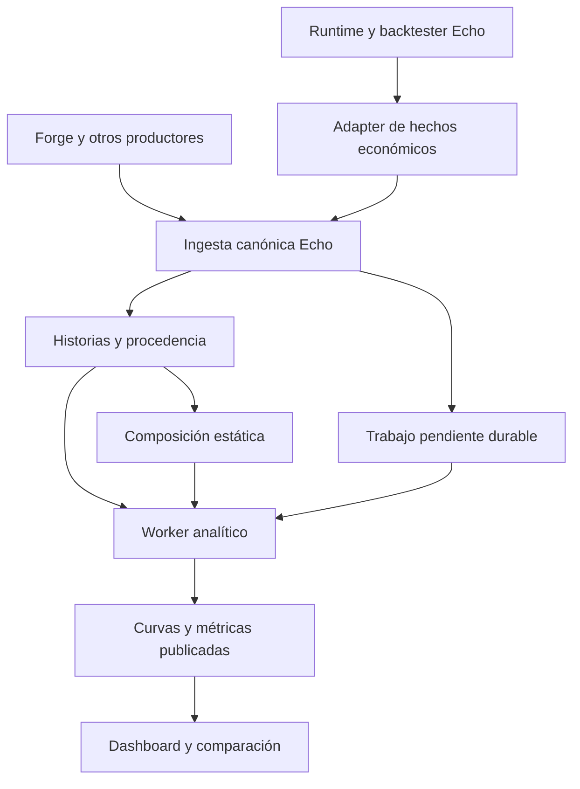

# The Lab V4 — Diseño para revisión con el mánager

**Estado:** propuesta completa de producto y arquitectura; pendiente de validación y freeze del mánager y del Owner. No constituye autorización de implementación ni certificación del sistema desplegado.

**Fecha del diseño:** 20 de octubre de 2026, America/Santiago. **Owner:** KoR / Rodrigo Jara. **Alcance:** Shot 1, descubrimiento y diseño. **Repositorio Echo inspeccionado:** `xKoRx/echo@d74b652500e673fc2bf4289f9f195f11960ba26e`. **Corte de Agents-OS consultado por root:** `8a9d8f3207b494d8aefd9476103f4776ec086542`; algunas referencias históricas se inspeccionaron en el corte anterior `dacfd7310409b502c1cb000818b0e900f7118333`.

Este documento consolida requisitos, decisiones, modelo, contratos, arquitectura, migración, aceptación y plan de ejecución. Es el handoff de diseño del proyecto existente, sin crear otra autoridad de planificación. Las respuestas del Owner en la única ronda de preguntas prevalecen sobre antecedentes históricos. Las decisiones técnicas nuevas están identificadas como propuestas; no se atribuyen al Owner por haberlas recomendado aquí.

## Resumen de la propuesta

The Lab será la base analítica común de Echo para conservar evidencia de estrategias, generar curvas bajo reglas explícitas, comparar resultados y alimentar la construcción de portfolios. La unidad de catálogo será la estrategia y su versión; la unidad económica comparable incluirá además su MM, historia y perfil de cálculo.

La primera iteración entrega, en este orden, **estructura de datos y contratos → integración canónica de Forge y otros productores → dashboard de estrategias → composición estática sobre historias existentes**. Quedan fuera de esta iteración el scheduler de portfolios, la selección y rotación automática, el backtest de membresía dinámica y la aplicación operacional de asignaciones. La simulación que cambia entradas, salidas o comportamiento MM reutilizará el motor correspondiente de Echo.

La arquitectura propuesta conserva las autoridades de identidad y ejecución de Echo, utiliza PostgreSQL para hechos analíticos y trabajo pendiente, calcula derivados mediante un worker acotado y expone una sola experiencia de Lab. No requiere un nuevo sistema de mensajería, un registro paralelo de estrategias ni un framework de plugins.

Las cuatro decisiones que sostienen el diseño son:

1. Separar **identidad, procedencia, período temporal, modalidad de ejecución y perfil económico**. SQX, MT5 y Echo son procedencias; no definen por sí solas la fase histórica ni la comparabilidad.
2. Conservar una historia principal y alternativas identificables. La vista continua une la selección principal con la referencia Echo bajo una política explícita de cobertura y solapes.
3. Definir la curva normalizada como **capital virtual 10k + porcentaje común + riesgo inicial probado + tratamiento causal de las aperturas**, diferenciándola del PnL monetario observado.
4. Publicar curvas y métricas completas contra una revisión exacta de sus insumos. Una corrección nunca debe producir una pantalla que mezcle resultados de dos revisiones.

---

# A. V4 Product Vision & Requirements

## A.1. Requisitos confirmados

| ID | Decisión confirmada | Consecuencia en el diseño |
|---|---|---|
| O01 | Comparar preconstrucción, postconstrucción anterior a Echo e historia Echo; también pre frente a post agregado | Cortes temporales explícitos, vistas por etapa y vista `POST = POST_PRE_ECHO + ECHO`, con procedencia visible |
| O02 | Forge entrega datos ya procesados en el contrato que exige Echo | La frontera de Echo valida un DTO canónico; los parsers de SQX/MT5 pertenecen al productor |
| O03 | Importar varias historias, elegir una principal y actualizar cualquiera posteriormente | Identidad estable por historia, selección principal y actualización con concurrencia controlada |
| O04 | Comparar estrategias con R y una curva normalizada sobre 10k | Algoritmos versionados y perfil común; se elimina el supuesto de “100 por entrada” |
| O05 | Registrar referencias reales y teóricas, incluidas estrategias nativas de futures | Rol de referencia separado de modo live/backtest/replay y de tipo de instrumento |
| O06 | Seleccionar estrategia/versión con MM; rankings multifactor y diferentes calendarios | Contexto MM explícito hoy; política de ranking, scheduler y rotación en I2 |
| O07 | Simulación inicial de composición/asignación sobre historias existentes | Portfolio estático con una contabilidad de capital definida y resultados reproducibles |
| O08 | Cambiar el comportamiento MM reutiliza parte del motor existente | Lab consume resultados del motor; no crea otro intérprete de estrategias |
| O09 | Estrategias desechables y futuras rotaciones | Retiro y fechas de elegibilidad sin borrar evidencia; automatización posterior |
| O10 | Dashboard completo, creación por endpoint y actualización de historia | Ingesta y consulta son entregables de I1; aceptar una historia no activa trading |
| O11 | Catálogo previsto de 10k–20k estrategias, múltiples símbolos y timeframes | Consultas paginadas, derivados persistidos y trabajo dirigido; prueba separada de capacidad operacional |
| O12 | Diseño modular, clean, KISS y YAGNI | Pocos módulos, autoridad única por dato y extensiones sustentadas en necesidades concretas |

Los ejemplos “top 5 de los últimos tres meses, rebalanceado mensualmente” o “selección diaria sobre una semana” son casos de uso. No fijan defaults universales de número de componentes, lookback o frecuencia.

## A.2. Alcance por iteración

| Capacidad | I1 | I2 / posterior |
|---|---|---|
| Registro común de estrategia/versiones de distintos orígenes | Sí | Evolución compatible |
| Ingesta y actualización de historias principales y alternativas | Sí | Actualizaciones incrementales externas si la carga real las exige |
| Curvas R, dinero observado y normalización porcentual 10k | Sí, condicionadas a datos suficientes | Nuevos perfiles bajo el mismo contrato |
| Métricas, comparación de etapas y dashboard | Sí | Más métricas y análisis de selección |
| Evidencia de referencia real/teórica y enlaces para evaluar copias | Sí | Analítica avanzada de ejecución conforme exista evidencia |
| Comparación básica de copias por estrategia y broker | Propuesta acotada a enlaces explícitos y evidencia disponible en los adapters incluidos | Modelos de impacto/capacidad más elaborados |
| Composición estática de historias existentes | Sí | Capital compartido con admisión/margen mediante simulación correspondiente |
| Ranking automático, Top N, calendario de rebalanceo y rotación | Modelo preparado; sin servicio automático | I2 |
| Backtest causal de portfolio dinámico | No | I2 con catálogo y datos disponibles en cada fecha |
| Ejecutar otro MM que cambia la secuencia de operaciones | No como nuevo motor Lab | Integración con runtime/backtester existente |
| Aplicar pesos a cuentas, abrir/cerrar posiciones o automatizar retiro | No | Proyecto operacional específico |
| Certificar reglas vigentes de Darwinex, Axi o una prop | No | Perfiles específicos y evidencia intradía cuando se aborde cada destino |

La captura de metadata de referencias pertenece a I1. La comparación básica de copias es una propuesta técnica acotada a evidencia ya disponible o producida por los adapters incluidos; no obliga a completar otro subsistema operacional de captura ni correlación heurística. Si faltan enlaces, el panel informa cobertura e insuficiencia sin bloquear el recorrido de rendimiento. Las capacidades de copia dependen del detalle recibido: una historia de resultados cerrados puede alimentar rendimiento sin ser apta para deslizamiento por fill. El dashboard debe expresar esa diferencia en cada análisis, sin bloquear toda la estrategia.

## A.3. Resultado observable de I1

Una estrategia puede llegar desde Forge, una carga preForge o un productor futuro; quedar registrada con su versión e historias; generar curvas; aparecer en el catálogo; mostrar comparación pre/post; incorporar referencia Echo; y participar en una composición estática. Una actualización preserva identidad, invalida únicamente los derivados afectados y publica una nueva generación coherente. Una estrategia retirada continúa presente en análisis históricos que la referencian.

---

# B. V4 Domain & Analytical Model

## B.1. Autoridad y conceptos mínimos

| Concepto | Significado y autoridad | Identificación / invariantes |
|---|---|---|
| Strategy | Identidad canónica compartida de Echo | Se reutiliza el registro de Echo; alias y referencias externas no crean identidades rivales |
| StrategyVersion | Definición inmutable de una versión | Referencia sellada; cambios de definición producen otra versión, no sobrescritura |
| EvaluationContext | Contexto económico de una historia: versión, MM y ejecución | Puede representarse como campos y digest; no requiere agregado ni servicio nuevo |
| History | Conjunto identificable de evidencia económica y su cobertura | `history_id`, versión, contexto, procedencia y head de revisión |
| HistorySelection | Elección principal y segmentos que forman la vista continua | Referencias exactas a historias y cortes; alternativas conservadas |
| Operation | Ciclo lógico de la estrategia bajo su MM | Identidad estable, independiente del neteo físico de la cuenta |
| EconomicMovement | Realización o coste que modifica el resultado de una operación | Identidad, tiempo económico, importe/moneda y trazabilidad; opcional si sólo existe resumen cerrado |
| Curve | Derivado bajo un algoritmo y configuración conocidos | Historia/selección + contexto + algoritmo/versión + configuración |
| MetricResult | Resultado de una definición sobre curva/hechos y ventana | Definición, versión, unidad, ventana, revisión y estado explícitos |
| StaticPortfolio | Composición manual persistida con reparto inicial de capital | Miembros, pesos, perfil, revisión y referencias exactas a insumos |

Cardinalidades: una estrategia tiene una o más versiones; una versión puede tener varias historias y contextos MM; una historia contiene cero o más operaciones y cada operación cero o más movimientos. Una historia o selección puede alimentar varias curvas, cada una con generaciones y métricas por ventana. Un portfolio referencia varios componentes y una estrategia puede participar en varios portfolios.

La selección de estrategia/versión + MM se apoya en una historia compatible con ese MM. Pedir otro MM no transforma una historia existente en evidencia de su comportamiento.

### Registro común de versiones

El repositorio actual de versiones restringe `TargetPlatform` a MT4/MT5 y exige hashes y manifest de un paquete ejecutable. Debe extenderse la autoridad común para versiones nativas y registros analíticos sin fabricar ejecutables o magics. Las referencias existentes y su receta de hash se preservan; los nuevos tipos usan una receta explícitamente versionada. Disponibilidad analítica y capacidad de ejecución son estados separados. [S05]

Campos de elegibilidad propuestos: estado activo/retirado, fecha efectiva y motivo. No hace falta un nuevo lifecycle complejo. El retiro excluye futuras selecciones según la política y conserva historia, resultados y referencias de portfolios. Cerrar operaciones abiertas es una decisión del dominio operacional.

## B.2. Los cortes temporales

Se conservan cuatro metadatos distintos cuando exista evidencia:

- `construction_at`: cuándo quedó construida/fijada esa versión para el uso que se analiza.
- `construction_data_cutoff`: hasta qué instante llegaron los datos utilizados para construirla o seleccionarla.
- `available_at`: cuándo la versión estuvo realmente disponible para selección en el sistema correspondiente.
- `echo_reference_started_at`: comienzo explícito de su referencia Echo.

No se sustituyen entre sí ni se infieren de la fecha de importación. `received_at` y la fecha de una corrección pertenecen a la trazabilidad de ingestión. Si una fecha histórica se desconoce, su estado es desconocido; el sistema no fabrica una condición forward.

**Propuesta de semántica temporal:** intervalos UTC cerrados por la izquierda y abiertos por la derecha.

| Etapa | Intervalo por defecto | Interpretación |
|---|---|---|
| PRE_CONSTRUCTION | `t < construction_at` | Historia anterior a la construcción de la versión |
| POST_CONSTRUCTION_PRE_ECHO | `construction_at ≤ t < echo_reference_started_at` | Historia posterior a la construcción y anterior a su referencia Echo |
| ECHO_PERIOD | `t ≥ echo_reference_started_at` | Período durante el cual existe la referencia Echo |

Si Echo aún no comienza, la segunda etapa queda abierta. Si el corte de construcción es desconocido, las vistas pre/post quedan no disponibles hasta recibirlo. Datos inconsistentes, como un inicio Echo anterior al corte de construcción declarado para esa misma versión, requieren corregir metadatos o declarar el contexto histórico correcto.

La etapa temporal no certifica el origen de la evidencia. Un backtest MT5 que cubre fechas de `ECHO_PERIOD` sigue siendo un backtest de MT5. Sólo los hechos procedentes de la referencia Echo se presentan como ejecución Echo. Las etiquetas IS/OOS/holdout, cuando se conozcan, son otra dimensión relacionada con los datos de construcción; no se deducen automáticamente del nombre de la etapa.

### Operaciones que cruzan un corte

La apertura determina la cohorte de una operación; cada realización conserva su fecha económica. Una operación que abre antes de construcción y cierra después sigue perteneciendo a su cohorte de apertura, pero su beneficio no se mueve artificialmente al período anterior.

Por ello existen dos consultas explícitas:

- **Rendimiento temporal:** movimientos reconocidos dentro de `[from, to)`; describe la curva durante esa ventana.
- **Resultado por cohorte:** operaciones abiertas en una etapa; incluye movimientos con tiempo económico hasta el `as_of` solicitado sobre la revisión de datos identificada y señala operaciones todavía abiertas.

En I1, `as_of` es un corte del tiempo económico sobre una revisión explícita de insumos: excluye cierres con fecha económica posterior, pero no demuestra qué correcciones se conocían entonces. Una revisión recibida hoy puede corregir un importe de ayer. Esa consulta se identifica como reconstrucción retrospectiva con la revisión elegida. Certificar la información realmente disponible en una fecha exige además el contenido y las fechas de disponibilidad de las revisiones; I2 deberá demostrarlo antes de certificar un selector causal.

## B.3. Historia principal y alternativas

Cada historia tiene su propio ID, contexto MM, procedencia, modo, cobertura y revisión. Su propietario de escritura se fija al crearla: productor externo autenticado o adapter interno Echo. Cada mutación valida namespace y propietario; la procedencia interna se establece desde el contexto del servicio y no se confía a campos del body. Un productor externo no puede reemplazar una historia de runtime Echo. Las correcciones de hechos operacionales provienen de su autoridad original; Lab no modifica fills fuente ni el journal. Una es principal dentro del contexto elegido; las secundarias no se suman a ella. La vista continua referencia la principal en los períodos importados y la referencia Echo desde su corte, preservando las fuentes elegidas.

Cada segmento fija versión de estrategia, contexto MM y perfil económico. Una historia principal con MM A seguida de referencia Echo con MM B conserva la discontinuidad de contexto; no se presenta como deterioro de una política inalterada. La unión homogénea requiere compatibilidad explícita de esos contratos.

La selección puede cambiar de forma explícita. Su digest forma parte de los insumos de curvas y portfolios. Una comparación anterior conserva la selección que utilizó.

No se concatenan fuentes por conveniencia. En intervalos superpuestos se aplica la selección de segmentos declarada. Para una operación abierta antes de la frontera, se conserva su continuidad de origen hasta su terminación; si existe un traspaso a Echo, se exige un enlace de identidad que permita unir o deduplicar los hechos. Sin ese enlace, la operación se conserva como evidencia de su fuente y la vista compuesta declara el hueco o conflicto en la frontera. No se presenta como una continuidad económica demostrada.

Cobertura significa intervalo efectivamente observado, no simplemente primera y última operación. Un período cubierto sin actividad produce cero retorno; un período sin datos produce ausencia. El productor declara cobertura y la validación comprueba su consistencia. Los calendarios y sesiones se identifican cuando la métrica los requiere.

## B.4. Grano económico y nuevo motor de ejecución

El ciclo lógico `Operation` es la unidad de evaluación de resultados, aunque contenga múltiples entradas, fills parciales, reducciones y reentradas. Una posición física neta puede agregar varias operaciones; no sirve como sustituto de sus identidades.

La evidencia admite dos niveles:

1. **CLOSED_SUMMARY:** resumen procesado de una operación cerrada, con apertura, cierre, resultado neto, moneda, riesgo si existe y procedencia. Permite curvas de balance con la precisión del resumen.
2. **ECONOMIC_MOVEMENTS:** operación con realizaciones/costes, enlaces de órdenes/fills e información de estado. Permite parciales, resultados abiertos conocidos y análisis de ejecución según campos disponibles.

No se suman ambos niveles para la misma operación. El resumen es un total reconciliable o el único dato económico disponible; cuando hay movimientos completos, éstos producen el total. No se inventan fills para representar un resumen importado.

Cada movimiento es un delta firmado de resultado: `REALIZED_PNL` representa resultado bruto realizado; `COMMISSION`, `FEE` y `SWAP` representan su impacto firmado, normalmente negativo y positivo cuando hay abonos. No se admite una realización neta que incluya un coste entregado también como movimiento independiente. En una operación terminal con movimientos completos, `net_pnl = suma(amount_signed)` bajo su moneda y precisión declaradas; `CLOSED_SUMMARY` aporta el neto una sola vez al cierre.

Cada movimiento tiene `movement_id`, `operation_id`, tiempo económico, tipo, importe exacto, moneda, referencia al hecho origen y revisión/provenance. La economía se recibe procesada: el adapter de runtime debe producir las realizaciones conforme al contrato de instrumento y su método documentado. Lab valida conservación y coherencia; no se convierte en otro motor de trading.

La operación debe conservar versión de estrategia, MM/configuración sellada, instrumento/contrato, cuenta cuando corresponda, run y riesgo normalizador probado. El contrato `Operation` inspeccionado conserva órdenes y MM snapshots, pero todavía no garantiza un campo genérico explícito de riesgo inicial ni una referencia universal de versión. El adapter debe capturar esa evidencia en origen, no buscar posteriormente la configuración vigente. [S06]

## B.5. Referencia y ejecución de copias

Se separan `reference_role` —referencia real, referencia teórica o ejecución observada— y `execution_mode` —live, backtest o replay—. Una referencia teórica declara modelo de precio, costes, datos, versión y momento de disponibilidad de la información. No utiliza el mejor precio elegido después del evento.

Para copias, la relación mínima es oportunidad/intención → orden de referencia → orden/fills de ejecución, con operación, estrategia/versión, MM, broker, cuenta e instrumento. La identidad de broker no se usa como identidad de cuenta. Se permiten varios proveedores y cuentas por estrategia.

El análisis básico separa:

- Cobertura de copia: oportunidades esperadas, ejecutadas, omitidas, rechazadas y sin correlación suficiente.
- Diferencia de precio adversa sobre cantidades realmente comparables.
- Latencia donde haya relojes y timestamps compatibles.
- Comisiones, swap y otros costes identificados.
- Diferencias de cantidad o política MM, que tienen su propia atribución.

Para una orden de compra, deslizamiento adverso de precio = `precio_ejecución − precio_referencia`; para venta se invierte el signo. Se usa precio ponderado por cantidad de los fills emparejados, con la misma regla de referencia. Convertir a dinero requiere cantidad, multiplicador y moneda coherentes. Una omisión no tiene slippage cero; una diferencia de PnL entre MMs no prueba deslizamiento.

El emparejamiento ambiguo queda marcado como tal. En I1 no se incorpora un algoritmo probabilístico de correlación. Se muestran cobertura y exclusiones junto a cualquier promedio por estrategia o broker.

---

## B.6. Curvas, normalización y métricas

### B.6.1. Qué se recuperó de la documentación

Los antecedentes inspeccionados contienen definiciones distintas; no hay una única definición histórica congelada de “10k porcentual”.

| Antecedente | Definición verificada | Implicación |
|---|---|---|
| RFC-004, §12 | Base100, riesgo estándar configurable con preset 1%; `C_i = C_(i−1) × (1 + R_i × r)` | Existió la idea de normalización porcentual; no se especifica causalidad de aperturas simultáneas |
| RFC-009 | `10.000 + suma del PnL neto observado` bajo una policy operativa homogénea | La base 10k posterior no normaliza por sí sola riesgos distintos |
| Motor `sdk/analytics/curve` del baseline | R monetario acumulado y dinero acumulado; R pips insuficiente sin especificación | La curva porcentual 10k requiere un algoritmo y contrato V4 explícitos |

Fuentes: [S01], [S02], [S03]. El valor histórico de riesgo fijo mencionado por RFC-009 no se convierte en default V4. Tampoco se conserva la interpretación descartada de “100 por entrada”.

### B.6.2. Catálogo inicial de perfiles

| Perfil | Fórmula / base | Uso y requisitos |
|---|---|---|
| `r_net_cumulative.v1` | `Σ(delta_resultado_ij / riesgo_base_i)` por movimiento, o neto al cierre cuando sólo hay resumen | Comparación en R; denominador positivo y semántica compatible por operación |
| `recorded_money.v1` | `Σ PnL_neto` o balance inicial explícito + flujos | Dinero observado en una misma moneda; no normaliza MM |
| `normalized_10k_open_balance.v1` | Presupuesto porcentual sobre balance virtual conocido al abrir | Propuesta principal para comparación porcentual, con reinversión causal |
| `normalized_10k_initial_balance.v1` | Presupuesto porcentual constante sobre el capital inicial | Variante sin reinversión; comparación separada |

Rebasar visualmente una curva a 100 o 10k es una transformación de presentación. No cambia su perfil económico ni hace comparables datos que antes no lo eran. El selector de curvas distingue dinero observado, balance virtual y R; no denomina a todos “equity”.

### Riesgo normalizador

Para la operación `i`, `Q_i > 0` es el riesgo monetario o presupuesto económico definido y sellado en la apertura. `R_i = PnL_neto_i / Q_i`. En una operación con entradas adicionales, `Q_i` representa el presupuesto del ciclo bajo un método identificado; el SL de la primera entrada no se considera automáticamente riesgo de todo el ciclo.

Si una política no define un presupuesto inicial apto para ese cociente, esa historia no tiene R comparable bajo ese perfil. Se conserva el PnL observado y el motivo de insuficiencia. No se reconstruye el riesgo a partir del stop final ni de pérdidas efectivamente ocurridas.

Con movimientos completos, la curva R incorpora cada delta en su fecha económica, incluidos parciales y costes de operaciones todavía abiertas. Con resumen cerrado, agrega el R total al cierre. Win rate, expectancy y profit factor por operación utilizan ciclos terminales evaluables, no convierten parciales en trades. Curva y métricas declaran su precisión temporal y universo.

Un cambio posterior del plan de riesgo se registra como parte del MM y puede exigir otra definición de R; no reescribe retroactivamente el denominador inicial del perfil. Dos métodos de denominador incompatibles no entran en el mismo ranking sin una política explícita.

### B.6.3. Propuesta de curva 10k porcentual

**Preset propuesto para validación:** `C0 = 10.000` unidades virtuales y `r = 0,01`. El 1% recupera el antecedente RFC-004; es configurable y todavía no está ratificado como default V4 por el Owner.

Para cada operación:

```text
B_i = r × C_realizado(t_apertura_i −)
B_i queda sellado durante toda la operación
ΔR_ij = delta_resultado_ij / Q_i
ΔC_ij = B_i × ΔR_ij
C_t = C0 + suma de ΔC realizados hasta t
```

`B_i` es presupuesto de riesgo, no un gasto ni una retirada de capital. El balance sólo cambia por movimientos económicos. Dos operaciones simultáneas pueden recibir cada una el 1% del mismo balance conocido; limitar riesgo agregado o margen es otra política, fuera de este comparador.

Orden causal: si los eventos de un mismo instante poseen una secuencia de origen fiable, se respeta. Si no la poseen, todas las aperturas de ese timestamp utilizan el balance inmediatamente anterior y después se aplican sus realizaciones/costes. Un ID lexicográfico sirve para salida determinista, pero no inventa causalidad económica.

Ejemplo con operaciones sucesivas de `+2R` y `−1R`:

```text
10.000 → presupuesto 100 → 10.200
10.200 → presupuesto 102 → 10.098
```

Si ambas abrieron antes de conocer sus resultados, cada presupuesto es 100 y el final es **10.100**. Aplicar un producto por orden de cierre habría utilizado información que no existía al abrir la segunda operación.

“Causal” describe aquí la reconstrucción según tiempos económicos sobre la revisión seleccionada. No certifica disponibilidad histórica de toda la información: una comisión o corrección recibida tarde puede recalcular presupuestos posteriores en una nueva revisión. El resultado anterior conserva sus insumos; I2 debe incorporar el corte de conocimiento antes de atribuir esta reconstrucción a decisiones que realmente podían tomarse entonces.

La variante sobre capital inicial calcula `B_i = r × C0` para todas las operaciones. Tiene su propio identificador y no sustituye silenciosamente a la variante causal cuando faltan aperturas.

### Costes, datos incompletos y capital agotado

El R neto incluye costes conocidos una sola vez. Escalar R neto es una transformación algebraica para comparación: no reproduce automáticamente mínimos de lote, comisiones fijas, rechazos, margen ni impacto de volumen. Una simulación ejecutable debe producir nueva evidencia mediante el motor apropiado.

Si faltan riesgos o fechas necesarios para operaciones incluidas, el perfil normalizado completo queda `INSUFFICIENT_DATA`; no se omiten esas operaciones y se rankea el resto como equivalente. La historia puede seguir válida para otros perfiles. La UI informa cantidad y motivo de faltantes.

Si el balance llega a cero o negativo, se conserva la pérdida observada, se marca `CAPITAL_EXHAUSTED` y no se calculan presupuestos nuevos negativos ni se recorta artificialmente la curva. Las operaciones ya presupuestadas conservan sus movimientos. Las siguientes aperturas no simulables impiden presentar el tramo restante como una curva completa; el prefijo calculable permanece visible con estado explícito.

Con sólo resúmenes cerrados se calcula balance realizado por cierre. Sin marcas de posiciones abiertas no se certifican drawdown de equity, pérdidas intradía ni cumplimiento de límites sensibles al flotante.

### B.6.4. Comparabilidad como contrato

Dos resultados se presentan como comparables cuando coinciden o tienen una transformación declarada en: unidad de operación, definición de riesgo, perfil económico/versión, tratamiento de costes, ventana y calendario, precisión de realizaciones y cobertura suficiente. Las diferencias restantes se muestran junto al resultado.

El identificador de una curva incluye:

```text
namespace + strategy_version_ref + evaluation_context_digest
+ history_or_selection_id + algorithm_id + algorithm_version + config_digest
```

La generación publicada fija además `input_revision`, `input_digest`, fecha de cálculo y versión de definiciones. La identidad de curva no se reemplaza por un hash opaco sin metadatos legibles.

### B.6.5. Métricas iniciales y extensibilidad

Cada definición contiene `metric_id`, `definition_version`, unidad, requisitos, función y estados posibles. Un registro de implementaciones Go y tipos pequeños basta; no se propone un lenguaje o plataforma de plugins.

| Familia | Métricas iniciales | Semántica necesaria |
|---|---|---|
| Muestra | Operaciones cerradas, abiertas, rechazadas; cobertura y exclusiones | Rechazos sin fills no entran en win rate |
| Resultado | PnL neto, R neto, retorno normalizado | Unidad y perfil visibles |
| Distribución | Expectancy por operación, win rate, ganancia/pérdida media, profit factor | Win rate = ganadoras / cerradas evaluables, incluyendo ceros en denominador; ceros informados aparte |
| Riesgo realizado | Máximo drawdown, drawdown actual, recuperación y tiempo bajo máximo | Máximo inicial incluye `C0`; R usa drawdown absoluto en R, sin dividir por una base cero |
| Actividad | Frecuencia y duración cuando los timestamps/cobertura lo permiten | Calendario y tiempo observado definidos |
| Variación | Pre/post y por ventanas: diferencias absolutas y relativas | Si el denominador es cero, diferencia relativa no definida |
| Ejecución | Slippage, latencia, costes y cobertura de copia | Sólo sobre hechos correlacionados y unidades compatibles |

PF sin pérdidas, ratios con drawdown cero o métricas con muestra insuficiente no se convierten en cero ni en un número arbitrariamente grande. El resultado devuelve `DEFINED`, `NO_OBSERVATIONS`, `INSUFFICIENT_DATA` o `UNDEFINED`, más razón y metadatos. Sharpe/Sortino anualizados se agregan cuando exista una serie de retornos y calendario especificados; no son requisito del catálogo mínimo.

Cada consulta fija `[from, to)`, `as_of` económico, revisión de insumos, base económica y calendario. La métrica declara además su estado inicial: `window_local` inicia el máximo en el balance inmediatamente anterior a `from`, mientras `curve_running` arrastra el máximo histórico previo. El drawdown local de la ventana y el drawdown vigente de toda la curva son resultados distintos; filtrar una pantalla no cambia silenciosamente su significado. El retorno de un tramo usa su balance inicial positivo, cuando esté definido, y las curvas en R/dinero sin capital base no generan porcentajes inventados. Un límite de deterioro fija también esta política de estado inicial. “Últimos 7 días”, “semana calendario” y “último mes calendario” son ventanas diferentes. Las comparaciones pre/post deben mostrar tamaño de muestra y duración; no interpretar iguales niveles de confianza por mostrar el mismo indicador.

### Preparación de criterios de deterioro

El modelo permite consultar una métrica actual contra una referencia explícita: métrica/versión, sentido del límite, baseline, ventana y distancia. Por ejemplo, drawdown límite 8R y actual 7,2R permiten mostrar **90% consumido y 0,8R disponible**. Eso es proximidad a un límite, no probabilidad de ruptura.

No se construye un score universal ni un scheduler en I1. Una futura política multifactor fijará transformaciones, pesos, métricas obligatorias, cobertura mínima y desempate determinista; valores ausentes no recibirán puntuaciones favorables por accidente.

---

# C. V4 Architecture & Data Design

## C.1. Componentes y dependencias



El adapter interno de Echo utiliza el mismo servicio de aplicación y las mismas invariantes de ingestión; no necesita hacer HTTP contra sí mismo. Forge conserva su adapter del lado productor. El motor operacional mantiene su journal y sus mecanismos de recuperación existentes; el diagrama no los sustituye.

Módulos propuestos, dentro de las aplicaciones actuales:

| Módulo | Responsabilidad | Límite |
|---|---|---|
| Registry / history application | Identidad común, contratos, selección de historia e ingestión | No conoce modelos internos de Forge ni decide posiciones |
| Curve engine | Transformaciones económicas puras sobre hechos y perfiles | No consulta repositorios desde el algoritmo |
| Metrics | Definiciones, ventanas, requisitos y resultados | No crea un lenguaje de fórmulas en I1 |
| Execution comparison | Correlación explícita y atribución básica de copias | No inventa correspondencias ni estrategias de ejecución |
| Static composition | Capital inicial, miembros, pesos e inputs fijados | No selecciona ni rota automáticamente |
| PostgreSQL adapters / worker | Persistencia, concurrencia, cola y publicación | No concentra decisiones de negocio en SQL opaco |
| Gateway / read models / Vue | Contratos de escritura y experiencia analítica | No recalcula métricas financieras en el navegador |

Se reutilizan gateway Go, PostgreSQL, worker y frontend existentes. Hasura puede exponer read models y permisos; las mutaciones de negocio pasan por el servicio Go. Se aprovechan contratos y utilidades útiles de `sdk/analytics/curve`, tras adaptar su modelo. El antiguo `sdk/lab` no obliga a conservar la arquitectura anterior. [S03], [S08a], [S08b]

## C.2. Persistencia propuesta

Los nombres siguientes son una propuesta de destino para revisar junto al inventario de consumidores; no son migraciones ejecutadas.

| Grupo | Tablas / almacenamiento | Autoridad |
|---|---|---|
| Identidad | Registro existente de identidades y versiones Echo, ampliado | Echo Foundation |
| Historia aceptada | `echo.strategy_histories`, `echo.strategy_history_operations`, `echo.strategy_history_movements` | Servicio de historia Echo |
| Selección principal | Referencias y segmentos asociados a versión/contexto | Servicio de historia Echo; puede vivir en un pequeño registro propio |
| Recepción | Receipt durable de ingestión, clave de idempotencia y resultado | Gateway / servicio de ingestión |
| Derivados | `lab.curves`, `lab.curve_points`, `lab.metric_results` | Worker Lab |
| Trabajo | `lab.jobs` con tipo, insumos, lease, intentos y estado | Worker Lab |
| Composición | `lab.portfolios`, `lab.portfolio_members` y resultados referenciados | Lab, sin autoridad sobre cuentas |
| Proyección operacional genérica | Esquema `execution` para operaciones, órdenes, fills y observaciones | Proyector del runtime Echo |

Las operaciones de una historia se identifican por namespace, historia e ID estable del productor. El mismo ciclo puede figurar en una historia alternativa sin que eso autorice sumarlo dos veces en una selección compuesta. Los movimientos tienen identidad estable dentro de su operación/historia.

Los campos usados para filtrar, ordenar, enlazar y calcular se tipan en columnas. JSON se reserva para configuración algorítmica, provenance y extensiones acotadas. Importes y cantidades usan representación decimal exacta; la serialización no convierte valores monetarios en `float64` accidentalmente.

No se propone una entidad pública `HistoryRevision`: un head monotónico, hashes de contenido y receipts resuelven concurrencia. Para reproducir un resultado retenido se conserva su input canónico exacto o una referencia inmutable comprobable al artefacto correspondiente. Un hash sin el contenido no basta. Se reutiliza el almacenamiento de artefactos existente cuando corresponda, sin crear infraestructura nueva.

Las revisiones que siguen referenciadas por resultados guardados no se eliminan como parte de una limpieza de cache. La política de retención distinguirá datos fuente, snapshots fijados por resultados y generaciones transitorias de cálculo. Esto no certifica todavía un catálogo histórico completo apto para backtests causales de selección; I2 debe verificar esa capacidad con evidencia.

## C.3. Cálculo y publicación

La escritura acepta datos canónicos válidos, actualiza el head e inserta trabajo pendiente **en una misma transacción**. El cálculo costoso sucede fuera del lock de historia.

Secuencia propuesta:

1. El worker reclama un trabajo con transacción corta, lease y token de intento.
2. Lee un snapshot coherente de insumos y su digest; libera la transacción antes del cálculo largo. Puede volcar el snapshot a un archivo de trabajo para limitar memoria.
3. Calcula puntos y métricas para una generación nueva, todavía invisible como vigente.
4. Para resultados que siguen el head, publica en una transacción únicamente si todas las revisiones/digests del manifiesto de entrada siguen vigentes y el intento conserva su lease válido. Los cálculos fijados expresamente a inputs históricos se guardan como resultados de esos inputs; no se promocionan como resultado current por ignorar cambios posteriores.
5. Cambia el puntero de generación activa junto con su estado y métricas. Una generación obsoleta no reemplaza una más reciente.

`SKIP LOCKED` es adecuado para reclamar filas de una cola con consumidores concurrentes, no para leer una historia consistente. Las lecturas que fijan un snapshot usan aislamiento y orden adecuados. [S12], [S13]

Cada cálculo fija un manifiesto pequeño de insumos: revisiones/digests de todas las historias consumidas, revisión de selección, revisión de composición cuando corresponda y versiones de perfiles/algoritmos. La publicación verifica atómicamente todas las dependencias mutables y el token de intento. Los escritores y el publicador usan el mismo protocolo de locks/CAS, en orden determinista, cubriendo el intervalo hasta cambiar el puntero activo; un SELECT de verificación seguido de una escritura sin protección no basta. Mutar selección o composición invalida y encola sus dependientes en la misma transacción.

Para derivados que siguen el head, los cambios pendientes de un objetivo se agrupan manteniendo el objetivo más reciente (`desired_seq` y manifiesto esperado). El worker omite trabajos superados antes de calcular y, si pierde CAS, garantiza que siga pendiente la revisión vigente. No ejecuta todas las revisiones intermedias de un feed rápido. Los cálculos fijados a inputs históricos no se agrupan con trabajos de “última versión” y conservan la revisión solicitada. La deduplicación de esos cálculos se realiza por objetivo y digest de insumos. La cola reintenta fallos recuperables con límite y conserva el error; un lease vencido permite recuperación. No se añade Kafka o Temporal para esta cola. Si el adapter operacional consume eventos de la infraestructura que Echo ya tiene, se conserva ese mecanismo existente.

Una corrección histórica puede obligar a recalcular toda la curva porcentual de esa historia por dependencia del balance. En I1 se permite reconstruir el historial afectado completo; no se recalculan todas las estrategias. Una optimización incremental sólo entra después de medir necesidad y probar equivalencia.

Mientras se calcula, puede seguir visible la última generación completa con `STALE` y la revisión que representa. El frontend no mezcla puntos antiguos con métricas nuevas. Una curva rechazada por falta de datos conserva una razón legible y no queda indefinidamente en “cargando”.

## C.4. Escala y consultas

El objetivo es un catálogo de 10k–20k estrategias con sus versiones, historias y perfiles. No equivale a una certificación de 20k instancias de runtime concurrentes. El dimensionamiento operacional exige otro benchmark de cuentas, feeds, frecuencias, MM y carga real.

Medidas de I1:

- Catálogo paginado por cursor y orden estable; filtros sobre columnas/indexes y métricas publicadas.
- Puntos de curva limitados por rango y resolución para visualización; descarga/detalle exacto paginado. La reducción visual no recalcula ni altera métricas exactas.
- Perfiles por defecto acotados; ventanas adicionales se calculan bajo demanda y se cachean con su revisión.
- Jobs con concurrencia y memoria acotadas; prioridad para actualizaciones recientes y trabajo interactivo.
- Índices por namespace, versión/historia, tiempo económico y claves de metric/window; particionado sólo si las mediciones lo justifican.
- Consulta explícita de frescura, cobertura, revisión de insumos y última generación.

Con 20.000 estrategias existen `20.000 × 19.999 / 2 = 199.990.000` pares. No se materializa una matriz universal de correlación en I1. Se calculan pares sobre un conjunto filtrado y acotado de candidatos o miembros de portfolio.

La correlación se aplica a retornos o incrementos de R en una grilla temporal común y bajo perfiles compatibles; correlacionar niveles acumulados de curvas puede producir una comparación engañosa. Deben declararse ventana, intersección de cobertura, cantidad de muestras y varianza. Sin datos no se rellena con cero; dentro de cobertura confirmada, ausencia de actividad sí puede producir cero. Si la serie es constante o la muestra insuficiente, la correlación queda no definida.

El benchmark previo al freeze fijará SLOs numéricos sobre hardware y distribución reales de longitud de historia. No se promete una latencia sin ese contexto. El gate deberá medir catálogo de 20k, ingestión representativa, cola bajo carga y correcciones, sin cargar todas las historias en una solicitud ni calcular todos los pares.

---

# D. V4 Current State & Impact Matrix

## D.1. Hallazgos verificados

El contrato actual de historia ya recibe datos canónicos: Echo no parsea archivos internos SQX. Sin embargo, acopla `training` a SQX, `pre_real` a MT5 y cada fila a un único trade completo cerrado. El nuevo trabajo consiste en separar fuente, período, historia y grano económico. [S04]

El servicio actual recalcula hashes, evita trabajo si el contenido no cambia, serializa reemplazos y lee snapshots coherentes. Deben conservarse estas garantías. Falta una revisión esperada para detectar una actualización hecha sobre un head anterior y falta identidad para varias historias de la misma versión. [S07]

La proyección `echo.futures_operations` de la migración 066 tiene clave por `owner_key`; conserva el snapshot más reciente de ese propietario y no garantiza historial de todas sus operaciones. La misma migración permite MARKET/LIMIT en el check de tipo de orden, mientras el dominio inspeccionado incluye STOP_MARKET. Son brechas del baseline de código; no se verificó la BD desplegada. [S06], [S09]

## D.2. Matriz de intervención

| Superficie actual | Clasificación | Destino / justificación |
|---|---|---|
| Identidades y versiones Echo existentes | ADAPT | Extender registro genérico manteniendo IDs y recetas de versiones existentes |
| Resolución de instrumentos y decimales exactos | REUSE | Capacidades comunes necesarias; verificar contratos por consumidor |
| Promoción operacional Forge | ADAPT / OUT_OF_SCOPE parcial | Reutilizar autoridad común; conservar su significado de promoción y sus contratos congelados salvo cambio aprobado |
| `strategy-history.v1` | REPLACE | Nuevo contrato de historias por contexto, sin dos fuentes obligatorias ni una sola historia |
| Servicio actual de history replacement | ADAPT | Conservar validación/hash/atomicidad y agregar CAS por historia, receipts y jobs |
| `echo.canonical_operations`, `echo.strategy_history_state` | ADAPT / MIGRATE | Datos Echo Foundation: migrar o reingerir antes de retirar estructura vieja |
| `sdk/analytics/curve` | ADAPT | Reutilizar ideas puras y contratos válidos; incorporar nuevos perfiles/grano |
| `sdk/lab` y pipelines anteriores exclusivos de Lab | REPLACE → DELETE | Un único motor Lab V4; no conservar múltiples generaciones activas |
| Curvas/métricas V3 | REPLACE | Historial/contexto y múltiples ventanas por métrica, generaciones atómicas |
| Proyecciones genéricas con prefijo futures | ADAPT | Naming `execution` y retención por operación lógica; preservar datos/runtime |
| Adaptadores y contratos verdaderamente específicos de futures | REUSE / OUT_OF_SCOPE | El mercado real puede conservar naming específico |
| Front Lab Clean/V3 y estados de tabs anteriores | REPLACE → DELETE | Dashboard único y nuevo modelo de lectura |
| Componentes gráficos genéricos útiles | REUSE | Sólo si no arrastran semántica legacy |
| Tracking Hasura exclusivo de Lab antiguo | REPLACE → DELETE | Read models nuevos; verificar permisos y consumidores |
| Journals activos, configuración productiva, infraestructura y cuentas | OUT_OF_SCOPE | La sustitución de Lab no autoriza su destrucción |

`MIGRATE` describe el procedimiento de una fila clasificada ADAPT; las categorías de inventario de implementación permanecen `REUSE`, `ADAPT`, `REPLACE`, `DELETE`, `OUT_OF_SCOPE`.

## D.3. Naming del runtime genérico

Destino propuesto para conceptos realmente compartidos:

| Actual | Destino propuesto | Condición |
|---|---|---|
| `sdk/futures/domain` y lógica genérica de operaciones/MM | Paquetes bajo `sdk/execution` | Separar adaptadores específicos; no mover por búsqueda/reemplazo ciega |
| `echo.futures_operations` | `execution.operations` | Clave por operación lógica en su scope de namespace/run; retener operaciones terminadas |
| `echo.futures_orders`, `echo.futures_fills` | `execution.orders`, `execution.fills` | Preservar claves de proveedor, relación y procedencia |
| `futures_provider_decisions` | `execution.provider_decisions` | Misma autoridad del proyector |
| `futures_position_observations`, `futures_session_observations` | Equivalentes en `execution` | Observaciones físicas separadas de operaciones lógicas |
| `echo.futures.operation-facts.v1` | Topic genérico versionado, propuesto `echo.execution.operation-facts.v1` | Inventario de productores, consumidores y transición antes de activar |
| DTOs/interfaces genéricos con futures en el nombre | Equivalentes de execution | Renombre coherente, preservando semántica y recovery |

La clave completa debe reutilizar el scope real del runtime: namespace y run donde sean necesarios para aislar live, backtest y replay, más `operation_id`. El estado actual por propietario puede consultarse mediante índice/vista; no reemplaza el registro por operación. El proyector conserva la secuencia de origen para impedir regresiones por mensajes atrasados.

No se agrega una entidad operacional artificial “AnalyticalTrade” para satisfacer consultas. El modelo analítico puede agrupar/proyectar hechos de forma diferente sin duplicar su autoridad. La proyección SQL no sustituye al journal como autoridad de recuperación.

## D.4. Inventario acotado de retiro

Rutas confirmadas en el baseline para inspección de consumidores durante implementación:

- Backend: `v3/sdk/lab/`; `v3/lab-worker/internal/builders/`, `repo/`, `jobs/`; comandos `lab-worker`, `lab-canonical-a0`, `lab-materialize-pg`, `lab-recompute-pg`; `v3/sdk/postgres/lab_curve_repository.go`, `lab_curve_service.go`; jobs SQL `strategy_lab_v3.sql`, `account_lab_v1.sql`, `portfolio_lab_v1.sql`.
- Frontend: `v3/front/src/views/LabView.vue`; contenedores `StrategyLabCleanTabContainer.vue`, `StrategyCurveV3TabContainer.vue`; `components/lab/`; queries `strategyLabClean.js`, `strategyCurveV3.js`, `accountLabV3.js`, `portfolioLabV3.js`, `labExecutionScope.js`; providers `strategyLabCleanProvider.js`, `strategyLabScopeProvider.js`.
- Hasura: tablas metadata `canonical_history_readonly.yaml`, `lab_curves_v3.yaml`, `lab_clean.yaml`, `the_lab.yaml`, `strategy_portfolio_lab.yaml`, `canonical_analytics.yaml`; funciones metadata `lab_clean.yaml`, `the_lab.yaml`.

La existencia de una ruta no demuestra que sea eliminable íntegramente. Deben clasificarse consumidores compartidos, permisos, event triggers y autoridad de datos antes de borrar. En particular, los datos fuente de la migración 064 pertenecen a Echo Foundation y los modelos derivados de la 065 tienen otras garantías/consumidores. [S08a], [S08b]

## D.5. Migración y corte

Secuencia propuesta: crear estructuras nuevas → migrar o reingerir evidencia fuente → verificar conciliación y cobertura → validar lectura y curvas → cortar productores/consumidores al nuevo contrato → retirar superficies exclusivas anteriores.

Se admite una transición acotada para migración, con un único writer autoritativo por hecho. No se admite dual-write permanente ni convivencia indefinida de las experiencias V3/V4. El plan de rollback conserva originales y evidencia suficiente para restaurar el corte previo; el detalle depende del inventario real de despliegue.

La información que la proyección anterior ya sobrescribió sólo puede recuperarse de journals, artefactos o hechos originales todavía disponibles. Si no existen, se declara un hueco histórico. No se reconstruye una historia certificada a partir del último snapshot.

---

# E. V4 Technical SPEC

## E.1. Contrato canónico de ingestión

Rutas propuestas, versionadas para expresar el cambio semántico:

| Operación | Ruta propuesta | Resultado |
|---|---|---|
| Crear/registrar estrategia, versión e historias | `POST /api/v2/strategy-ingestions` | Identidades, historias y cabeceras de curvas; derivados pendientes |
| Consultar recepción | `GET /api/v2/strategy-ingestions/{receipt_id}` | Resultado durable de la petición y estados de derivados |
| Actualizar una historia | `PUT /api/v2/strategy-versions/{version_ref}/histories/{history_id}` | Reemplazo completo sólo de esa historia, condicionado a revisión |
| Consultar una historia | `GET /api/v2/strategy-versions/{version_ref}/histories/{history_id}` | Metadatos, cobertura, head y enlaces a lectura paginada |
| Cambiar selección principal | Mutación explícita sobre selección de historia de la versión/contexto | Nueva revisión de selección e invalidación de derivados dependientes |
| Catálogo, curvas, métricas y operaciones | Read models paginados vía API/Hasura | Consultas acotadas, permisos y frescura visibles |

Los nombres de rutas son propuestas técnicas; se congelan con el contrato. No se obliga a Forge a conocer tablas o detalles de persistencia de Lab.

### Envelope mínimo

| Campo | Regla |
|---|---|
| `schema_version` | Identifica el contrato canónico, p. ej. `strategy-ingestion.v2` |
| `producer_ref`, `external_strategy_ref` | Procedencia y referencia estable en el productor; scoped por namespace |
| `strategy` / `strategy_ref` | Definición admitida por registry o referencia existente; no registro paralelo |
| `version_definition` / `strategy_version_ref` | Definición inmutable bajo receta conocida o referencia ya registrada |
| `histories[]` | Historia(s) con ID externo estable, contexto, cobertura, metadatos temporales y datos |
| `requested_curve_profiles[]` | IDs/configuraciones permitidos; ausencia usa un conjunto pequeño declarado |
| Header `Idempotency-Key` | Clave durable dentro del namespace autenticado |

Cada historia contiene `source_history_ref`, `source_run_ref` si existe, modalidad/rol de referencia, contexto MM y digest, instrumentos, cobertura, granularidad y operaciones/movimientos. “Campaña Forge”, archivos SQX y layout MT5 no son requisitos del contrato.

La cuenta y broker son opcionales para historias que no los tienen. `construction_at`, `available_at` y riesgo pueden ser desconocidos, con consecuencias explícitas sobre métricas; los campos no se rellenan con valores ficticios. Las operaciones conservan cantidades, dirección, instrumentos y precios cuando existan. Un resumen sin detalle no declara un nivel de precisión que no posee.

Importes, cantidades y precios se serializan como strings decimales. Timestamps tienen zona explícita y se normalizan a UTC; símbolos de proveedor se resuelven contra identidad canónica, preservando el original. Si una fuente mezcla monedas, conserva cada moneda: la curva monetaria común requiere conversiones con fuente y timestamp explícitos. No se inventa USD por defecto.

### Semántica transaccional y respuesta

La aceptación valida el contrato completo y calcula hashes en Echo. POST registra historias nuevas. En una transacción registra/reutiliza identidad y versión, inserta cada historia nueva y sus datos, publica sus heads, crea cabeceras de curvas y encola los cálculos. Si el ID de historia ya existe para ese productor, contenido idéntico converge sin modificarla; contenido diferente devuelve conflicto. Otra Idempotency-Key no convierte una actualización en creación. Todos los cambios de una historia existente utilizan PUT con revisión esperada. Si una historia de un request múltiple tiene conflicto, no se aplican parcialmente las restantes. Los procesos de cálculo no quedan dentro de ese lock.

`202 Accepted` significa **datos aceptados y trabajo analítico pendiente**, no curvas listas ni trading activado. La respuesta incluye `receipt_id`, `strategy_ref`, `strategy_version_ref`, IDs/revisiones/digests de historias, curvas solicitadas y estados consultables. La respuesta de una actualización sin cambios puede ser `200 UNCHANGED`.

Payload malformado, identidad incompatible, moneda/economía inconsistente o referencia no autorizada rechazan la escritura de ese request completa. Datos válidos sin riesgo suficiente pueden ser aceptados y producir un perfil `INSUFFICIENT_DATA`; no se confunde rechazo de datos con imposibilidad de una métrica.

La misma clave y contenido devuelven el receipt y las identidades originales, incluso tras un timeout. La misma clave con contenido diferente devuelve conflicto. El namespace procede de autenticación/autorización, no de un campo confiado del body.

Se mantendrá acotado el tamaño de request por historia, validado con artefactos reales antes del freeze. Si los historiales representativos exceden el transporte inline, el mismo contrato deberá aceptar una referencia autenticada a un artefacto canónico inmutable en el almacenamiento existente y procesarla como recepción pendiente de validación. Esa variante deberá distinguir `RECEIVED` de `COMMITTED`; no se activará mediante una URL arbitraria. Es un punto técnico de capacidad a cerrar antes de implementación, no un requisito de construir ahora un servicio nuevo de archivos.

## E.2. Actualizaciones, conflictos y calidad

La actualización externa inicial es snapshot completo de **una** historia propiedad del productor autenticado. El permiso sobre el namespace no habilita escribir historias de otro productor ni de Echo. Un append externo optimizado se agrega sólo si la medición lo necesita; una actualización del histórico MT5/SQX no requiere reescribir otras historias ni la referencia Echo.

Precondición: `If-Match`/`expected_revision`. Un head distinto devuelve `412 PRECONDITION_FAILED`; una clave idempotente reutilizada con otro contenido devuelve `409 CONFLICT`. El replay del mismo request aceptado se resuelve por su receipt antes de tratarlo como una escritura nueva sobre un head posterior. Una revisión se incrementa sólo ante un cambio efectivo.

El productor conserva `operation_id` y `movement_id` estables. Una corrección modifica el contenido de esos IDs bajo nueva revisión; no crea operaciones duplicadas. La validación considera monedas, sumas económicas, orden temporal posible, cobertura y relaciones. No exige que una operación rechazada tenga un fill o PnL inventado.

Los feeds internos pueden aplicar upserts por hecho con identidad y secuencia de origen, manteniendo las mismas garantías de head/dirty job. Ese camino es una adaptación del flujo operacional existente, no una exposición accidental de tablas al productor.

Estados de derivados: `PENDING`, `PROCESSING`, `READY`, `INSUFFICIENT_DATA`, `FAILED`; `STALE` identifica que la generación visible corresponde a un head anterior. La respuesta expone por separado estado de historia, cálculo y generación visible. Las razones de calidad no se reducen a un booleano global.

## E.3. Dashboard de estrategias

Una sola experiencia Lab con estas superficies:

| Superficie | Contenido imprescindible |
|---|---|
| Catálogo | Estrategia/versión, origen, instrumento(s), timeframe(s), MM/contexto, estado, muestra, cobertura, métricas seleccionadas y frescura |
| Detalle de estrategia | Curvas por perfil e historia; principal/alternativas; cortes de etapas; resultados y operaciones trazables |
| Comparación pre/post | Métrica y perfil fijos, vistas temporal/cohorte, tamaño de muestra, cambios absolutos/relativos y datos faltantes |
| Comparación entre historias/estrategias | Ventana común, perfiles compatibles, overlay y diferencias; incompatibilidades explícitas |
| Ejecuciones y copias | Referencia real/teórica elegida, resultados por broker/cuenta, emparejamiento y cobertura |
| Composición estática | Selección manual de componentes, capital/pesos, curva agregada y comparación histórica |
| Estado de datos | Última recepción, revisión, errores accionables y cálculos pendientes; sin detalles internos innecesarios |

Filtros y ordenación sobre métricas disponibles permiten explorar tops de una ventana. Eso no incorpora el servicio de selección automática ni su scheduler. Las métricas no disponibles tienen tratamiento explícito al ordenar, sin aparecer como rendimientos cero.

La curva principal puede verse continua con bandas de etapas; los cortes no reinician capital por defecto. “Rebasar cada tramo” es una vista comparativa separada, identificada, útil para comparar forma y retorno relativo. El valor de una curva monetaria no se convierte en saldo real de una cuenta por mostrarle una base 10k.

## E.4. Composición estática de portfolios

**Propuesta económica para I1:** la composición declara `composition_start_at` y comienza flat con capital nuevo. Incluye operaciones cuya apertura ocurre desde ese instante; reconoce sus movimientos dentro de la ventana. Una operación abierta antes no aporta beneficios a un capital que todavía no la financiaba. Al final se conservan realizaciones conocidas de operaciones aún abiertas, mostrando que falta su flotante/resultado final. Es una composición económica de operaciones observadas, no un replay integral del estado interno del MM. Recortar visualmente una curva calculada desde antes no equivale a iniciar esta composición.

Se usan componentes con capital inicial asignado a compartimentos independientes, sin préstamos ni transferencias entre ellos. Se seleccionan manualmente estrategia/versión, MM, historia/perfil y pesos `w_j ≥ 0`, con `Σw_j ≤ 1`. El remanente queda en efectivo sin rendimiento modelado.

```text
C0_portfolio = capital inicial elegido
C0_j = w_j × C0_portfolio
C_cash = (1 − suma(w_j)) × C0_portfolio
C_portfolio(t) = C_cash + suma(C_j(t))
```

Cada componente se calcula con su capital asignado bajo el perfil acordado. Si se transforma una curva normalizada ya calculada, debe demostrarse homogeneidad del algoritmo respecto al capital; un perfil con costes o umbrales no proporcionales exige recalcular. Curvas de dinero observado no se reescalan como si fueran simulaciones de otro tamaño.

Los componentes normalizados se agregan en la misma unidad virtual y con perfiles compatibles. Componentes monetarios observados requieren una moneda común o conversión probada; no constituyen automáticamente una simulación de capital nuevo. La cobertura completa exige datos de todos los miembros requeridos. Un hueco no se rellena con una línea plana ni se interpreta como efectivo. El resultado propaga insuficiencia, obsolescencia y capital agotado de sus componentes; puede mostrar un prefijo común válido, identificado, pero no marcar como completo/current un agregado incompleto.

Los pesos son asignaciones iniciales y pueden derivar con los resultados. No hay rebalanceo implícito periódico. Una membresía estática sí puede utilizar un MM que cambia tamaños dentro de cada componente; lo que se fija es la composición y la regla económica.

Ejemplo: portfolio de 10k con 60% y 40% asigna 6k y 4k. Sumar dos curvas que empezaron con 10k y etiquetar el resultado como un portfolio de 10k sería incorrecto.

Sólo se compone un componente bajo MM para el cual existe evidencia compatible. Modificar entradas, salidas, stops o reentradas requiere nueva simulación en el motor existente. No se certifican capital compartido, margen, neteo, admisión o límites de cuenta a partir de esta suma.

Cada resultado fija miembros, pesos, capital, perfiles, selección/revisiones de historia, ventana y versión de cálculo. Se puede graficar contra una ejecución real cuando existan membresía, contexto y flujos comparables. Aportes/retiros o cambios de composición reales se identifican; la diferencia total no se atribuye automáticamente a slippage.

Una composición elegida hoy sobre historia pasada se etiqueta **análisis retrospectivo de composición**. No prueba que esas estrategias hubieran sido seleccionables entonces. El backtest causal de un selector pertenece a I2.

## E.5. Preparación mínima para portfolios dinámicos

Se conservan ahora identidad/versiones inmutables, fechas de construcción/disponibilidad/retiro, revisiones de insumos, perfiles, ventanas y resultados reproducibles. Es suficiente para no cerrar el camino al siguiente módulo.

En I2, una política de portfolio añadirá: universo elegible, criterios/ranking multifactor, lookback, Top N, desempate, restricciones de correlación, frecuencia/calendario, instante de decisión y momento efectivo de membresía, asignación/MM y costes de transición. Frecuencia de selección y ventana de evaluación son parámetros independientes.

Un scheduler invocará servicios de portfolio; las reglas no vivirán en el cron. Antes de simular, el selector deberá ver sólo estrategias y datos disponibles en la fecha correspondiente, incluidas retiradas. La reconstrucción requiere snapshots o artefactos efectivamente retenidos; la presencia de campos temporales por sí sola no demuestra ausencia de sesgo retrospectivo.

No se crean en I1 tablas vacías para todos esos conceptos, un DSL de ranking, un optimizador universal, un scheduler ni una máquina de estados de selección. Retirar estrategias de vida corta usa el mismo modelo de elegibilidad y preservación histórica, sin un tipo especial de estrategia “desechable”.

---

# F. V4 Acceptance & Adversarial Test Plan

## F.1. Gates de producto y datos

Estos son criterios para implementación y verificación futuras. No se ejecutaron tests de producto ni pruebas de infraestructura en este Shot 1.

| Gate | Evidencia requerida para aprobar |
|---|---|
| G1 — Identidad e ingestión | Un productor crea estrategia/versión e historias canónicas; reintentos preservan IDs; un productor preForge/nativo no fabrica una promoción Forge |
| G2 — Historia económica | Se conserva identidad y resultado de operaciones simples y complejas, sin igualar operación, trade, fill y posición |
| G3 — Comparabilidad | R y 10k reproducen cálculos esperados; faltantes/incompatibilidades no producen rankings falsamente completos |
| G4 — Temporalidad | Cortes, cobertura, solapes, cohortes y vista continua no duplican ni adelantan resultados |
| G5 — Consistencia | CAS, snapshot de lectura y publicación impiden sobrescrituras obsoletas y generaciones mezcladas |
| G6 — Producto visible | Catálogo, detalle, historia principal/alternativas, métricas y estados funcionan extremo a extremo |
| G7 — Composición estática | Conservación de capital, miembros/pesos fijados y resultados reproducibles; comparación real correctamente etiquetada |
| G8 — Ejecución | Referencias reales/teóricas diferenciadas, correlación y cobertura verificables; órdenes omitidas no son slippage cero |
| G9 — Sustitución | Consumidores migrados, naming genérico coherente y superficies Lab antiguas retiradas sin pérdida de autoridades comunes |
| G10 — Escala y recuperación | Catálogo de 20k bajo la distribución pactada, worker recuperable y trabajo/memoria acotados; SLOs acordados antes del freeze |
| G11 — Integración física | Artefacto auténtico de Forge aceptado por Echo, visible en Lab y posteriormente actualizado; identidad/economía conciliadas con origen |

## F.2. Casos adversariales obligatorios

| Caso | Entrada / situación | Resultado esperado |
|---|---|---|
| T01 — Operación simple | Una entrada y salida completas, costes conocidos | Identidad y neto exactos, un resultado por operación |
| T02 — Varias entradas y reducciones | 2 unidades a 100, 2 a 102; salida de 1 a 103 y 3 a 104; multiplicador 1 y costes totales 1 | Coste medio 101; gross 11, net 10; con presupuesto probado 5, resultado 2R; movimientos y total reconciliados |
| T03 — Fills parciales | Una orden se ejecuta en varios fills | Cantidades y precio ponderado correctos; la orden no se cuenta como varias operaciones |
| T04 — Cierres parciales | Dos realizaciones antes de cierre final | Curva por movimientos en sus fechas; resumen total no se vuelve a sumar |
| T05 — Flat y reentrada | El MM conserva el mismo ciclo activo durante un tramo flat | Una operación lógica según identidad del runtime; no se parte por observar posición cero |
| T06 — Rechazo sin fill | Señal/orden rechazada | Cobertura de ejecución informa rechazo; no inventa PnL ni entra en win rate |
| T07 — Posición neta compartida | Varias operaciones contribuyen a la misma posición de broker | Resultados preservados por operación; no atribución por posición neta únicamente |
| T08 — Historia Forge auténtica | Dataset canónico desde un candidato aislado autorizado | Identidad, importes, fechas y curva reconciliados con artefacto original |
| T09 — Backtest y replay | Misma estrategia en runs distintos | Scope/provenance evita colisiones y no etiqueta replay como live |
| T10 — Duplicado y replay | Mismo request y clave tras timeout | Mismo receipt/IDs, sin otra revisión ni recálculo innecesario |
| T11 — Clave conflictiva | Mismo Idempotency-Key, distinto contenido | Conflicto durable; no sobrescribe |
| T12 — Dos escritores | Actualizaciones parten de la misma revisión | Sólo una publica; la otra recibe conflicto de precondición |
| T13 — Corrección atrasada | Cambia una operación antigua con ID estable | No duplica; recalcula derivados dependientes y conserva la procedencia del cambio |
| T14 — Worker obsoleto | Termina cálculo de revisión N después de existir N+1 | N no sustituye la generación vigente de N+1 |
| T15 — Worker interrumpido | Lease expira durante trabajo o publicación | Recuperación idempotente; intento viejo no publica sobre uno nuevo |
| T16 — Alternativa actualizada | Se corrige historia secundaria | Principal y otras historias intactas salvo resultados que referencien esa secundaria |
| T17 — Solapes | SQX/MT5/Echo cubren fechas iguales | La selección continua no suma las tres; overlay conserva cada fuente |
| T18 — Cruce de frontera | Operación abre antes del corte y cierra después | Cohorte preservada, beneficio en su fecha real; baseline previo no conoce el cierre futuro |
| T19 — Construcción vs datos | Dataset de entrenamiento acaba antes de construction_at | Corte de datos y fecha de construcción conservados; etiquetas no se fusionan |
| T20 — Riesgo ausente | Parte del dataset no tiene Q positivo probado | Historia aceptada si es válida; perfil R/10k insuficiente con exclusiones visibles, sin ranking parcial disfrazado |
| T21 — Simultaneidad | +2R y −1R abren sobre 10k antes de sus resultados, r=1% | Presupuesto 100 cada una; final 10.100 |
| T22 — Secuencia causal | +2R termina antes de abrir −1R, r=1% | 10.000 → 10.200 → 10.098 |
| T23 — Primera pérdida | Primera realización negativa | Drawdown medido contra C0, no máximo iniciado después de la pérdida |
| T24 — Capital agotado | Pérdida lleva balance a cero/negativo | Sin clamp ni futuros presupuestos negativos; estado y prefijo computable explícitos |
| T25 — Degeneración | Cero pérdidas, cero DD, serie constante o vacía | Ratios/correlación no definidos con motivo; no valores mágicos |
| T26 — Monedas distintas | Operaciones en varias monedas sin FX probado | PnL por moneda; agregado monetario no disponible, sin USD implícito |
| T27 — Copia omitida | Referencia tiene intención sin ejecución correlacionada | Omisión o falta de evidencia visible; no slippage cero |
| T28 — Otro MM | Cambian salidas o reentradas | Se exige historia/simulación de ese MM; no se atribuye a slippage |
| T29 — Retirada | Estrategia sale del universo vigente | Persiste en resultados y portfolios históricos; no cierre operacional implícito |
| T30 — Capital del portfolio | 10k, pesos 60/40 | Suma de capitales iniciales 10k; 6k/4k por componente; sin duplicación |
| T31 — Sesgo retrospectivo | Selección de hoy usa estrategias aparecidas después del inicio histórico | Etiqueta retrospectiva; no certificación de selector causal |
| T32 — Cobertura desconocida | Días sin datos frente a días cubiertos sin actividad | Missing distinto de retorno cero |
| T33 — Autorización | Referencia o history_id de otro namespace | Acceso rechazado sin fuga de datos |
| T34 — Migración | Historia anterior y proyección con múltiples ciclos | Conciliación por IDs/cantidades/importes; huecos históricos declarados |
| T35 — POST tardío | POST inicial, PUT revisión 2 y luego POST con otra clave/contenido anterior | Conflicto; revisión 2 intacta |
| T36 — Writer ajeno | Forge intenta actualizar historia cuyo writer es Echo | Rechazo sin cambio, aun dentro del mismo namespace |
| T37 — Dependencia mutable | Cambia selección principal, un componente o sus pesos durante un cálculo | El manifiesto completo impide publicar el cálculo viejo como vigente |
| T38 — Ráfaga de cambios | Muchas revisiones de una historia durante su cálculo | Trabajo pendiente agrupado, publicación eventual del último head sin procesar todos los intermedios |
| T39 — Costes firmados | Bruto +120; comisiones −3/−2; swap −1 | Neto +114 una sola vez, cada delta en su fecha |
| T40 — Parciales en R | Realizaciones +0,8R, −0,3R y coste −0,1R | Curva +0,8 → +0,5 → +0,4R; una operación terminal ganadora |
| T41 — Inicio de composición | Operación abierta antes del inicio, cierra después | Excluida del portfolio que comienza flat; no beneficio no financiado |
| T42 — Corrección y conocimiento | Hoy se corrige un hecho con fecha económica de ayer | Reconstrucción con nueva revisión, sin afirmar que se conocía ayer |
| T43 — Estado de ventana | Máximo en PRE y caída en POST | DD local y DD con máximo arrastrado coinciden con sus definiciones distintas |
| T44 — Contexto distinto | Historia principal MM A, referencia Echo MM B | Discontinuidad visible; no degradación atribuida a una policy inalterada |
| T45 — Copia sin detalle | Rendimiento válido, sin enlaces a fills | Recorrido de rendimiento válido; panel de copia insuficiente, sin datos ficticios |

## F.3. Estrategia de evidencia

Los tests unitarios verifican algoritmos y casos económicos con ejemplos exactos; los de integración verifican idempotencia, concurrencia, persistencia y publicación; la prueba extremo a extremo verifica productor → Echo → Lab → actualización. Se evita una suite que sólo reproduzca la implementación sin un oracle independiente.

Para áreas críticas nuevas o modificadas se conserva el gate de cobertura del proyecto, incluido el objetivo de al menos 95% cuando aplique, junto con casos semánticos adversariales. El porcentaje no sustituye conciliación económica ni evidencia real. Builds verdes y fixtures sintéticos no certifican integración física o comportamiento desplegado.

El dataset de capacidad incluye 20k estrategias, varias historias/contextos, distribución representativa de operaciones y una carga de correcciones. El informe fija hardware, versiones, distribución, concurrencia, tiempos, backlog y memoria; permite repetir el escenario. Antes del freeze se fijan límites y SLOs numéricos, evitando recortarlos después para hacer pasar la implementación.

La verificación física de Forge utiliza candidatos aislados dentro de su entorno operativo existente y respeta los jobs operacionales. Echo DEV/PROD se mantienen separados. No se inventa un Forge DEV ni se requiere instalar SQX en otro host como prerrequisito. Cualquier acceso o mutación requiere el alcance autorizado del shot correspondiente. [S14]

---

# G. V4 Decision Register

## G.1. Clasificación y autoridad

`REQUIREMENT` expresa una necesidad; `DECISION` una elección ratificada por el Owner o una restricción del mandato; `PROPOSAL` una solución de este diseño; `ASSUMPTION` una premisa pendiente de comprobar; `UNKNOWN` un hecho todavía no verificado. Una propuesta no se transforma en decisión aprobada por aparecer en la SPEC.

| ID | Tipo / estado | Contenido | Autoridad / cierre |
|---|---|---|---|
| D01 | REQUIREMENT / confirmado | Base analítica común para comparar estrategias y alimentar portfolios | Owner |
| D02 | DECISION / ratificada | Tres etapas y comparación pre/post agregado | Owner, semántica técnica detallada propuesta en B.2 |
| D03 | DECISION / ratificada | Principal y alternativas actualizables | Owner |
| D04 | DECISION / ratificada | Forge entrega modelo canónico ya procesado | Owner |
| D05 | DECISION / ratificada | I1 estructura, integración, dashboard y composición estática; dinámica después | Owner |
| D06 | DECISION / ratificada | Referencias reales y teóricas; MM significa money management | Owner |
| D07 | REQUIREMENT / confirmado | 10k–20k estrategias, múltiples instrumentos/timeframes | Owner; no equivale a capacidad runtime certificada |
| D08 | DECISION / mandato | Reemplazo de Lab anterior, una autoridad por hecho y naming genérico del motor | Mandato Shot 1 |
| D09 | PROPOSAL / pendiente de freeze | Curva 10k al 1% por defecto, causal al abrir, variante sobre capital inicial separada | Revisión mánager + Owner |
| D10 | PROPOSAL / pendiente de freeze | R del ciclo basado en presupuesto inicial probado; insuficiencia explícita | Revisión de contrato económico |
| D11 | PROPOSAL / pendiente de freeze | Portfolio estático con capital independiente por componente y comienzo flat | Validación de semántica de simulación I1 |
| D12 | PROPOSAL / pendiente de freeze | PostgreSQL, cola durable y un worker acotado; sin nueva infraestructura distribuida | Revisión técnica |
| D13 | PROPOSAL / pendiente de freeze | Nuevos contratos v2 y actualización por historia con CAS | Revisión de integración |
| D14 | PROPOSAL / pendiente de freeze | Snapshot/head y artefactos fijados, sin framework de revisiones/event sourcing nuevo | Revisión de retención y reproducción |
| D15 | PROPOSAL / pendiente de freeze | Evaluación básica de copia con matching explícito y cobertura; sin heurísticas | Validación de alcance visible de I1 |
| D16 | PROPOSAL / pendiente de freeze | Corte temporal por construction_at separado del cutoff de datos | Ratificar la definición de negocio durante revisión, sin nueva entrevista |
| A01 | ASSUMPTION / por verificar | Los productores pueden emitir IDs estables y riesgo con semántica suficiente para al menos un perfil común | Prueba con artefactos auténticos |
| A02 | ASSUMPTION / por verificar | La infraestructura de artefactos existente puede retener inputs fijados por resultados | Inspección local de retención y permisos |
| U01 | UNKNOWN / técnico | Correspondencia completa de versión/MM/riesgo desde hechos reales de Echo | Leer emisor/adapter y realizar conciliación |
| U02 | UNKNOWN / técnico | Retención física suficiente para recuperar ciclos que no están en el último snapshot | Auditoría acotada de journals/artefactos autorizados |
| U03 | UNKNOWN / técnico | Tamaño real de histories y necesidad de transporte por artefacto | Medir ejemplos representativos antes de congelar wire |
| U04 | UNKNOWN / técnico | SLOs y concurrencia sostenibles con hardware/datos del entorno | Benchmark y presupuesto de recursos |
| U05 | UNKNOWN / técnico | Todos los consumidores de nombres genéricos, metadata y topics afectados | Inventario dirigido por llamadas/referencias |
| U06 | UNKNOWN / técnico | Estado desplegado y tests efectivos del baseline integrado | Verificación LOCAL; el read de repositorio no lo certifica |

## G.2. Condiciones de freeze

El diseño está listo para revisión, sin una segunda ronda de preguntas. Antes de autorizar Shot 2, el mánager debe registrar aceptación o ajustes de las propuestas D09–D16 y cerrar los puntos técnicos que determinan el contrato ejecutable: evidencia de versión/riesgo, forma de transporte, retención, alcance de naming y SLOs.

Si una brecha impide cumplir el alcance, debe presentar antes del freeze un MVP vertical completo y la deuda explícita para decisión del Owner. No se permite resolverla ocultamente convirtiendo “historia completa” en “sólo último snapshot”, o retirando un gate después de implementar.

No existe un bloqueo para entregar este diseño. Sí existen condiciones pendientes para declarar `READY_FOR_IMPLEMENTATION` o `FROZEN`; ninguno de esos estados se declara aquí.

---

# H. V4 Implementation Roadmap

El programa posterior contiene **exactamente tres shots**, todos LOCAL, con GLM-5.3-Flash Max según el mandato. Los hitos internos siguientes no crean shots adicionales.

## H.1. Shot 2 — IMPLEMENTATION

**Entrada:** Owner acepta Shot 1; SPEC y decisiones económicas congeladas; baseline y límites técnicos registrados. No empezar por autorización implícita de este documento.

Hitos internos, en orden:

1. **Fundación e integración.** Inventariar consumidores; extender registro común; capturar versión/MM/riesgo; preparar proyección genérica por operación; implementar contrato canónico, idempotencia, CAS, historias múltiples y actualización. Demostrar un recorrido real desde Forge y un origen independiente de Forge.
2. **Curvas y experiencia.** Implementar perfiles y métricas congelados, worker/publicación atómica y dashboard. Verificar etapas, alternativos, parciales, datos insuficientes y comparación básica de ejecución.
3. **Composición y corte.** Entregar portfolio estático con contabilidad aprobada; ejecutar migración/conciliación en ambiente autorizado; retirar dependencias exclusivas del Lab anterior; probar capacidad/recuperación y producir evidencia reproducible.

**Salida requerida:** implementación integrada según flujo autorizado del repositorio, matriz de impactos actualizada, pruebas y evidencia de gates, instrucciones de reproducibilidad, migración/rollback documentados y listado de restricciones reales. No declarar producción validada por haber completado desarrollo.

**GO a Shot 3:** aceptación del gate de implementación por el mánager/Owner, con todos los requisitos cubiertos o excepciones expresamente aceptadas. Si no, se mantiene Shot 2; no se recortan criterios silenciosamente.

## H.2. Shot 3 — INDEPENDENT ADVERSARIAL VERIFICATION

Sesión y contexto independientes del implementador. Recibe SPEC congelada, commits exactos, artefactos y pruebas; reconstruye su propio entendimiento de las garantías.

Debe intentar refutar identidad/autoridad, dinero y riesgo, temporalidad, reintentos/concurrencia, recuperación, integración real, retiro de legacy y escala. Ejecuta casos adversariales y compara con fuentes originales. No edita el producto ni “arregla mientras verifica”.

**Salida:** findings clasificados con reproducción e impacto, gates aprobados/rechazados y matriz de evidencia. **GO a Shot 4:** informe aceptado y findings priorizados; las discrepancias con la SPEC se resuelven por el mánager, no por reinterpretación unilateral del auditor.

## H.3. Shot 4 — CORRECTIONS & FINAL CERTIFICATION

Corrige findings aceptados sin ampliar producto, repite gates afectados y verifica regresiones materiales. Entrega conciliación final, estado de integración y despliegue realmente observado, riesgos residuales y evidencia suficiente para que el Owner decida la operación.

La certificación distingue: código integrado, pruebas automatizadas, integración física, entorno observado y estado productivo. Un estado no implica automáticamente el siguiente. No despliega ni muta producción sin autorización explícita.

**Cierre:** sólo por solicitud del Owner. No autocerrar Agents-OS ni generar feedback de cierre anticipado.

---

# I. Shot 2 Master Prompt

> **Mandato preparado para copiar a una sesión LOCAL nueva. No ejecutable hasta la aprobación explícita de Shot 1 y la incorporación de la SPEC congelada al proyecto canónico.**

```text
PROJECT: THE LAB V4
SHOT: 2 — IMPLEMENTATION
EXECUTION: LOCAL
MODEL: GLM-5.3-Flash Max

AUTHORITY
- Trabaja bajo el mánager del proyecto existente en Agents-OS.
- Recupera primero el estado canónico del proyecto, la aprobación del Owner,
  la SPEC congelada y el registro de decisiones.
- No uses este borrador como evidencia de aprobación.
- Agents-OS se trabaja sobre master; no crees ramas ni PRs allí.
- Para Echo, respeta el flujo y las instrucciones vigentes del repositorio.

PRECONDITIONS
- Approval de Shot 1 y referencia exacta de la SPEC FROZEN.
- Decisiones económicas cerradas: perfiles 10k/R, cortes, capital del portfolio
  y alcance de evaluación de copias.
- Contrato de riesgo/versionado, retención y transporte verificados.
- Inventario de consumidores genéricos y SLOs acordados.
- Baselines actualizados y diferencias respecto del corte de diseño evaluadas.
- No modifiques contratos congelados de Forge sin impacto y autorización.

MISSION
Implementa I1: registro común e historia canónica multiproductor; creación y
actualización por endpoint; principal/alternativas; curvas y métricas bajo
perfiles aprobados; dashboard de Echo; evidencia y comparación básica de
copias; composición estática de historias existentes; sustitución completa
del Lab anterior bajo el plan de migración aprobado.

ORDER
1. Estructura y servicio de integración; recorrido real Forge -> Echo.
2. Motor de curvas/métricas, worker consistente y visualización.
3. Composición estática, corte, retiro legacy y gates completos.

INVARIANTS
- Una autoridad por identidad y por hecho.
- Ingestión no activa trading.
- Fuente, fase temporal, modalidad, referencia y MM son dimensiones separadas.
- Operation no se fuerza a ser Trade ni Position.
- No perder entradas, fills, parciales, reentradas, moneda ni provenance.
- No inventar riesgo, fechas, FX, fills ni continuidad histórica.
- Reintentos idempotentes, CAS y publicación por generación coherente.
- No mezclar resultados de distintas revisiones.
- Conservar la evidencia de estrategias retiradas y resultados guardados.
- No duplicar motor MM/backtester ni agregar event sourcing nuevo.
- Naming genérico execution para conceptos compartidos; mantener nombres de
  mercado en adaptadores realmente específicos.
- No dual-write permanente ni convivencia indefinida de Labs V3/V4.

OUT OF SCOPE
Scheduler, ranking/rotación automática, backtest de membresía dinámica,
optimización universal, aplicación de pesos a cuentas y nueva ejecución
operacional desde Lab. No inventes estos componentes para "preparar" I2.

VERIFICATION
- Ejecuta gates y casos F de la SPEC, con oracle económico independiente.
- Respeta el gate de cobertura de código crítico y verifica integración real.
- Un fixture sintético no satisface un gate que exige un artefacto auténtico.
- Prueba 20k estrategias bajo la distribución y SLOs congelados.
- Verifica versiones/head, permisos, decimales, cortes, solapes, correcciones,
  concurrencia, leases, particiones incompletas y recuperación.
- Valida consumidores y preserva metadata, event triggers, journals,
  configuraciones y datos operacionales fuera del reemplazo.

ENVIRONMENT
Echo DEV/PROD separados. Forge tiene un entorno operativo único; usa los
candidatos aislados autorizados sin afectar jobs operacionales. No inventes
Forge DEV ni prerrequisitos de SQX no acordados. Confirma accesos reales.
No despliegues ni mutes producción sin autorización explícita.

CHANGE CONTROL
Si una decisión económica o requisito no es implementable, entrega el
hallazgo y el impacto al mánager. No rediseñes silenciosamente ni reduzcas
un gate para completar el shot. Las diferencias del baseline deben quedar
registradas antes de cambios dependientes.

HANDOFF
Entrega commits y paths exactos, matriz CURRENT -> TARGET final, resumen de
migración/rollback, evidencias reproducibles, estados observados de cada
gate y bloqueos reales. Deja paquete autocontenido para Shot 3 independiente.
No inicies Shot 3 ni cierres Agents-OS. Espera aceptación del gate del mánager.
```

---

# Referencias y evidencia

La inspección fue de código, contratos y documentación del alcance; no una auditoría exhaustiva del monorepo. No hubo cambios de código de producto, migraciones, despliegues ni pruebas contra infraestructura durante Shot 1. Los SHAs documentan lo leído; no prueban el estado de un servicio desplegado.

| Fuente | Evidencia utilizada |
|---|---|
| [S01 — RFC-004][S01] | Antecedente Base100 porcentual y fórmula compuesta |
| [S02 — RFC-009][S02] | 10k con PnL observado y condición de policy homogénea |
| [S03 — Algoritmos actuales][S03] | R monetario/dinero acumulados y requisitos de datos |
| [S04 — Contrato de historia][S04] | Datos canónicos, fuentes/períodos acoplados y grano cerrado simple |
| [S05 — Registro de versiones][S05] | Plataforma y manifest restringidos, identidad de versión existente |
| [S06 — Operation del motor][S06] | Ciclo, órdenes, MM snapshots y tipos de orden |
| [S07 — Servicio de historia][S07] | Hashes, reemplazo atómico, lock y lectura consistente |
| [S08a — Migración 064][S08a] / [S08b — Migración 065][S08b] | Ownership de datos fuente y esquema de derivados |
| [S09 — Migración 066][S09] | Proyección por owner y estructuras operacionales |
| [S10 — Ingesta Forge][S10] | Frontera de promoción operacional existente |
| [S11 — Servicio de curvas][S11] | Cálculo/lock actuales y punto de adaptación |
| [S12 — PostgreSQL SELECT][S12] | Uso acotado de SKIP LOCKED para colas y orden de resultados |
| [S13 — PostgreSQL isolation][S13] | Semántica de snapshots de lectura |
| [S14 — Environment Contract][S14] | Separación Echo DEV/PROD y entorno Forge operativo único |

[S01]: https://github.com/xKoRx/echo/blob/d74b652500e673fc2bf4289f9f195f11960ba26e/v3/docs/rfcs/thelabs/RFC-004-The-Lab-Strategy-V3.md
[S02]: https://github.com/xKoRx/echo/blob/d74b652500e673fc2bf4289f9f195f11960ba26e/v3/docs/rfcs/RFC-009-analytics-v3-strategy-lab-v3-clean.md
[S03]: https://github.com/xKoRx/echo/blob/d74b652500e673fc2bf4289f9f195f11960ba26e/v3/sdk/analytics/curve/algorithms.go
[S04]: https://github.com/xKoRx/echo/blob/d74b652500e673fc2bf4289f9f195f11960ba26e/v3/sdk/contracts/strategy_history.go
[S05]: https://github.com/xKoRx/echo/blob/d74b652500e673fc2bf4289f9f195f11960ba26e/v3/sdk/postgres/strategy_version_repository.go
[S06]: https://github.com/xKoRx/echo/blob/d74b652500e673fc2bf4289f9f195f11960ba26e/v3/sdk/futures/domain/operation.go
[S07]: https://github.com/xKoRx/echo/blob/d74b652500e673fc2bf4289f9f195f11960ba26e/v3/sdk/postgres/strategy_history_service.go
[S08a]: https://github.com/xKoRx/echo/blob/d74b652500e673fc2bf4289f9f195f11960ba26e/v3/sdk/postgres/migrations/064_canonical_operations.up.sql
[S08b]: https://github.com/xKoRx/echo/blob/d74b652500e673fc2bf4289f9f195f11960ba26e/v3/sdk/postgres/migrations/065_lab_curves_v3.up.sql
[S09]: https://github.com/xKoRx/echo/blob/d74b652500e673fc2bf4289f9f195f11960ba26e/v3/sdk/postgres/migrations/066_futures_projections.up.sql
[S10]: https://github.com/xKoRx/echo/blob/d74b652500e673fc2bf4289f9f195f11960ba26e/v3/gateway/internal/forge_ingest_handler.go
[S11]: https://github.com/xKoRx/echo/blob/d74b652500e673fc2bf4289f9f195f11960ba26e/v3/sdk/postgres/lab_curve_service.go
[S12]: https://www.postgresql.org/docs/current/sql-select.html
[S13]: https://www.postgresql.org/docs/current/transaction-iso.html
[S14]: https://github.com/xKoRx/agents-os/blob/8a9d8f3207b494d8aefd9476103f4776ec086542/main/30-resources/aranea/07-integration/Echo%20%2B%20Echo%20Forge%20%E2%80%94%20Environment%20Contract.md

## Handoff de Shot 1

```text
PROJECT: THE LAB V4
SHOT: 1 — DISCOVERY & DESIGN

STATUS:
  READY_FOR_OWNER_REVIEW

OWNER_REQUIREMENTS:
  Historia por etapas, principal y alternativas actualizables, curvas
  comparables, referencias reales/teóricas y 10k–20k estrategias.
  I1: estructura, ingestión canónica, dashboard y composición estática.
  Dinámica y ejecución de asignaciones quedan fuera de I1.

ARCHITECTURE:
  Autoridades Echo existentes; historia canónica por contexto; perfiles
  económicos versionados; PostgreSQL y worker; generaciones atómicas.

RUNTIME_IMPACT:
  Capturar versión/MM/riesgo y hechos completos por operación lógica.
  Generalizar naming y proyecciones sin duplicar runtime ni recovery.

LAB_REPLACEMENT:
  Reemplazo completo con migración/conciliación; un solo Lab activo al corte.
  Preservar datos fuente, journals y capacidades compartidas.

FORGE_INTEGRATION:
  Productor entrega DTO canónico; Echo crea identidad/historias/curvas.
  Actualizaciones idempotentes por historia con revisión esperada.

BLOCKERS:
  Ninguno para revisión del diseño.
  Freeze requiere resolver propuestas económicas y verificaciones G.2.
  Estado desplegado e integración física no certificados en este shot.

ARTIFACTS:
  Paquete consolidado THE_LAB_V4_Diseno_para_revision.md, secciones A–I.
  Persistencia canónica en Agents-OS: NOT_PERSISTED.
  Incorporación al proyecto existente corresponde al mánager tras revisión.

BASELINES:
  Echo: d74b652500e673fc2bf4289f9f195f11960ba26e
  Agents-OS root: 8a9d8f3207b494d8aefd9476103f4776ec086542
  Referencias históricas Agents-OS: dacfd7310409b502c1cb000818b0e900f7118333

NEXT:
  OWNER_REVIEW_SHOT1
```
