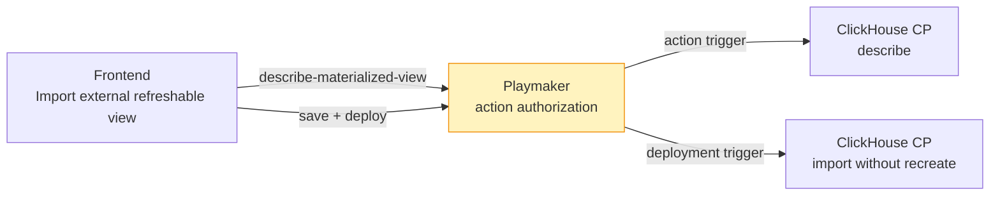

# Descripción PR — rio-playmaker

rio-playmaker · `feature/refreshable-view-import` @ `15c359560` (pusheado con `--no-verify` autorizado por el owner, 2026-10-24; CI verde; ready for review) · base del PR `origin/feature/rio-e2e-local-flink` @ `9045e81fa6195c612171cb59f624aa50c7854be9` · 23 commits · 19 files changed, 985 insertions(+), 57 deletions(-) · [draft #1328](https://github.com/melisource/fury_rio-playmaker/pull/1328) · SIG-700 / SIG-702 · `test` 5194 tests / 3 skipped, `localTest` 64, contrato 64 selectores + 2 checks L0 (2026-10-24) · versión de prueba vigente `0.0.1-import-ref-view-ch`.

> [!warning] Bloqueantes
> **Push bloqueado por el gate Cleric (preparado hasta donde depende de esta rama):** la rama está sincronizada con la base #1332 (`dcabdc55a`, que ya trae develop y la suite nativa) y agrega el escenario nativo `junit-evidence/at-100-s11` (regenerado desde el catálogo; suite nativa 237/237, `CLEANUP_CERTIFIED`). El gate directo ya no reclama escenarios; con el perfil readonly configurado el siguiente bloqueo es "Tooling changes require added/modified committed declared Node E2E tests", disparado por `build.gradle` heredado de #1332, que nunca pasó por el gate (se pusheó desde un checkout sin hooks de Grimoire). Pasos restantes, en orden: (1) mergear #1332 a develop (requiere review); (2) sincronizar esta rama con develop; (3) `./local/test-lore.sh --gate` dejando API y worker vivos; (4) configurar `.grimoire/lore-readonly.local.json` y `.sdd/config.json` con el endpoint MCP que imprime el launcher; (5) `git push` normal. `--setup` necesita el alias SSH `github.com-emu` o un `insteadOf` temporal.
> **Versión de prueba:** no se creó una nueva versión porque la rama no está publicada; `0.0.1-import-ref-view-ch` (`74bcdde`) ya contiene el único cambio de runtime. Los commits posteriores son tests, manifiesto y tooling local.

## Propósito

Conservar el cuerpo verificable del PR junto al proyecto, con el template del repo y enlazado a los PRs hermanos.

## Contenido

Cuerpo del PR listo para pegar, seguido de notas internas que no van al PR.

---

## Description

`feat(actions): allow refreshable view description before creation` lets the frontend describe a ClickHouse refreshable view through Playmaker, both before the component exists and for persisted ref-views that are not imported from another data product. Imported ref-views stay rejected. This PR is one part of SIG-700, together with [ClickHouse control plane #362](https://github.com/melisource/fury_rio-controlplane-clickhouse/pull/362) and [frontend #816](https://github.com/melisource/fury_ads-signals-frontend/pull/816).

The feature was developed on top of the local RIO ecosystem E2E ([#1332](https://github.com/melisource/fury_rio-playmaker/pull/1332), already in `develop`): the import journey is a Lore case that drives the real frontend against local Playmaker and control planes, using the drag-and-drop tool from [Lore #21](https://github.com/melisource/fury_lore/pull/21).

Changes:
*  `application.yml`: add `clickhouse-ref-view` / `describe-materialized-view` to the reviewed read actions, without `allow-imported`. This is the only runtime change.
*  Tests load the real `application.yml` and pin the configured read and dispatch action sets exactly, including `allow-imported`. Imported ref-views are denied both by source component and by `IMPORTED` status.
*  New local E2E case `clickhouse-refreshable-view-import` (`.lore/ecosystem`, local tooling only): import and save from an empty pipeline, first deploy, reprovision and read-only after deploy, with eight backend checks on Playmaker, Kafka results and ClickHouse.
*  Native Lore evidence: the `junit-evidence/at-100-s11` scenario now also selects the ref-view permission tests (17 methods), regenerated from the repository catalog and declared as impacted in `.testing/impact.json`.
*  Runner: host services run in screen sessions named after the run owner, and their process identity and group are checked before signaling. Resources are recorded by Compose project and run-owner labels, also when a creating step fails, so teardown removes a partially started stack and never adopts foreign `rio-*` resources; the second broker's anonymous volumes are removed too. The seed receipt is reset per stack, and deployment checks count distinct completed deployments exactly.

## Dev checklist (should be completed by the developer assigned to the issue)

* [ ] I have met the definition of done — pending owner review of SIG-700 open questions PA-1 to PA-5
* [x] I have used [conventional commits](https://www.conventionalcommits.org/en/v1.0.0/)
* [x] My code follows the style guidelines of this project
    * [Java Fury Guideline](https://furydocs.io/code-quality/latest/guide/#/languages/java)
    * [Deep Source Java Guideline](https://deepsource.com/blog/java-code-review-guidelines#10-override-hashcode-when-overriding-equals)
* [x] I have performed a self-review of my own code
* [x] I have commented portions of my code, particularly in hard-to-understand areas
* [x] I have made corresponding changes to the documentation (`README.md`, `DEV.md`, `CHANGELOG.md`). — `.lore/ecosystem/README.md` and the authoring skill
* [x] After my changes were applied the app is still buildable
* [ ] My changes generate no new warnings (linters, code quality) — not measured separately from the build
* [x] I have added tests that prove my fix is effective or that my feature works
    * Unit testing is a must
    * Integration testing is recommended
* [x] New and existing unit tests pass locally with my changes
* [ ] Any dependent changes have been merged and published in downstream modules — sibling PRs #362, #816 and #21 are open
* [x] I have updated my current branch with changes made in develop/master previously
* [ ] I already deployed this branch in the pre-production environment — test version created, not deployed

## Code Review checklist (must be completed by the code reviewer)

* [ ] Is it the issue being completed?
    * Is the Acceptance criteria met?
    * Is the issue ready, according to the project’s Definition Of Done?

* [ ] Is the code good in style? (Easy to read, follows good practices and our style guide)
    * Are linters used?
    * Is it clear what a given class/method/function does?
    * Do names reflect what code does?
    * Are functions elegant?

* [ ] The code runs correctly? (Optional)
    * Have you tried the code locally?
    * Are exceptions handled correctly?
    * Are all corner cases handled correctly?
    * Check Java gotchas.
    * Edge cases for ifs, fors, whiles, dates
    * Are there unnecessary while loops?

* [ ] Is this a good enough implementation?
    * Is every line of code used?
    * Does code have unexpected [side effects](https://medium.com/@ryk.kiel/dont-let-your-code-get-out-of-control-avoiding-side-effects-in-python-d68faf26912)?
    * Check usage of third party libraries (production-ready, copyright, etc.)
    * Is the solution performant? (and avoid early optimization since it is the root of all evil)
    * Could the solution be simpler?
    * Look for vulnerabilities ([OWASP](https://owasp.org/www-project-top-ten/) top 10)
    * Is the code properly modularized and [S.O.L.I.D.](https://www.freecodecamp.org/news/solid-principles-explained-in-plain-english/)?
    * Is the code properly tested?
    * Do we have some duplicated code?
    * What is missing (docs, comments, metrics, logs, etc.)?
    * Is there a pre-existing code that already solves our problem?

## How Has This Been Tested?

* `./gradlew cleanTest test cleanLocalTest localTest` (JDK 25): `test` 5223 tests, 0 failures, 3 skipped (inherited: one external-MySQL test and two `@Disabled` topological sort tests); `localTest` 64 tests.
* `scripts/run-agentic-testing-contract.sh --base origin/develop --head HEAD`: 70 focused selectors and both L0 local-stack checks passed, with cleanup.
* `.lore/ecosystem/tests/ecosystem-test.py` (13 tests) and `processes-test.sh` (three consecutive runs) passed.
* Native suite `./local/test-lore.sh`: 237/237 scenarios passed, release approved, `CLEANUP_CERTIFIED`.
* Local E2E `.lore/ecosystem/rio-ecosystem all clickhouse-refreshable-view-import`: Lore run `run_mvpps59z4c0d5e6de3` passed 5/5 scenarios and 8/8 backend checks with the ClickHouse and frontend branches at their current heads; teardown left no stack resources.
* Test version [0.0.2-import-ref-view-ch](https://web.furycloud.io/rio-playmaker/versions/detail/0.0.2-import-ref-view-ch) from `49328ca8b`. Deploy the ClickHouse control plane and Playmaker before the frontend.

## Issue

[SIG-700](https://spellbook.adminml.com/projects/SIG/specs/SIG-700) · [SIG-702](https://spellbook.adminml.com/projects/SIG/specs/SIG-702)

---

## Notas internas — NO van al PR

- PA-1 a PA-5 siguen abiertas.
- `apps.json` apunta CP, frontend y Lore a sus ramas feature con marcadores `requires`; al mergear los hermanos hay que volverlos a `develop`.
- La E2E del 2026-10-24 (corrida 7) descubrió la nota contradictoria del frontend en la externa desplegada; corregida en el frontend y certificada en la corrida 8.
- Volúmenes anónimos acumulados de corridas anteriores (87 en `colima-rio`) no se borraron; desde `239842c19` el teardown ya no los deja.
